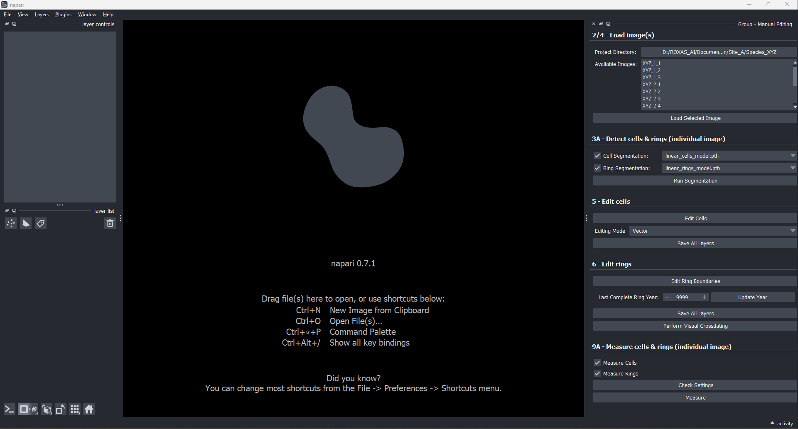

# Installation & Setup Guide

Welcome to **ROXAS AI**! This guide walks you through setting up a clean Python environment, installing the `napari-roxas-ai` plugin, and configuring optional hardware GPU acceleration for fast deep-learning inference.

---

## System Requirements & Prerequisites

| Component | Minimum Specification | Recommended Specification |
| :--- | :--- | :--- |
| **Operating System** | Windows 10/11 (64-bit), macOS 12+ (Monterey or later), Linux (Ubuntu 20.04+, Debian, Fedora, Arch) | Windows 11 (64-bit), macOS 14+ (Sonoma/Sequoia), or modern Linux x86_64 |
| **Processor Architecture** | x86_64 (64-bit Intel/AMD) or ARM64 (Apple Silicon M-Series, Linux aarch64) | 8+ CPU cores (Intel Core i7/i9, AMD Ryzen 7/9, Apple Silicon) |
| **Python Version** | Python 3.10 | **Python 3.12** (strongly recommended) |
| **System Memory (RAM)** | 8 GB RAM | **16 GB to 32 GB RAM** (recommended for large gigapixel wood anatomy scans) |
| **Disk Space** | ~2 GB free disk space | 5+ GB free space (for conda environments, deep-learning model weights, and sample data) |
| **Graphics (GPU)** *(Optional)* | CPU-only processing supported | Dedicated NVIDIA GPU ($\ge$ 6 GB VRAM, RTX 20/30/40/50 series), Apple Silicon (M1–M4), or Intel Arc GPU |

---

## Step 1: Install a Package Manager & Open Terminal

We strongly recommend installing **Miniforge** (community-driven, pre-configured with the fast `conda-forge` channel) or **Miniconda** to manage your Python environment.

=== "Windows"

    1. **Download the installer:**
        - **Miniforge (Recommended):** Download the [Miniforge Windows 64-bit Installer](https://github.com/conda-forge/miniforge/releases/latest/download/Miniforge3-Windows-x86_64.exe).
        - **Miniconda (Alternative):** Download the [Miniconda Windows 64-bit Installer](https://docs.anaconda.com/miniconda/).
    2. **Run the installer:** Follow the standard setup wizard. We recommend installing for "Just Me" into the default directory.
    3. **Open the prompt:**
        - Open the Windows Start menu and search for **Miniforge Prompt** (or **Anaconda Prompt** if using Miniconda).
        - Alternatively, if you use **Windows Terminal** or **PowerShell** and initialized Conda, open your standard terminal.
        - Run all subsequent installation commands inside this prompt.

=== "macOS"

    1. **Download the installer:**
        - **Apple Silicon (M1/M2/M3/M4):** Download [Miniforge3-MacOSX-arm64.pkg](https://github.com/conda-forge/miniforge/releases/latest/download/Miniforge3-MacOSX-arm64.pkg) or the [Miniconda Apple Silicon Installer](https://docs.anaconda.com/miniconda/).
        - **Intel Macs:** Download [Miniforge3-MacOSX-x86_64.pkg](https://github.com/conda-forge/miniforge/releases/latest/download/Miniforge3-MacOSX-x86_64.pkg) or the [Miniconda Intel Installer](https://docs.anaconda.com/miniconda/).
    2. **Run the installer package** and follow the prompts.
    3. *Alternative (Command-line installation via Terminal):*
        ```bash
        curl -L -O "https://github.com/conda-forge/miniforge/releases/latest/download/Miniforge3-MacOSX-$(uname -m).sh"
        bash Miniforge3-MacOSX-$(uname -m).sh
        ```
    4. **Open Terminal:** Open `Applications > Utilities > Terminal`.

=== "Linux"

    1. **Download and run the installer in Terminal:**
        - **x86_64 (64-bit Intel/AMD):**
          ```bash
          wget https://github.com/conda-forge/miniforge/releases/latest/download/Miniforge3-Linux-x86_64.sh
          bash Miniforge3-Linux-x86_64.sh
          ```
        - **ARM64 / aarch64:**
          ```bash
          wget https://github.com/conda-forge/miniforge/releases/latest/download/Miniforge3-Linux-aarch64.sh
          bash Miniforge3-Linux-aarch64.sh
          ```
    2. Follow the installer prompts and answer `yes` when asked to initialize Conda for your shell.
    3. Close and reopen your Terminal window to activate Conda.

---

## Step 2: Create & Activate the Environment

Create a dedicated, clean Python 3.12 environment named `roxas-ai` and activate it:

```bash
conda create -n roxas-ai python=3.12 -y
conda activate roxas-ai
```

!!! tip "Always activate your environment"
    Whenever you open a new terminal session to run ROXAS AI, make sure to activate the environment first:
    ```bash
    conda activate roxas-ai
    ```

---

## Step 3: (Optional) GPU Acceleration

While ROXAS AI functions fully on CPU, enabling GPU acceleration significantly speeds up deep-learning instance segmentation for wood anatomical cells and tree ring boundaries on large, high-resolution scans.

=== "Windows & Linux (NVIDIA GPUs)"

    By default, standard PyPI wheels install a CPU-only build of PyTorch on Windows and Linux. To leverage your NVIDIA GPU:

    1. **Install CUDA-enabled PyTorch:**
        ```bash
        pip install torch torchvision --index-url https://download.pytorch.org/whl/cu128
        ```
        *This command installs PyTorch with CUDA 12.8 runtime support, fully compatible with modern NVIDIA GPUs (RTX 20-, 30-, 40-, and 50-series / Blackwell, Ada Lovelace, Ampere, and Turing architectures). The CUDA runtime is bundled with the PyTorch wheels; you only need an up-to-date NVIDIA display driver installed.*

        *(Note: If your system uses older NVIDIA drivers that cannot be updated, install the CUDA 12.6 build instead by replacing `cu128` with `cu126`).*

    2. **Verify GPU / CUDA availability:**
        ```bash
        python -c "import torch; print('CUDA available:', torch.cuda.is_available()); print('CUDA version:', torch.version.cuda); print('GPU:', torch.cuda.get_device_name(0) if torch.cuda.is_available() else 'None')"
        ```
        *For a functional GPU installation, `CUDA available:` should output `True` and list your NVIDIA GPU model name.*

    3. **Troubleshooting:**
        If `CUDA available:` reports `False` after installation (e.g., if a CPU-only PyTorch build was previously cached or installed), cleanly remove PyTorch and reinstall with the explicit CUDA wheel index:
        ```bash
        pip uninstall torch torchvision torchaudio -y
        pip install torch torchvision --index-url https://download.pytorch.org/whl/cu128
        ```

    *(For supported AMD GPUs on Linux, consult the [PyTorch ROCm installation guide](https://pytorch.org/get-started/locally/)).*

=== "Windows & Linux (Intel GPUs)"

    !!! warning "Experimental"
        Intel GPU (XPU) acceleration in PyTorch is supported for Intel Arc A-Series and B-Series dedicated graphics cards, as well as Intel Core Ultra processors with integrated Arc graphics on Windows 11 and Ubuntu. See the [PyTorch Intel GPU guide](https://docs.pytorch.org/docs/stable/notes/get_start_xpu.html) for detailed device support.

    1. **Install the Intel GPU driver:**
        Download and install the latest graphics driver from Intel's website. No separate oneAPI base toolkit installation is required.

    2. **Install XPU-enabled PyTorch:**
        ```bash
        pip install "torch>=2.5,<2.9" "torchvision<0.24" --index-url https://download.pytorch.org/whl/xpu
        ```
        *The version constraints ensure PyTorch remains within the range supported by ROXAS AI, preventing subsequent pip commands from replacing it with a CPU build.*

    3. **Verify XPU availability:**
        ```bash
        python -c "import torch; print('XPU available:', getattr(torch, 'xpu', None) is not None and torch.xpu.is_available()); print('GPU:', torch.xpu.get_device_name(0) if getattr(torch, 'xpu', None) and torch.xpu.is_available() else 'None')"
        ```
        *For a functional installation, `XPU available:` should output `True` and list your Intel GPU device name.*

    !!! note "First run kernel compilation"
        On some Intel GPUs, the initial inference pass compiles GPU compute kernels, which can take several minutes with no terminal output. The compiled kernels are cached on disk, so subsequent runs start within seconds.

=== "macOS (Apple Silicon & Intel)"

    - **Apple Silicon (M1 / M2 / M3 / M4):**
      PyTorch leverages Apple's **Metal Performance Shaders (MPS)** backend natively. No additional CUDA or driver configuration is required. The standard PyTorch wheels installed with ROXAS AI automatically include MPS support.
      
      To verify MPS availability in Terminal:
      ```bash
      python -c "import torch; print('MPS available:', torch.backends.mps.is_available()); print('MPS built:', torch.backends.mps.is_built())"
      ```
      *When `MPS available: True` is displayed, ROXAS AI automatically accelerates deep-learning segmentation using your Apple Silicon GPU.*

    - **Intel-based Macs:**
      GPU acceleration is not supported on Intel Macs; ROXAS AI will run automatically using the CPU.

---

## Step 4: Install ROXAS AI

Install the latest released version of `napari-roxas-ai` via `pip`:

=== "Standard Installation (PyPI)"

    ```bash
    pip install napari-roxas-ai
    ```

=== "Upgrading Existing Installation"

    ```bash
    pip install --upgrade napari-roxas-ai
    ```

=== "Development / Source Installation"

    If you are contributing to the plugin or testing bleeding-edge development branches:
    ```bash
    git clone https://github.com/roxas-ai/napari-roxas-ai.git
    cd napari-roxas-ai
    pip install -e ".[testing]"
    ```

---

## Step 5: Launch & Verify

### 1. Launch napari with ROXAS AI

Run the dedicated launcher command in your terminal:

```bash
napari-roxas
```

**Why use `napari-roxas`?**

- **Instant Shortcuts:** Installs all custom ROXAS AI keyboard and canvas navigation shortcuts (`W`, `A`, `S`, `D`, `Space`, and nudging hotkeys) immediately upon startup.
- **Auto-docked Workflow:** Opens and docks the **Group - Manual Editing** widget panel on the right sidebar, ready for immediate use.
- **Duplicate Prevention:** Manages dock widgets through the manifest to prevent accidental duplicate panels.

*(Note: Starting with plain `napari` works as well; plugin shortcuts and widgets become active as soon as you open any ROXAS AI widget via `Plugins > ROXAS AI`).*



*ROXAS AI workbench initialized in napari with the Manual Editing Group docked in the right sidebar.*

### 2. Verify with Bundled Sample Data

1. In the napari menu, navigate to `File > Open Sample > ROXAS AI`.
2. Three layers (**Image**, **Rings**, and **Cells**) will load into the canvas viewer.

!!! info "Automatic Background Model & Asset Downloads"
    Pre-trained deep learning neural network weights (`.pth` files) and sample image assets are automatically downloaded from remote repositories in the background upon first access and cached locally in your user data directory for all subsequent sessions. Download progress is logged in the terminal.

### 3. Verify Hardware Acceleration in Settings

1. In napari, open `Plugins > ROXAS AI > ZZ - Settings` (or click the floating settings icon ⚙️ in the measurement widgets).
2. Expand the **`processing`** section.
3. Confirm that **`try_to_use_gpu`** and **`try_to_use_autocast`** are enabled (`true`).
4. Click **`Apply`**.
5. *Settings apply immediately across all open widgets without requiring a napari restart.*

---

## Summary Checklist

- [x] **Miniforge / Miniconda** installed and prompt opened.
- [x] Dedicated Python 3.12 environment created and activated (`conda activate roxas-ai`).
- [x] *(Optional)* GPU PyTorch installed and tested (`CUDA available: True`, `MPS available: True`, or `XPU available: True`).
- [x] `napari-roxas-ai` installed via `pip install napari-roxas-ai`.
- [x] Launched using `napari-roxas` and loaded bundled sample data (`File > Open Sample > ROXAS AI`).
- [x] Verified `try_to_use_gpu` in `Plugins > ROXAS AI > ZZ - Settings`.

!!! warning "Important note on package installation"
    Never install or upgrade packages into the environment while napari or any Python script is actively running in it. Always close napari and execute package commands from a dedicated terminal prompt.

---

## Troubleshooting & Clean Reinstall

### 1. PyTorch Uses CPU Despite Having an NVIDIA GPU
If PyTorch reports `CUDA available: False` or runs segmentation on CPU despite an NVIDIA GPU being present:
1. Ensure your NVIDIA graphics card driver is up to date via NVIDIA GeForce Experience or the NVIDIA Driver Downloads page.
2. Check if a CPU-only wheel of PyTorch was installed by another dependency. Reinstall the CUDA 12.8 wheel:
   ```bash
   pip uninstall torch torchvision torchaudio -y
   pip install torch torchvision --index-url https://download.pytorch.org/whl/cu128
   ```

### 2. Settings Not Updating or Corrupted Configuration
When upgrading `napari-roxas-ai` over an older installation, your customized `settings.json` file is preserved on disk to prevent overwriting user preferences. If you experience unexpected parameter behavior or schema mismatches:

- **Reset via UI**: In napari, open `Plugins > ROXAS AI > ZZ - Settings` and click **Reset to defaults**.
- **Manual Reset**: Delete your local settings file to let ROXAS AI regenerate default settings on next launch:
    - **Windows:** `%LOCALAPPDATA%\napari-roxas-ai\settings.json`
    - **macOS:** `~/Library/Application Support/napari-roxas-ai/settings.json`
    - **Linux:** `~/.config/napari-roxas-ai/settings.json`

### 3. Linux GUI / Wayland Display Issues
On certain Linux distributions using Wayland display servers, Qt6 / napari may encounter rendering glitches or fail to start. If this occurs, force Qt to use X11/XCB:
```bash
export QT_QPA_PLATFORM=xcb
napari-roxas
```

### 4. Complete Clean Reinstallation
If you need to perform a completely fresh reinstallation:
1. Close napari and open your terminal with `conda activate roxas-ai`.
2. Uninstall the plugin:
   ```bash
   pip uninstall napari-roxas-ai -y
   ```
3. Reinstall the latest release:
   ```bash
   pip install napari-roxas-ai
   ```
4. Or recreate the entire Conda environment from scratch:
   ```bash
   conda deactivate
   conda env remove -n roxas-ai -y
   conda create -n roxas-ai python=3.12 -y
   conda activate roxas-ai
   pip install torch torchvision --index-url https://download.pytorch.org/whl/cu128  # Optional GPU
   pip install napari-roxas-ai
   ```
