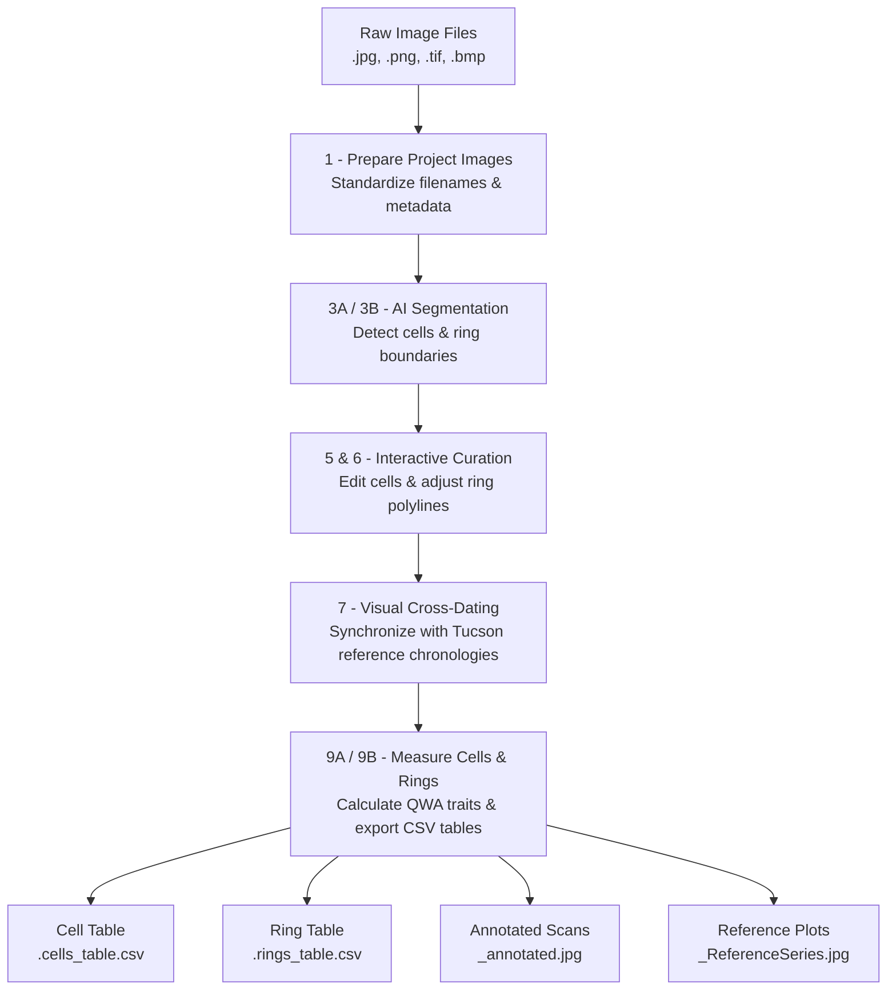

# Welcome to ROXAS AI

**ROXAS AI** is an open-source, Python-based quantitative wood anatomy (QWA) and dendrochronology analysis platform built on the [napari](https://napari.org) multi-dimensional image viewer. It integrates state-of-the-art deep learning segmentation models, interactive vector/raster curation tools, automated batch pipelines, and visual cross-dating into a unified, high-throughput ecosystem for **Windows, macOS, and Linux**.

Currently optimized for **linear conifer anatomies**, ROXAS AI modernizes and expands upon the foundations of classical ROXAS (von Arx & Carrer, 2014) by eliminating proprietary software dependencies (such as Image-Pro Plus), providing native cross-platform compatibility, and incorporating specialized neural networks (Katzenmaier et al., 2023, 2025).

---

## Key Capabilities

=== "AI Segmentation"
    - **Cell Lumen Detection**: Deep ResNet-50 U-Net architecture (`linear_cells_model`) segmenting tens of thousands of tracheid lumina per cross-section with sub-pixel boundary fidelity.
    - **Tree-Ring Boundary Segmentation**: Iterative boundary regression network (`linear_rings_model`) accurately tracing annual ring boundaries along latewood-earlywood transitions.
    - **Automated Model Management**: Missing neural network checkpoints are automatically downloaded in the background and cached locally for seamless execution.
    - See the [Segmentation Models Reference](reference/segmentation_models.md) for network architectures and training benchmarks.

=== "Interactive Editing"
    - **Dual-Mode Cell Curation**: Switch instantly between *Raster Mode* (interactive paint/erase brush with <kbd>Ctrl</kbd> + Mouse Wheel sizing) and *Vector Mode* (polygon vertex editing with multi-cell lasso deletion).
    - **Precise Ring Boundary Nudging**: Keyboard-driven fine nudging (1 px via <kbd>Ctrl</kbd> + Arrows) and fast nudging (10 px via <kbd>Ctrl</kbd> + <kbd>Shift</kbd> + Arrows) for sub-lumen boundary alignment.
    - **Topmost Lasso Priority**: Lasso vertex deletion automatically isolates and modifies the topmost boundary when multiple rings overlap or touch.
    - **Comprehensive Undo Stack**: 50-step undo history (<kbd>Ctrl</kbd> + <kbd>Z</kbd>) across all raster strokes, vector movements, and affine transformations.
    - See the [Shortcuts Reference](reference/shortcuts.md) for all hotkeys and mouse bindings.

=== "Batch Pipelines"
    - **High-Throughput Processing**: Run sample image preparation, deep-learning segmentation, anatomical trait extraction, and annotated scan generation across entire directory trees in the background.
    - **Real-Time Directory Sync**: Dynamic filesystem listeners automatically detect newly prepared or segmented samples across widgets without requiring UI restarts.
    - **Linked Operation Guardrails**: Automatically keeps measurement tables, annotated overview images (`<sample>_annotated.jpg`), and cross-dating plots (`<sample>_ReferenceSeries.jpg`) strictly synchronized.

=== "Visual Cross-Dating"
    - **Synchronized Time Series Plotting**: Interactively align sample mean ring width (`MRW`) curves against master chronologies or neighboring samples.
    - **Standard Dendrochronological Formats**: Seamlessly imports Tucson (`.rwl`, `.tuc`) files as well as delimiter-separated tabular files (`.csv`, `.tsv`, `.txt`).
    - **Statistical Agreement Metrics**: Computes Pearson correlation coefficients ($r$), Gleichläufigkeit ($Gl$), Student's $t$-values, and overlap length across variable time-lag offsets.

=== "Quantitative Trait Extraction"
    - **Cell-Level Metrics**: Lumen Area ($LA$), Lumen Radial & Tangential Diameters ($LD_{RAD}$, $LD_{TAN}$), Aspect Ratio ($ASP$), Hydraulic Diameter ($D_H$), and Theoretical Hydraulic Conductance ($K_h$).
    - **Continuous Wavelet Transform (CWT)**: Multi-scale radial, tangential, and overall cell wall thickness profiling ($CWT_{RAD}$, $CWT_{TAN}$, $CWT_{ALL}$).
    - **Ring-Level Aggregates**: Mean Ring Width ($MRW$), Total Lumen Area, Cell Density ($CD$), Conductive Lumen Area Fraction ($RCTA$), Mork's Index ($R_{TSR}$), and Relative Anatomical Density ($RWD$).
    - See the [Technical Reference](reference/technical_reference.md) for complete mathematical definitions, units, and CSV schema.

---

## End-to-End Workflow

The ROXAS AI analysis pipeline guides you from raw microphotograph mosaics to publication-ready anatomical and dendrochronological datasets:

---

## Documentation Quick Links

-   :material-rocket-launch: **[Getting Started](getting_started/installation.md)**
    
    ---
    
    Step-by-step instructions for installing ROXAS AI via Conda or pip, configuring GPU hardware acceleration (NVIDIA CUDA / Apple MPS), and launching the custom viewer (`napari-roxas`).

-   :material-widgets: **[User Guide](user_guide/widgets.md)**
    
    ---
    
    Comprehensive guide covering all 11 dedicated workflow widgets, UI dock containers, layer controls, and the centralized preferences manager (`ZZ - Settings`).

-   :material-book-open-page-variant: **[Tutorials & Workflows](tutorials/workflows.md)**
    
    ---
    
    Walkthroughs tailored for real-world research: a 5-minute quickstart guide, standard single-sample workflow, and high-throughput batch production pipelines.

-   :material-code-json: **[Technical Reference](reference/technical_reference.md)**
    
    ---
    
    In-depth reference for all cell- and ring-level output variables, mathematical formulations ($LA$, $D_H$, $K_h$, $CWT$, $R_{TSR}$, $RWD$), and JSON metadata schema.

-   :material-brain: **[Segmentation Models](reference/segmentation_models.md)**
    
    ---
    
    Detailed specifications of the deep-learning architectures, training methodologies, receptive fields, performance benchmarks, and automated checkpoint caching.

-   :material-keyboard: **[Shortcuts Reference](reference/shortcuts.md)**
    
    ---
    
    Quick-reference hotkey table covering WASD viewport navigation, dynamic brush resizing, polygon lasso operations, and ring boundary nudging.

---

## Scientific Background & Citation

If you use **ROXAS AI** in your research, please cite the following publications:

1. **Katzenmaier, M., Peters, R. L., & von Arx, G. (2025).**
   *Deep learning for automated tree-ring boundary detection in linear conifer wood anatomy.* Frontiers in Plant Science, 16:1516635.
   [doi:10.3389/fpls.2025.1516635](https://doi.org/10.3389/fpls.2025.1516635)

2. **Katzenmaier, M., Peters, R. L., & von Arx, G. (2023).**
   *Linear conifer cell segmentation using deep convolutional neural networks.* Dendrochronologia, 81:126126.
   [doi:10.1016/j.dendro.2023.126126](https://doi.org/10.1016/j.dendro.2023.126126)

3. **von Arx, G., & Carrer, M. (2014).**
   *ROXAS - A new tool to build datasets of many thousand computerized wood-anatomical features per sample.* Dendrochronologia, 32(3), 290–293.
   [doi:10.1016/j.dendro.2013.12.001](https://doi.org/10.1016/j.dendro.2013.12.001)

---

## Support & Contributing

ROXAS AI is actively developed and maintained by the **Dendrosciences Group** at the **Swiss Federal Research Institute WSL**.

- **Source Code & Issue Tracker**: [GitHub Repository (roxas-ai/napari-roxas-ai)](https://github.com/roxas-ai/napari-roxas-ai)
- **Bug Reports & Feature Requests**: Please submit an issue on GitHub with steps to reproduce and system information.
- **License**: Released under the [BSD 3-Clause License](https://github.com/roxas-ai/napari-roxas-ai/blob/main/LICENSE).
