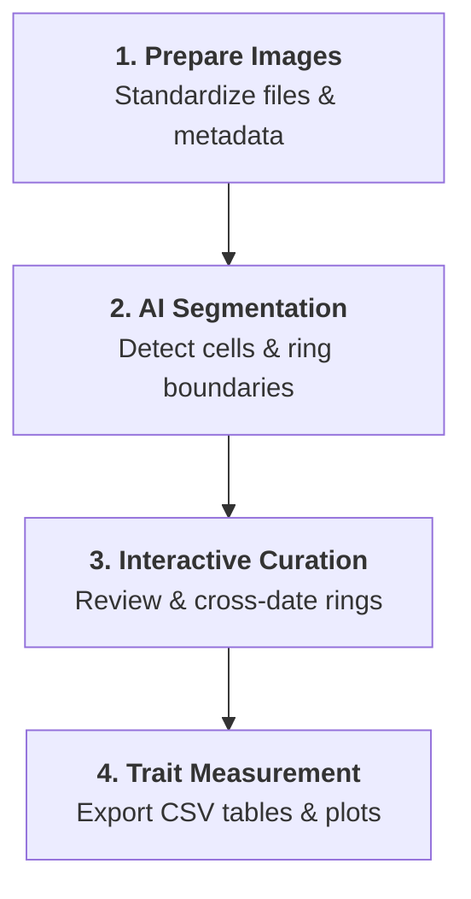

# Welcome to ROXAS AI

**ROXAS AI** is an **open-source, Python-based** tool designed to streamline quantitative wood anatomy (QWA) and dendrochronology research. Built as an extensible plugin for the [napari](https://napari.org) multi-dimensional image viewer, it enables researchers to efficiently extract anatomical traits and establish high-resolution time series of cell measurements within dated tree rings.

Currently optimized for **linear conifer anatomies** (with **linear angiosperm anatomies** currently in development), ROXAS AI provides an end-to-end workflow—from automated image segmentation to visual cross-dating—on **Windows, macOS, and Linux**.

---

## Why ROXAS AI?

ROXAS AI was developed to modernize and expand upon the foundations of the [classical ROXAS implementation](https://roxas.wsl.ch). It addresses key limitations of classical workflows to make wood anatomy more accessible, automated, and scalable:

-   :material-laptop: **Cross-Platform Accessibility**

    ---

    Runs natively on **Windows, macOS, and Linux**, bringing quantitative wood anatomy to all operating systems.

-   :material-open-source-initiative: **Open Science & Powerful Viewing**

    ---

    Built on the open-source **napari** image viewer, completely eliminating dependencies on proprietary commercial software (such as Image-Pro Plus).

-   :material-brain: **Modern AI Segmentation**

    ---

    Leverages specialized deep-learning neural networks to segment cell lumens and ring boundaries with high accuracy and minimal manual editing.

-   :material-lightning-bolt: **Intuitive End-to-End Workflow**

    ---

    Combines batch preparation, interactive raster/vector curation, visual cross-dating, and trait extraction into a streamlined, user-friendly interface.

---

## High-Level Workflow

ROXAS AI guides you through an end-to-end pipeline from raw wood cross-section images to structured anatomical datasets:

---

## Documentation Overview

Explore the sections below to get started:

-   :material-rocket-launch: **[Getting Started](getting_started/installation.md)**

    ---

    Installation instructions via Conda or pip, hardware acceleration setup, and how to launch the plugin.

-   :material-widgets: **[User Guide](user_guide/widgets.md)**

    ---

    Detailed walkthrough of the workflow widgets, editing tools, visual cross-dating, and settings.

-   :material-book-open-page-variant: **[Tutorials](tutorials/workflows.md)**

    ---

    Step-by-step guides covering single-sample analysis and high-throughput batch processing pipelines.

-   :material-code-json: **[Reference](reference/technical_reference.md)**

    ---

    Technical specifications, output variables, [deep-learning models](reference/segmentation_models.md), and [shortcuts](reference/shortcuts.md).

---

## Scientific Background & Citation

If you use **ROXAS AI** in your research, please cite the following publications:

1. **Katzenmaier, M., Peters, R. L., & von Arx, G. (2025).**
   *Deep learning for automated tree-ring boundary detection in linear conifer wood anatomy.* Frontiers in Plant Science, 16:1516635.
   [doi:10.3389/fpls.2025.1516635](https://doi.org/10.3389/fpls.2025.1516635)

2. **Katzenmaier, M., Peters, R. L., & von Arx, G. (2023).**
   *Linear conifer cell segmentation using deep convolutional neural networks.* Dendrochronologia, 81:126126.
   [doi:10.1016/j.dendro.2023.126126](https://doi.org/10.1016/j.dendro.2023.126126)

3. **von Arx, G., & Carrer, M. (2014).**
   *ROXAS - A new tool to build datasets of many thousand computerized wood-anatomical features per sample.* Dendrochronologia, 32(3), 290–293.
   [doi:10.1016/j.dendro.2013.12.001](https://doi.org/10.1016/j.dendro.2013.12.001)

---

## Support & Contributing

ROXAS AI is actively developed and maintained by the **Dendrosciences Group** at the **Swiss Federal Research Institute WSL**.

* **Source Code & Issue Tracker**: [GitHub Repository (roxas-ai/napari-roxas-ai)](https://github.com/roxas-ai/napari-roxas-ai)
* **Bug Reports & Feature Requests**: Please submit an issue on GitHub with steps to reproduce and system information.
* **License**: Released under the [GNU General Public License v3.0 (GPLv3)](https://github.com/roxas-ai/napari-roxas-ai/blob/main/LICENSE).
