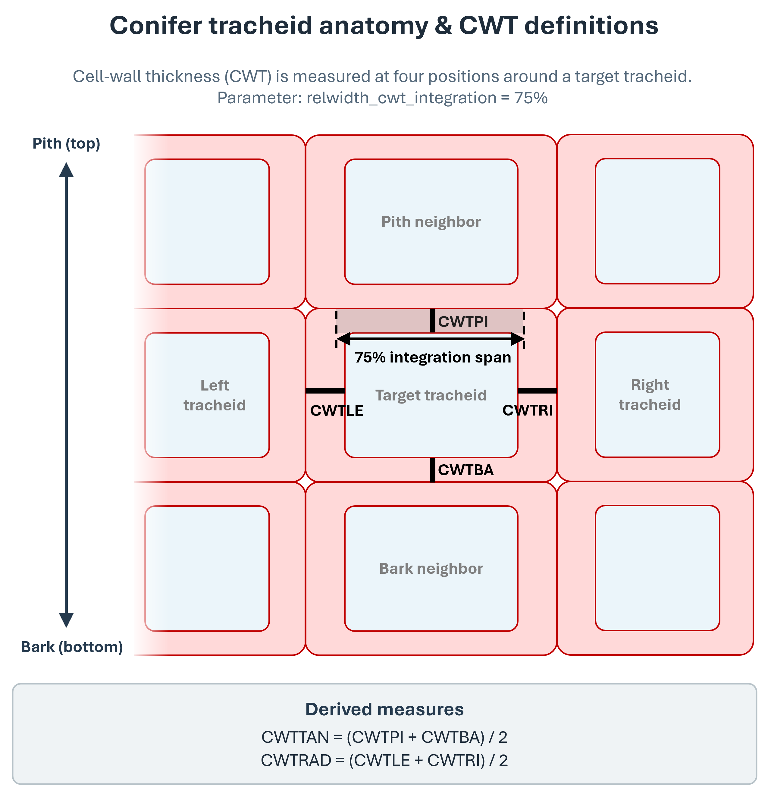
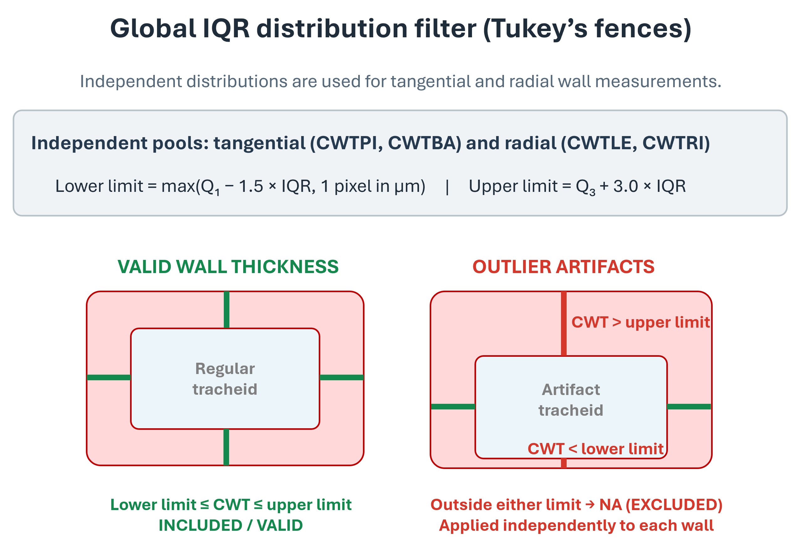
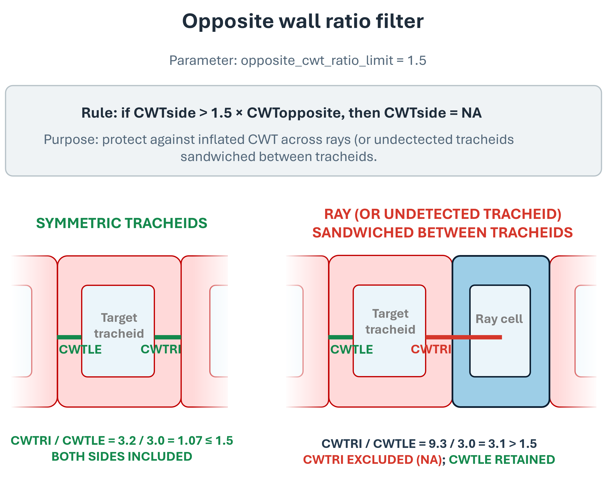
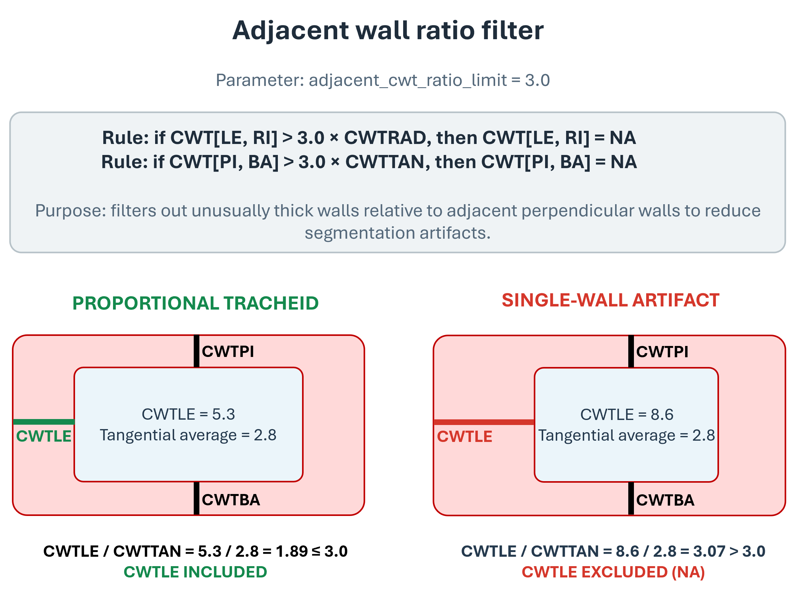
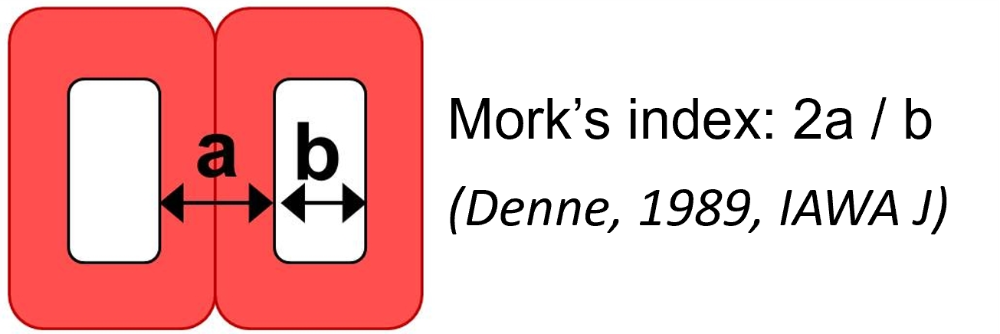
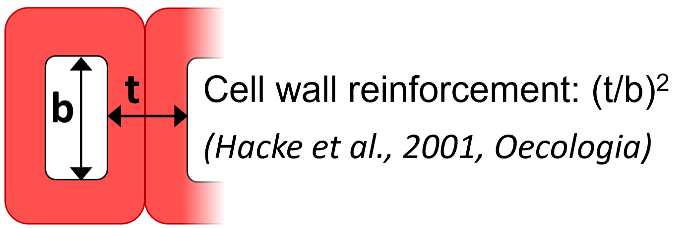

# Reference

Technical details about the files created by ROXAS AI and the numeric output variables.

## Image Orientation Requirements

Linear input images have to be oriented with +/- horizontal rings and the bark side at the bottom.

## File Formats

ROXAS AI uses a standardized naming convention to organize analysis data. For a sample named `sample_01`, the following files are typically generated:

### Spatial & Image Files
- **`.scan.jpg` / `.scan.tif`** etc.: The original high-resolution scan of the wood sample; supported image formats: **JPG**, **JPEG**, **TIFF**, **TIF**, **PNG**, **BMP**, **JP2**.
- **`.cells.png`**: A label image produced by the deep-learning cell segmentation model ([Segmentation Models](segmentation_models.md)) where each pixel value corresponds to a unique cell ID (CID).
- **`.rings.tif`**: A label image (or vector-like representation) produced by the deep-learning ring boundary segmentation model ([Segmentation Models](segmentation_models.md)) containing the identified tree-ring boundaries.
- **`_annotated.jpg`**: A visualization of the scan with ring boundaries and year labels overlaid for quick review. This file is automatically generated after segmentation (3A/3B), after updating the outermost ring year (6), after applying a cross-dating offset (7) and with every measurement (9A/9B). Manual saves (**Save All Layers**) do not redraw it.
- **`.ReferenceSeries.jpg`**: (Optional) A visual representation of the reference chronologies used during cross-dating.

### Data & Metadata Files
- **`.metadata.json`**: A comprehensive JSON file containing sample information, imaging parameters, and all processing thresholds required to reproduce the analysis.
- **`.cwt.json`**: A JSON file storing cell wall thickness (CWT) quality assurance circles, centroid coordinates, thickness values, inclusion/exclusion status, and filter reasons for sampled cells. It is created during trait measurement (9A/9B) and automatically loaded into napari as the `[<sample>] CWT Circles` Shapes layer when reopening samples.
- **`.cells_table.csv`**: A CSV file (semicolon-delimited by default, configurable in settings) containing measurements for every individual cell.
- **`.rings_table.csv`**: A CSV file (semicolon-delimited by default, configurable in settings) containing aggregated measurements for each tree ring.

---

## Output Variables (Acronyms)

The output tables (`.cells_table.csv` and `.rings_table.csv`) use standardized acronyms. Most measurements are provided in **micrometers ($\mu\text{m}$)** or **square micrometers ($\mu\text{m}^2$)**.

### Missing Values & Error Codes
Missing values or empty fields are left **blank (NA)** in the CSV output to ensure compatibility with modern data analysis tools like R and Python.

### Ring-Level Output (`.rings_table.csv`)

| Acronym | Description | Unit | Details |
| :--- | :--- | :--- | :--- |
| `ID` | Sample ID | - | Unique identifier for the sample. |
| `YEAR` | Ring Affiliation | - | Calendar year of the tree ring. |
| `RA` | Ring Area | $\text{mm}^2$ | Area of the analyzed ring. |
| `MRW` | Mean Ring Width | $\mu\text{m}$ | Corrected for inclined ring boundaries. |
| `CNO` | Number of Cells | count | Total cells in the tree ring. |
| `CD` | Cell Density | no./$\text{mm}^2$ | Number of cells per $\text{mm}^2$. |
| `CTA` | Cumulative Transsectional Area | $\text{mm}^2$ | Cumulative area of all counted cells. |
| `RCTA` | Conductive Area Percentage | % | `CTA` / `RA`. |
| `MLA` | Mean Lumen Area | $\mu\text{m}^2$ | Mean cell lumen area in the ring. |
| `MINLA` | Minimum Lumen Area | $\mu\text{m}^2$ | Minimum cell lumen area in the ring. |
| `MAXLA` | Maximum Lumen Area | $\mu\text{m}^2$ | Maximum cell lumen area in the ring. |
| `KH` | Hydraulic Conductance | $\text{m}^4\,\text{s}^{-1}\,\text{MPa}^{-1}$ | Theoretical (Poiseuille) adjusted for elliptical tubes. |
| `KS` | Specific Hydraulic Conductivity | $\text{m}^2\,\text{s}^{-1}\,\text{MPa}^{-1}$ | `KH` / `RA` (assuming tube length of 1m). |
| `RVGI` | Vessel Grouping Index | index | Mean cells per group (Carlquist 2001). |
| `RVSF` | Vessel Solitary Fraction | % | Fraction of solitary cells vs all cells. |
| `RGSGV` | Group Size of Grouped Cells | index | Mean size of non-solitary cell groups. |
| `AOIAR` | Area of Interest (Ring) | $\text{mm}^2$ | Area of interest within the ring. |
| `RAOIAR` | Relative Area of Interest | % | Percentage of ring area covered by area of interest. |
| `CWTPI` | Cell Wall Thickness - Pith | $\mu\text{m}$ | Inner wall facing towards the pith. |
| `CWTBA` | Cell Wall Thickness - Bark | $\mu\text{m}$ | Outer wall facing towards the bark. |
| `CWTLE` | Cell Wall Thickness - Left | $\mu\text{m}$ | Measured with bark at the bottom. |
| `CWTRI` | Cell Wall Thickness - Right | $\mu\text{m}$ | Measured with bark at the bottom. |
| `CWTTAN` | Tangential Wall Thickness | $\mu\text{m}$ | Mean of pith and bark sides: (`[CWTPI+CWTBA]/2`; or single valid side if one is NA). |
| `CWTRAD` | Radial Wall Thickness | $\mu\text{m}$ | Mean of left and right sides: (`[CWTLE+CWTRI]/2`; or single valid side if one is NA). |
| `CWTALL` | Overall Wall Thickness | $\mu\text{m}$ | Mean of all sides: (`[CWTRAD+CWTTAN]/2`; or single valid side if one is NA). |
| `RTSR` | Radial Thickness-to-Span Ratio | ratio | Mork's index; ratio between 4x `CWTTAN` and radial diameter (Denne 1989). |
| `CTSR` | Circular Thickness-to-Span Ratio | ratio | Ratio between 4x `CWTALL` and area-equivalent circle diameter. |
| `DHW` | Hydraulic Diameter (W) | $\mu\text{m}$ | Mean per ring (Kolb & Sperry 1999). |
| `DHM` | Hydraulic Diameter (M) | $\mu\text{m}$ | Mean per ring (Tyree & Zimmermann 2002). |
| `DRAD` | Mean Radial Diameter | $\mu\text{m}$ | Measured bark-to-pith, corrected for inclination. |
| `DTAN` | Mean Tangential Diameter | $\mu\text{m}$ | Measured tangentially to pith, corrected for inclination. |
| `TB2` | Reinforcement Index $(t/b)^2$ | index | Hacke et al. 2001; uses the smaller of rad/tan values. |
| `CWA` | Cell Wall Area | $\mu\text{m}^2$ | Mean per ring; may include pit artefacts. |
| `RWD` | Relative Anatomical Density | ratio | Mean of `CWA` / (`CWA` + `LA`) per ring. |
| `RBXY` | Ring Boundary Coordinates | pixels | Coordinate string defining the ring boundary. |
| `cells_above`  | Cells Above Boundary | count | Number of cells located above the ring boundary. |
| `enabled` | Ring Enabled Status | boolean | Flag indicating whether the ring is enabled/valid. |

---

### Cell-Level Output (`.cells_table.csv`)

| Acronym | Description | Unit | Details |
| :--- | :--- | :--- | :--- |
| `ID` | Sample ID | - | Unique identifier for the sample. |
| `CID` | Cell ID | - | Unique cell identifier within the sample. |
| `YEAR` | Ring Affiliation | - | Calendar year of cell formation. |
| `LA` | Cell Lumen Area | $\mu\text{m}^2$ | - |
| `XPIX` | X-Coordinate | pixels | Center of cell (0/0 is top-left corner). |
| `YPIX` | Y-Coordinate | pixels | Center of cell (0/0 is top-left corner). |
| `RADDISTR` | Radial Distance (Ring) | $\mu\text{m}$ | Distance of cell center from inner ring boundary. |
| `RRADDISTR` | Relative Radial Position | % | 0.00 (proximal boundary) to 100.00 (distal boundary). |
| `NBRNO` | Neighbor Number | count | Number of cells in the group this cell belongs to. |
| `NBRID` | Neighbor IDs | - | IDs of all cells in the same group (blank if solitary). |
| `ASP` | Aspect Ratio | ratio | Major axis / minor axis of equivalent ellipse. |
| `MAJAX` | Major Axis Deviation | degrees | Angular deviation from line towards X/Y origin. |
| `KH` | Hydraulic Conductance | $\text{m}^4\,\text{s}^{-1}\,\text{MPa}^{-1}$ | Theoretical conductance per cell. |
| `AOI` | Area of Interest | boolean | Flag indicating whether the cell lies within the area of interest. |
| `CWTPI` | Cell Wall Thickness - Pith | $\mu\text{m}$ | Facing towards the pith. |
| `CWTBA` | Cell Wall Thickness - Bark | $\mu\text{m}$ | Facing towards the bark. |
| `CWTLE` | Cell Wall Thickness - Left | $\mu\text{m}$ | Measured with bark at bottom. |
| `CWTRI` | Cell Wall Thickness - Right | $\mu\text{m}$ | Measured with bark at bottom. |
| `CWTTAN` | Tangential Wall Thickness | $\mu\text{m}$ | Mean of (`[CWTPI+CWTBA]/2`; or single valid side if one is NA). |
| `CWTRAD` | Radial Wall Thickness | $\mu\text{m}$ | Mean of (`[CWTLE+CWTRI]/2`; or single valid side if one is NA). |
| `CWTALL` | Overall Wall Thickness | $\mu\text{m}$ | Mean of (`[CWTRAD+CWTTAN]/2`; or single valid side if one is NA). |
| `RTSR` | Radial Thickness-to-Span Ratio | ratio | Mork's index per cell (Denne 1989). |
| `CTSR` | Circular Thickness-to-Span Ratio | ratio | Circular ratio per cell. |
| `DH` | Hydraulic Diameter | $\mu\text{m}$ | Corrected for elliptical shape (Lewis & Boose 1995). |
| `DRAD` | Radial Diameter | $\mu\text{m}$ | Bark-to-pith direction, corrected for inclination. |
| `DTAN` | Tangential Diameter | $\mu\text{m}$ | Tangential to pith, corrected for inclination. |
| `TB2` | Reinforcement Index $(t/b)^2$ | index | Cell wall reinforcement index (t/b)^2 (Hacke et al. 2001). |
| `CWA` | Cell Wall Area | $\mu\text{m}^2$ | Wall area per cell; may include pit artefacts. |
| `RWD` | Relative Anatomical Density | ratio | Cell-level `CWA` / (`CWA` + `LA`). |

---

## Theoretical Hydraulic Conductance (`KH`)

Theoretical hydraulic conductance is approximated using Poiseuille's law adjusted for elliptical tubes (Nonweiler 1975):

$$ \text{KH} = \frac{\text{LA}_{\text{m}^2} \cdot m^2}{\nu \cdot k} $$

Where:

- $\text{LA}_{\text{m}^2}$: Cell lumen area converted to square meters ($\text{LA}_{\text{m}^2} = \text{LA} \cdot 10^{-12}\,\text{m}^2$).
- $m$: Mean hydraulic radius defined as lumen area divided by ellipse circumference ($m = \text{LA}_{\text{m}^2} / C$, in meters). The circumference $C$ is computed using Ramanujan's formula: $C \approx \pi \left[ 3(a + b) - \sqrt{(3a + b)(a + 3b)} \right]$, where $a = \sqrt{\text{ASP} \cdot \text{LA}_{\text{m}^2} / \pi}$ is the semi-major axis and $b = \text{LA}_{\text{m}^2} / (\pi a)$ is the semi-minor axis in meters.
- $k$: Geometric form factor for elliptical cross-sections (Nonweiler 1975): $k = \frac{4}{1 + \sqrt{1 - e^4}}$, where $e = \sqrt{\frac{a^2 - b^2}{a^2}}$ is the elliptical eccentricity ($e \in [0, 1)$).
- $\nu$: Dynamic viscosity of water at 20°C ($1.002 \cdot 10^{-9}\,\text{MPa}\cdot\text{s}$, equivalent to $1.002 \cdot 10^{-3}\,\text{Pa}\cdot\text{s}$).

For ring-level summaries, `KH` is calculated as the sum of all individual cell conductances in that annual ring:

$$ \text{KH}_{\text{ring}} = \sum_{i=1}^{\text{CNO}} \text{KH}_i $$

---

## Specific Hydraulic Conductivity (`KS`)

Specific hydraulic conductivity normalizes the ring's theoretical conductance by the total cross-sectional ring area `RA` (assuming a reference conduit length of 1 meter):

$$ \text{KS} = \frac{\text{KH}_{\text{ring}}}{\text{RA}_{\text{m}^2}} = \frac{\text{KH}_{\text{ring}}}{\text{RA} \cdot 10^{-6}} $$

Where:

- $\text{KH}_{\text{ring}}$: Cumulative theoretical conductance ($\text{m}^4\,\text{s}^{-1}\,\text{MPa}^{-1}$).
- `RA`: Analyzed ring area in $\text{mm}^2$ (converted to $\text{m}^2$ via $10^{-6}$).
- Output unit: $\text{m}^2\,\text{s}^{-1}\,\text{MPa}^{-1}$.

---

## Conduit & Ring Hydraulic Diameters (`DH`, `DHW`, `DHM`)

### Cell-Level Hydraulic Diameter (`DH`)

For an elliptical lumen, the hydraulic diameter is calculated following Lewis & Boose (1995):

$$ \text{DH} = \sqrt{\frac{2 \cdot a_{\mu\text{m}}^2 \cdot b_{\mu\text{m}}^2}{a_{\mu\text{m}}^2 + b_{\mu\text{m}}^2}} $$

Where $a_{\mu\text{m}} = 2 \cdot a_{\text{semi}}$ and $b_{\mu\text{m}} = 2 \cdot b_{\text{semi}}$ are the full major and minor axis diameters of the lumen in micrometers ($\mu\text{m}$).

### Ring-Level Weighted Hydraulic Diameter (`DHW`)

The conductively weighted mean hydraulic diameter per tree ring emphasizes hydraulically dominant conduits (Sperry et al. 1994; Kolb & Sperry 1999):

$$ \text{DHW} = \frac{\sum_{i=1}^N \text{DH}_i^5}{\sum_{i=1}^N \text{DH}_i^4} $$

### Ring-Level Mean Hydraulic Diameter (`DHM`)

The mean conduit diameter corresponding to the average Hagen-Poiseuille fourth-power conductance (Tyree & Zimmermann 2002):

$$ \text{DHM} = \left( \frac{1}{N} \sum_{i=1}^N \text{DH}_i^4 \right)^{1/4} $$

---

## Vessel Grouping Metrics (`RVGI`, `RVSF`, `RGSGV`)

In angiosperm wood, xylem vessels may appear as solitary conduits or grouped into pore multiples and clusters (Carlquist 2001). 

### How Vessel Grouping Analysis Works
ROXAS AI identifies vessel groupings based on spatial proximity between adjacent vessel lumina:

1. **Cluster Separation Threshold**: Two vessels are considered connected within the same group if the spatial separation between their lumen perimeters is less than or equal to `cluster_dbl_cwt_threshold` (default: `3.0` $\mu\text{m}$, approximating intervening double cell wall thickness).
2. **Cluster Topology**: Contiguous networks of connected vessels are clustered together into discrete grouping units.
3. **Topological Indices**: From these clusters, standardized vessel grouping indices (Carlquist 2001) are computed:
    - **Vessel Grouping Index (`RVGI`, ratio):** Average number of vessels per grouping unit (solitary vessels count as a group of 1): $\text{RVGI} = \frac{N_{\text{total vessels}}}{N_{\text{groups}}}$.
    - **Vessel Solitary Fraction (`RVSF`, %):** Percentage of solitary vessels relative to all vessels: $\text{RVSF} = 100 \cdot \frac{N_{\text{solitary vessels}}}{N_{\text{total vessels}}}$.
    - **Mean Group Size of Grouped Vessels (`RGSGV`, index):** Mean number of vessels per cluster considering only non-solitary groups ($\text{size} > 1$).

*(Note: For conifer tracheid samples, vessel grouping metrics are not applicable and are populated with blank / NA).*

---

## Cell Wall Thickness (`CWT`) Quality Control & Filtering

To obtain robust, artifact-free anatomical measurements, ROXAS AI applies automated multi-stage quality control filters to all raw cell wall thickness measurements.

### 1. Wall Definitions & Measurement Integration (Figure 1) {: #1-wall-definitions-measurement-integration }

{ width="80%" }

*Figure 1: Definition of tangential and radial wall orientations and the central measurement integration span.*

#### Cell Wall Identification Algorithm
To measure the cell wall thickness of individual cells from segmented lumen masks, ROXAS AI uses an automated Euclidean distance and watershed-based approach:

1. **Lumen Boundaries & Euclidean Distance Mask:** Based on the segmented cell lumina, an inverted binary mask is created where background and cell walls are foreground pixels. A Euclidean distance transform is calculated across this mask, computing the exact spatial distance of every wall pixel to the nearest cell lumen boundary.
2. **Watershed Mask & Middle Lamella Approximation:** A watershed segmentation algorithm is computed between adjacent cell lumina to detect the contact boundary (the watershed line) between neighboring tracheids. Following Prendin et al. (2017), the exact position of the middle lamella separating two adjacent cells cannot be resolved directly from optical lumen contours alone; it is therefore geometrically approximated by assuming that each wall of two adjacent sharing cells has equal thickness (i.e., the middle lamella is located equidistant between the two lumina along the watershed ridge).
3. **Lateral Integration:** For each of the four anatomical wall sectors (`CWTPI`, `CWTBA`, `CWTLE`, `CWTRI`), distance values are sampled along the watershed line. To avoid geometric distortion at rounded cell corners, measurements are laterally integrated over the central portion of the wall (defined by `relwidth_cwt_integration`, default: `0.75` / 75%).

#### Wall Sectors & Aggregated Metrics
For each conifer tracheid, cell walls are measured across four distinct anatomical orientations:

- **Tangential walls:** `CWTPI` (pith-facing, top) and `CWTBA` (bark-facing, bottom).
- **Radial walls:** `CWTLE` (left) and `CWTRI` (right).
- **Integration span:** Wall thicknesses are integrated over the central span of each wall segment (defined by `relwidth_cwt_integration`, default: `0.75`) to avoid corner-rounding biases.
- **Aggregated metrics:**
    - Tangential mean: `CWTTAN` = (`CWTPI` + `CWTBA`) / 2; or single valid side if one is NA.
    - Radial mean: `CWTRAD` = (`CWTLE` + `CWTRI`) / 2; or single valid side if one is NA.
    - Overall mean: `CWTALL` = (`CWTTAN` + `CWTRAD`) / 2; or single valid side if one is NA.

### 2. Global IQR Distribution Filter / Tukey's Fences (Figure 2) {: #2-global-iqr-distribution-filter }

{ width="80%" }

*Figure 2: Global IQR outlier filtering based on lower and upper Tukey's fences.*

To exclude segmentation debris, extreme clumps, or sub-pixel erosion artifacts, measurements are filtered against population-wide distributions computed independently for tangential walls (`CWTPI`, `CWTBA`) and radial walls (`CWTLE`, `CWTRI`), based on the Interquartile Range ($\text{IQR} = Q_3 - Q_1$):

- **Lower Limit:** $\max(Q_1 - 1.5 \cdot \text{IQR},\, 1\text{ pixel in }\mu\text{m})$ (controlled by `lower_limit_cwt_iqr_multiplier`, default: `1.5`)
- **Upper Limit:** $Q_3 + 3.0 \cdot \text{IQR}$ (controlled by `upper_limit_cwt_iqr_multiplier`, default: `3.0`)
- Values falling outside **Lower Limit:** or **Upper Limit:** are set to **blank (NA)**.

### 3. Opposite Wall Ratio Filter & Percentile Exception (Figure 3) {: #3-opposite-wall-ratio-filter }

{ width="80%" }

*Figure 3: Opposite wall ratio filter identifying and removing inflated wall measurements bordering ray cells.*

In conifer xylem, opposing walls of a single tracheid have comparable thicknesses unless bordering a different anatomical structure (such as unsegmented wood ray parenchyma cells) or an intercellular gap.

- **Standard Ratio Rule:** If the thickness of one wall exceeds `opposite_cwt_ratio_limit` $\cdot$ opposing wall thickness (default threshold: `1.5`), the larger wall is flagged for potential exclusion (**NA**), while the valid opposing side is retained.
- **Ray Artifacts & Wall Inflation:** Wood rays run radially from pith to bark, meaning unsegmented ray contacts almost exclusively inflate **radial walls** (`CWTLE`, `CWTRI`, `CWTRAD`). Because the distance-to-watershed method assumes equal double-wall thickness between adjacent detected lumina (Prendin et al. 2017), the entire ray gap between two tracheid files is assigned as a single inflated tracheid wall. In earlywood, an unsegmented ray contact inflates thin tracheid walls ($\sim 1.5\text{--}2.5\ \mu\text{m}$) to $\sim 3.5\text{--}5.0\ \mu\text{m}$ (asymmetry ratio $\ge 1.5\text{--}2.0\times$); in latewood, walls inflate from $\sim 5.0\text{--}8.0\ \mu\text{m}$ to $\ge 8.0\text{--}12.0\ \mu\text{m}$.
- **Percentile Exception Threshold (`opposite_cwt_percentile_exception`):** To avoid falsely rejecting clean, thin earlywood walls due to benign natural ratio variations, the filter only activates when the thicker wall exceeds an empirical percentile cutoff (default: `0.60` / 60th percentile). This cutoff is calculated independently from the sample-wide distributions of tangential (`CWTPI` + `CWTBA`) and radial (`CWTLE` + `CWTRI`) walls immediately after IQR filtering. Walls thinner than the 60th percentile are protected from rejection, while walls exceeding the threshold that display opposite-side asymmetry (ratio > `opposite_cwt_ratio_limit`) are discarded.

### 4. Adjacent Wall Ratio Filter (Figure 4) {: #4-adjacent-wall-ratio-filter }

{ width="80%" }

*Figure 4: Adjacent wall ratio filter detecting and discarding local segmentation anomalies.*

Protects against severe local segmentation anomalies (e.g., pit aperture artifacts, small pollutions, tracheids sandwiched between two rays) that disproportionately distort a single wall relative to the tracheid's perpendicular dimensions.

- **Rule:** If an individual tangential wall thickness exceeds `adjacent_cwt_ratio_limit` $\cdot$ perpendicular radial wall thickness (default threshold: `3.0`), the distorted tangential wall is set to **NA** (and vice versa for radial walls).

### 5. CWT Quality Assurance Layer & File Lifecycle {: #5-cwt-quality-assurance-layer-file-lifecycle }

To support visual validation and interactive quality control of cell wall thickness measurements, ROXAS AI includes a dedicated CWT QA layer and data export workflow:

- **Data File (`<sample>.cwt.json`)**: During measurement (Widget 9A or 9B), measurement circle coordinates, wall thickness values, sector orientations, inclusion/exclusion status, and specific filter exclusion reasons are serialized directly to disk in `<sample>.cwt.json`.
- **Napari QA Layer (`[<sample>] CWT Circles`)**: Rendered directly in the viewer on sampled cells (default: every 25th cell, configured via `cwt_visualization.sample_interval`). Circles are color-coded (green/lime for `included`, red for `excluded`).
- **Interactive Tooltips**: Hovering the cursor over any measurement circle displays a tooltip with `Cell ID`, `Sector` (Pith/Bark/Left/Right), `Thickness` ($\mu\text{m}$), `Status` (`included`/`excluded`), and descriptive `Exclusion Reason`.
- **Automatic Loading**: When loading a sample in Widget 2/4, if `<sample>.cwt.json` exists and `cwt_visualization.enabled` is `true`, the `[<sample>] CWT Circles` layer is automatically loaded and displayed.
- **Mutual Editor Exclusion**: During manual cell editing (Widget 5) and ring editing (Widget 6), `[<sample>] CWT Circles` is automatically hidden to eliminate visual clutter and prevent accidental cross-layer edits, and restored when exiting edit mode.
- **Synchronization**: Re-running measurements in Widget 9A or 9B automatically recalculates and overwrites `<sample>.cwt.json` and refreshes the QA layer in napari.

---

## Mork's Index (`RTSR`) and Circular Ratio (`CTSR`, Figure 5)

Mork's index distinguishes earlywood from latewood tracheids based on the ratio between tangential cell wall thickness and radial lumen diameter (Denne 1989):

{ width="450" }

*Figure 5: Definition of Mork's index based on tangential cell wall thickness and radial lumen diameter.*

Mathematically, Mork's radial thickness-to-span ratio (`RTSR`) is defined as:

$$ \text{RTSR} = \frac{4 \cdot \text{CWTTAN}}{\text{DRAD}} = \frac{2 \cdot (\text{CWTPI} + \text{CWTBA})}{\text{DRAD}} $$

A conifer tracheid is classified as latewood when `RTSR` $\ge 1$ (i.e., when twice the double tangential cell wall thickness equals or exceeds the radial lumen diameter).

Similarly, the circular thickness-to-span ratio (`CTSR`) relates overall wall thickness to the diameter of an area-equivalent circle ($d_{\text{circ}} = 2\sqrt{\text{LA}/\pi}$):

$$ \text{CTSR} = \frac{4 \cdot \text{CWTALL}}{2\sqrt{\text{LA} / \pi}} $$

---

## Cell Wall Reinforcement Index (`TB2`, Figure 6)

The cell wall reinforcement index estimates conduit resistance against cell wall collapse (implosion) induced by negative xylem pressure (Hacke et al. 2001):

{ width="450" }

*Figure 6: Definition of the cell wall reinforcement index $(t/b)^2$.*

The index evaluates the double wall thickness ($t = 2 \cdot \text{CWT}$) relative to the internal lumen span ($b = \text{Diameter}$) independently for radial and tangential orientations:

$$ (t/b)_{\text{rad}}^2 = \left( \frac{2 \cdot \text{CWTRAD}}{\text{DRAD}} \right)^2 = \left( \frac{\text{CWTLE} + \text{CWTRI}}{\text{DRAD}} \right)^2 $$

$$ (t/b)_{\text{tan}}^2 = \left( \frac{2 \cdot \text{CWTTAN}}{\text{DTAN}} \right)^2 = \left( \frac{\text{CWTPI} + \text{CWTBA}}{\text{DTAN}} \right)^2 $$

Because mechanical buckling occurs along the weaker orientation, the final index is taken as the minimum:

$$ \text{TB2} = \min\left( (t/b)_{\text{rad}}^2, \, (t/b)_{\text{tan}}^2 \right) $$

---

## Relative Anatomical Density (`RWD`) and Cell Wall Area (`CWA`)

Cell wall area (`CWA`) and relative anatomical density (`RWD`) quantify the proportion of wood volume occupied by cell wall material:

- **Cell Wall Area (`CWA`, $\mu\text{m}^2$):** Area of the cell wall envelope surrounding the lumen: $\text{CWA} = \text{CA} - \text{LA}$, where `CA` is total cross-sectional cell area (lumen plus cell wall) and `LA` is lumen area. `CWA` is computed only when all four base wall measurements (`CWTPI`, `CWTBA`, `CWTLE`, `CWTRI`) are valid and `CA` > `LA`.
- **Relative Anatomical Density (`RWD`, ratio $[0, 1]$):** Fractional cell wall volume: $\text{RWD} = \frac{\text{CWA}}{\text{CA}} = \frac{\text{CWA}}{\text{CWA} + \text{LA}}$.

---

## Relative Radial Position in Ring (`RRADDISTR`)

`RRADDISTR` defines the relative positioning of each cell along the radial formation trajectory within its annual growth ring:

$$ \text{RRADDISTR} = 100 \cdot \frac{d_{\text{top}}}{d_{\text{top}} + d_{\text{bot}}} $$

Where:

- $d_{\text{top}}$ (`RADDISTR`): Distance ($\mu\text{m}$) from the proximal (pith-side / upper) ring boundary to the cell centroid along the local radial trajectory.
- $d_{\text{bot}}$: Distance ($\mu\text{m}$) from the cell centroid to the distal (bark-side / lower) ring boundary along the local radial trajectory.
- Local ring width is the total distance between proximal and distal boundaries passing through the cell centroid along the radial trajectory ($d_{\text{top}} + d_{\text{bot}}$).
- Values range from $0.00\%$ (cell centered directly on the proximal ring boundary) to $100.00\%$ (cell centered on the distal ring boundary).

### Accounting for Ring Boundary Inclination

In wood cross-sections, annual ring boundaries are rarely strictly horizontal. ROXAS AI accounts for boundary inclination:

1. **Vertical Distances:** First, the vertical distances along the pixel column of the cell centroid from the proximal ($d_{\text{top, vert}}$) and distal ($d_{\text{bot, vert}}$) ring boundaries are determined from the rasterized ring boundary polygons.
2. **Handling Differing Boundary Inclination Angles:** If the proximal (top) boundary and distal (bottom) boundary have different inclination angles ($\theta_{\text{top}}$ and $\theta_{\text{bot}}$), ROXAS AI calculates the mean inclination angle for the cell: $\theta_{\text{avg}} = \frac{\theta_{\text{top}} + \theta_{\text{bot}}}{2}$.
3. **Angled Distance Correction:** The radial distances orthogonal to the local ring orientation are then obtained by projecting the vertical distances along the mean inclination: $d_{\text{top}} = d_{\text{top, vert}} \cdot \cos(\theta_{\text{avg}})$ and $d_{\text{bot}} = d_{\text{bot, vert}} \cdot \cos(\theta_{\text{avg}})$. This ensures that both absolute radial distance (`RADDISTR` = $d_{\text{top}}$) and relative radial position (`RRADDISTR`) remain geometrically accurate even across tapered, wedging, or non-parallel tree rings.

---

## The Metadata File (`.metadata.json`)

The metadata file ensures traceability and reproducibility of your analysis. It stores four main categories of information:

### 1. Sample & Project Information
- **`sample_name`**: The unique identifier for the wood sample.
- **`sample_stem_path`**: The relative path of the sample within the project directory.
- **`sample_type`**: The type of wood (i.e., `conifer` or `angiosperm`; note that the `angiosperm` analysis is not implemented yet).
- **`meas_geometry`**: The measurement layout (i.e., `linear` or `circular`; note that the `circular` analysis is not implemented yet).
- **`rings_outmost_complete_year`**: The calendar year assigned to the most recent complete tree ring.
- **`reference_series`**: The cross-dating reference series used (or `NA` if none).

### 2. Imaging & Spatial Metadata
- **`spatial_resolution`**: The conversion factor from pixels to micrometers ($\text{px}/\mu\text{m}$). This is critical for all subsequent physical measurements.
- **`scan_size`**: The dimensions of the original image in pixels (Height, Width).
- **`scan_info`**: Detailed technical info about the image, including the detected **DPI** (Dots Per Inch).
- **`scan_exif`**: Metadata extracted directly from the image file (e.g., software used for scanning, capture date).

### 3. Processing & Traceability
- **`sw_version`**: The exact version of ROXAS AI used for the analysis.
- **`meas_by`**: The username or system identifier that ran the measurement analysis.
- **`cells_segmentation_model`** & **`rings_segmentation_model`**: The specific AI model filenames (`.pth` / `.pt`) used for detection.
- **`meas_created_at`**: A timestamp of when the final measurement table was generated.

### 4. Analysis Parameters & Quality Control
These parameters define how cell walls are measured and how clusters are handled:

- **`cluster_dbl_cwt_threshold`**: Distance threshold in $\mu\text{m}$ for detecting vessel groupings in angiosperms (see [Vessel Grouping Metrics](#vessel-grouping-metrics-rvgi-rvsf-rgsgv)).
- **`relwidth_cwt_integration`**: Relative wall fraction along the cell wall used for thickness integration (see [Wall Definitions & Measurement Integration](#1-wall-definitions-measurement-integration)).
- **`lower_limit_cwt_iqr_multiplier`**: Multiplier for the lower Tukey's fence ($Q_1 - k \cdot \text{IQR}$) in cell wall thickness outlier detection (see [Global IQR Distribution Filter](#2-global-iqr-distribution-filter)).
- **`upper_limit_cwt_iqr_multiplier`**: Multiplier for the upper Tukey's fence ($Q_3 + k \cdot \text{IQR}$) in cell wall thickness outlier detection (see [Global IQR Distribution Filter](#2-global-iqr-distribution-filter)).
- **`opposite_cwt_ratio_limit`**: Maximum allowed ratio between opposite wall thicknesses before triggering exclusion (see [Opposite Wall Ratio Filter & Percentile Exception](#3-opposite-wall-ratio-filter)).
- **`opposite_cwt_percentile_exception`**: Directional quantile cutoff (default: `0.60` / 60%) above which opposite-wall ratio filtering applies, protecting thin earlywood walls from false rejection while capturing ray artifacts (see [Opposite Wall Ratio Filter & Percentile Exception](#3-opposite-wall-ratio-filter)).
- **`adjacent_cwt_ratio_limit`**: Maximum allowed ratio between adjacent wall thicknesses (see [Adjacent Wall Ratio Filter](#4-adjacent-wall-ratio-filter)).

---

## Global Settings (`settings.json`)

While the `.metadata.json` is unique to each sample, the `settings.json` file stores your global preferences and plugin configurations. 

**Important**: One of the core goals of ROXAS AI is to be accessible. Unlike classical systems, **no expert knowledge is required** to configure these settings. For most users, the default values are optimized for professional results and do not need to be changed.

The settings are organized into several logical blocks:

### 1. File Extensions (`file_extensions`)

Defines how ROXAS AI recognizes and names files:

- **`scan_file_extension`**: File suffix for prepared scan images. (*Default:* `[".scan", ".jpg"]`)
- **`cells_file_extension`**: File suffix for cell segmentation label masks. (*Default:* `[".cells", ".png"]`)
- **`cells_table_file_extension`**: File suffix for cell-level measurement tables. (*Default:* `[".cells_table", ".csv"]`)
- **`rings_file_extension`**: File suffix for ring boundary label masks. (*Default:* `[".rings", ".tif"]`)
- **`rings_table_file_extension`**: File suffix for ring-level measurement tables. (*Default:* `[".rings_table", ".csv"]`)
- **`metadata_file_extension`**: File suffix for sample metadata JSON files. (*Default:* `[".metadata", ".json"]`)
- **`crossdating_file_extension`**: File suffix for Tucson cross-dating files. (*Default:* `[".crossdating", ".txt"]`)
- **`cwt_file_extension`**: File suffix for CWT QA datasets. (*Default:* `[".cwt", ".json"]`)
- **`roxas_file_extensions`**: List of managed ROXAS file suffixes. (*Default:* `[".scan", ".cells", ".rings", ".metadata", ".cwt"]`)
- **`image_file_extensions`**: Supported image formats. (*Default:* `[".jpg", ".jpeg", ".png", ".tif", ".tiff", ".bmp", ".jp2"]`)
- **`text_file_extensions`**: Supported text and table formats. (*Default:* `[".rwl", ".tuc", ".txt", ".csv", ".tsv"]`)

### 2. Processing & GPU (`processing`)

Allows configuring hardware acceleration and memory optimization:

- **`try_to_use_gpu`**: Set to `true` to enable GPU acceleration if a compatible CUDA-enabled graphics card, Apple Silicon (MPS), or Intel GPU (XPU) is available. (*Default:* `false`)
- **`try_to_use_autocast`**: Set to `true` for mixed precision acceleration during deep learning inference. (*Default:* `false`)

### 3. Tables (`tables`)

Defines the output format for tabular data:

- **`separator`**: Column delimiter for output tables. (*Default:* `";"`)
- **`index_column`**: Column identifier name. (*Default:* `"id"`)

### 4. Visualization (Vectorization & Rasterization) {: #4-visualization-vectorization-rasterization }

Controls geometric conversion algorithms, contour simplification tolerances, layer styling, and colormaps in the napari viewer:

#### Vectorization Parameters (`vectorization`)
Controls how raster label masks are converted into editable vector polygons and polylines:

- **`cells_tolerance`**: Maximum geometric approximation tolerance in pixels for Douglas-Peucker cell contour simplification. Eliminates single-pixel staircase artefacts while preserving lumen fidelity. (*Default:* `1`)
- **`cells_edge_width`**: Display line width (in pixels) of cell vector boundaries in the viewer. (*Default:* `5`)
- **`cells_edge_color`**: Outline color for cell vector shapes. (*Default:* `"blue"`)
- **`cells_face_color`**: Fill color for cell vector shapes. (*Default:* `"cyan"`)
- **`rings_tolerance`**: Maximum approximation tolerance in pixels for Douglas-Peucker ring polyline smoothing. Set to `0` to disable simplification and retain raw pixel coordinates. (*Default:* `5`)
- **`rings_edge_width`**: Display line thickness (in pixels) for ring boundary polylines. (*Default:* `7`)
- **`rings_edge_color`**: Display color for active ring boundary polylines. (*Default:* `"black"`)
- **`rerun_interactive_edge_color`**: Display color for newly detected boundaries generated during interactive AI re-runs. (*Default:* `"lime"`)

#### Rasterization & Colormaps (`rasterization`)
Controls how edited vector shapes are rasterized back onto integer label masks:

- **`cells_color`**: Default colormap color for rasterized cell lumens. (*Default:* `"lime"`)
- **`uncomplete_ring_value`**: Integer label assigned to the topmost uncompleted ring zone bordering the bark edge. (*Default:* `-1`)
- **`uncomplete_ring_color`**: Display color assigned to the uncompleted ring zone. (*Default:* `"red"`)
- **`rings_color_sequence`**: List of alternating colors assigned cyclically to successive annual rings. (*Default:* `["blue", "green", "yellow", "purple", "orange", "cyan", "brown", "pink", "gray", "lime"]`)

### 5. CWT Quality Assurance & Visualization (`cwt_visualization`)

Configures the interactive cell wall thickness visualization layer rendered in napari (see [CWT Quality Assurance Layer & File Lifecycle](#5-cwt-quality-assurance-layer-file-lifecycle) for full details):

- **`enabled`**: Toggle creation and display of the `[<sample>] CWT Circles` Shapes layer. (*Default:* `true`)
- **`sample_interval`**: Step stride for cell sampling along the cross-section (e.g., displaying circles on every 25th tracheid). (*Default:* `25`)
- **`included_color`**: Outline color for valid, measurement-included wall sectors. (*Default:* `"lime"`)
- **`excluded_color`**: Outline color for filtered/excluded wall sectors. (*Default:* `"red"`)
- **`edge_width`**: Line thickness (in pixels) for measurement circles. (*Default:* `3.0`)

### 6. Measurement Defaults (`measurements`)

Contains default parameters for anatomical analysis, used to populate metadata for new samples:

- **`cluster_dbl_cwt_threshold`**: Distance threshold in $\mu\text{m}$ for detecting vessel groupings in angiosperms (see [Vessel Grouping Metrics](#vessel-grouping-metrics-rvgi-rvsf-rgsgv)). (*Default:* `3.0`)
- **`cells_smoothing_kernel_size`**: Size of the kernel used for smoothing cell boundaries (see [Cell Wall Identification Algorithm](#cell-wall-identification-algorithm)). (*Default:* `1`)
- **`relwidth_cwt_integration`**: Relative wall fraction along the cell wall used for thickness integration (see [Wall Definitions & Measurement Integration](#1-wall-definitions-measurement-integration)). (*Default:* `0.75`)
- **`cells_tangential_angle`**: Default sample orientation angle in degrees clockwise. (*Default:* `0.0`)
- **`lower_limit_cwt_iqr_multiplier`**: Multiplier for the lower Tukey's fence in CWT outlier detection (see [Global IQR Distribution Filter](#2-global-iqr-distribution-filter)). (*Default:* `1.5`)
- **`upper_limit_cwt_iqr_multiplier`**: Multiplier for the upper Tukey's fence in CWT outlier detection (see [Global IQR Distribution Filter](#2-global-iqr-distribution-filter)). (*Default:* `3.0`)
- **`opposite_cwt_ratio_limit`**: Maximum allowed ratio between opposite wall thicknesses before filtering (see [Opposite Wall Ratio Filter & Percentile Exception](#3-opposite-wall-ratio-filter)). (*Default:* `1.5`)
- **`opposite_cwt_percentile_exception`**: Directional quantile cutoff exempting thin earlywood walls from opposite-wall ratio filtering (see [Opposite Wall Ratio Filter & Percentile Exception](#3-opposite-wall-ratio-filter)). (*Default:* `0.60`)
- **`adjacent_cwt_ratio_limit`**: Maximum allowed ratio between adjacent wall thicknesses (see [Adjacent Wall Ratio Filter](#4-adjacent-wall-ratio-filter)). (*Default:* `3.0`)

### 7. Annotated Image & Project Directory

- **`project_directory`**: Path to the currently active project working directory. (*Default:* `null`)
- **`annotated_image`**: Configuration for saved annotated verification images (`_annotated.jpg`):
    - **`cell_opacity`**: Opacity percentage (0–100) of the cell overlay. (*Default:* `50`)
    - **`cell_fill_color`**: Fill color for cell lumina. (*Default:* `"yellow"`)
    - **`year_label_size`**: Calendar year label font size as percentage of mean ring width. (*Default:* `20`)
    - **`scale_factor`**: Scale factor for image downscaling (1.0 = original dimensions). (*Default:* `1.0`)
    - **`quality`**: JPEG quality rating (1–100). (*Default:* `75`)

### 8. Metadata Field Definitions (`samples_metadata`)

Defines the structure, validation rules, and widget types for the input forms in the plugin:

- **`sample_name`**: Text input for the unique sample identifier. (*Read-only*)
- **`sample_type`**: Dropdown selection for wood type (`conifer`, `angiosperm`). (*Default:* `"conifer"`)
- **`meas_geometry`**: Dropdown selection for measurement layout (`linear`, `circular`). (*Default:* `"linear"`)
- **`spatial_resolution`**: Numeric input for spatial resolution in $\text{px}/\mu\text{m}$. (*Default:* `2.267574`)
- **`rings_outmost_complete_year`**: Integer input for the calendar year of the outermost complete ring. (*Default:* `9999` / "Not set")

---

## References

- **Carlquist 2001**: Carlquist, S. (2001). *Comparative Wood Anatomy: Systematic, Ecological, and Evolutionary Aspects of Dicotyledon Wood*. Springer-Verlag.
- **Denne 1989**: Denne, M. P. (1989). Definition of latewood according to Mork (1928). *IAWA Bulletin*, 10:59–62.
- **Hacke et al. 2001**: Hacke, U. G., Sperry, J. S., Pockman, W. T., Davis, S. D., & McCulloh, K. A. (2001). Trends in wood density and structure are linked to prevention of xylem cavitation by negative pressure. *Oecologia*, 126(4), 457–461.
- **Kolb & Sperry 1999**: Kolb, K. J., & Sperry, J. S. (1999). Differences in drought adaptation between subspecies of sagebrush: *Artemisia tridentata*. *Ecology*, 80(7), 2373–2384.
- **Lewis & Boose 1995**: Lewis, A. M., & Boose, E. R. (1995). Estimating volume flow rates through xylem conduits. *American Journal of Botany*, 82(9), 1112–1116.
- **Nonweiler 1975**: Nonweiler, T. R. F. (1975). *Computational Mathematics: An Introduction to Numerical Approximation*. Ellis Horwood.
- **Prendin et al. 2017**: Prendin, A. L., Petit, G., Carrer, M., Fonti, P., Björklund, J., & von Arx, G. (2017). New research perspectives from a novel approach to quantify tracheid wall thickness. *Tree Physiology*, 37(7), 976–983. https://doi.org/10.1093/treephys/tpx037
- **Tyree & Zimmermann 2002**: Tyree, M. T., & Zimmermann, M. H. (2002). *Xylem Structure and the Ascent of Sap*. Springer-Verlag.
