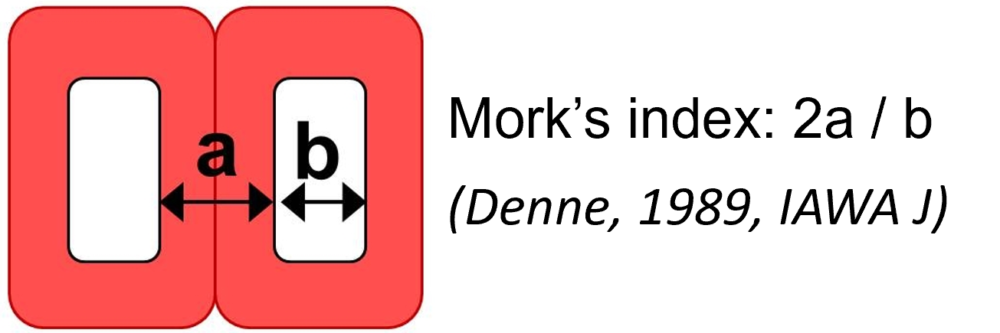
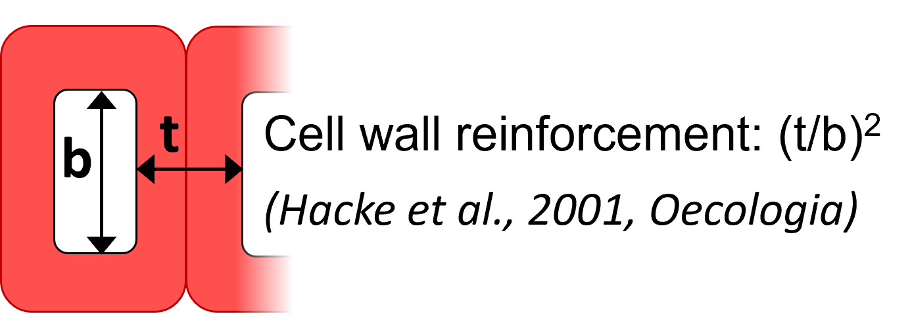
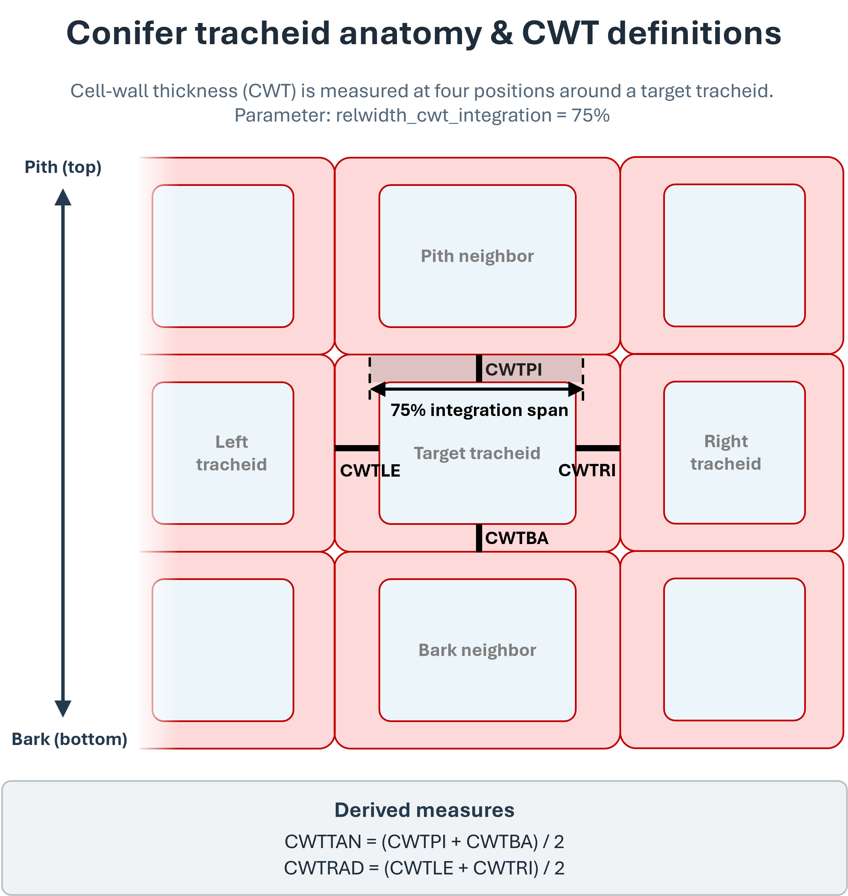
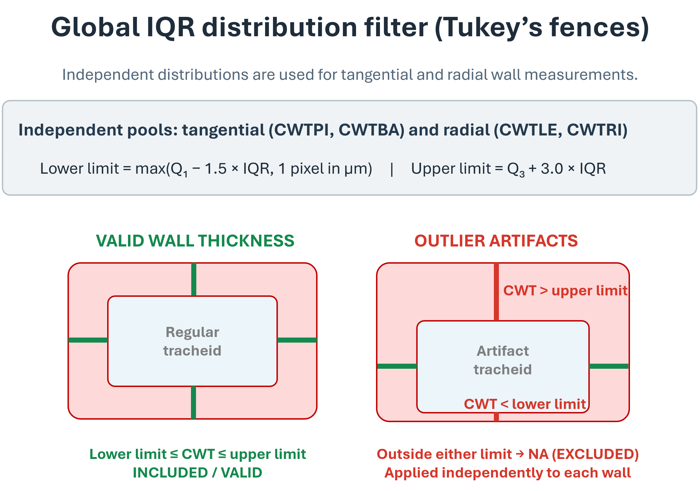
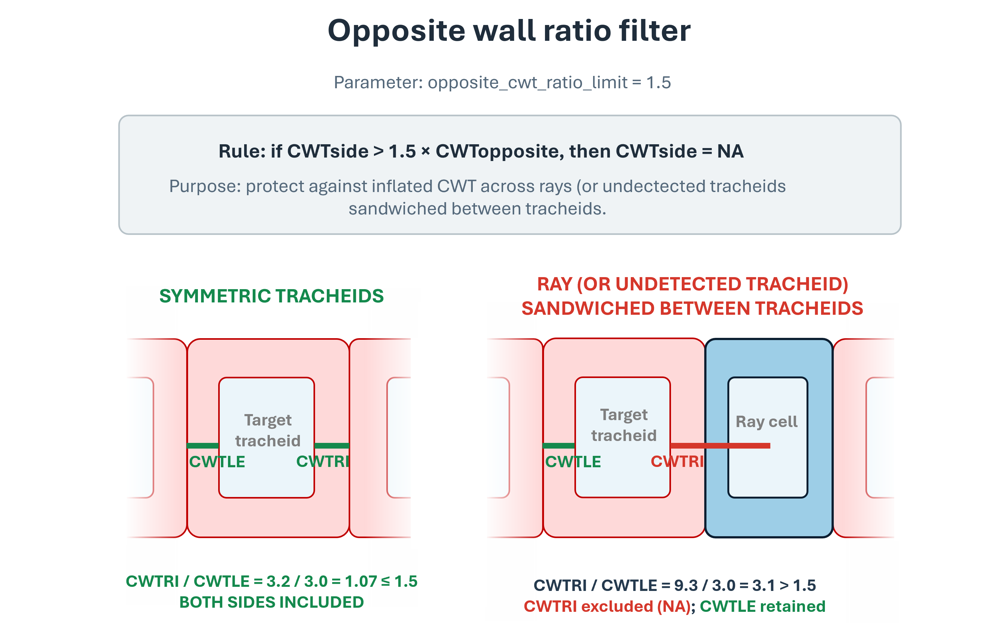
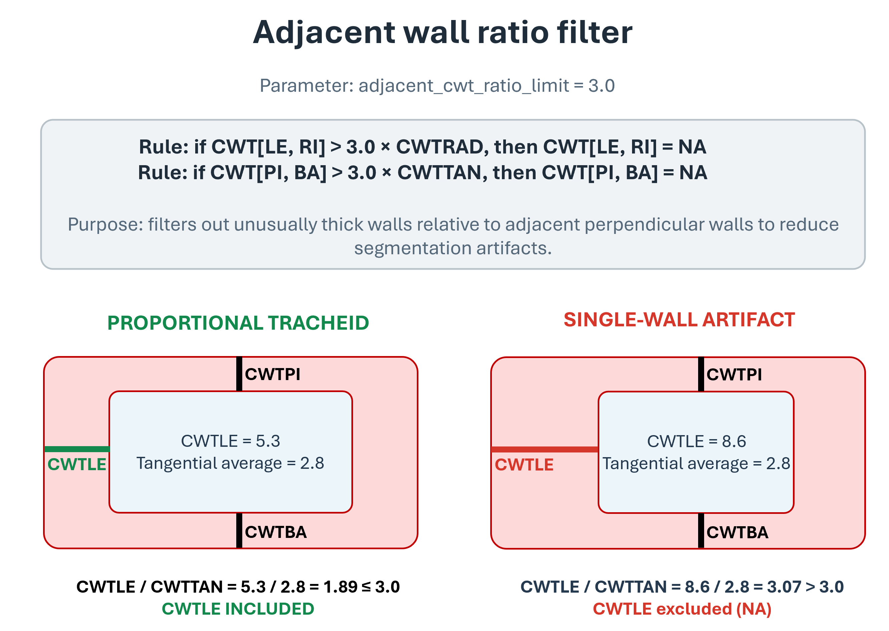

# Reference

Technical details about the files created by ROXAS AI and the numeric output variables.

## Image Orientation Requirements

Linear input images have to be oriented with +/- horizontal rings and the bark side at the bottom.

## File Formats

ROXAS AI uses a standardized naming convention to organize analysis data. For a sample named `sample_01`, the following files are typically generated:

### Spatial & Image Files
- **`.scan.jpg` / `.scan.tif`** etc.: The original high-resolution scan of the wood sample; supported image formats: **JPG**, **JPEG**, **TIFF**, **TIF**, **PNG**, **BMP**, **JP2**.
- **`.cells.png`**: A label image produced by the deep-learning cell segmentation model ([Segmentation Models](segmentation_models.md)) where each pixel value corresponds to a unique cell ID (CID).
- **`.rings.tif`**: A label image (or vector-like representation) produced by the deep-learning ring boundary segmentation model ([Segmentation Models](segmentation_models.md)) containing the identified tree-ring boundaries.
- **`_annotated.jpg`**: A visualization of the scan with ring boundaries and year labels overlaid for quick review. This file is automatically generated after segmentation (3A/3B), after updating the outermost ring year (6), after applying a cross-dating offset (7) and with every measurement (9A/9B). Manual saves (**Save All Layers**) do not redraw it.
- **`.ReferenceSeries.jpg`**: (Optional) A visual representation of the reference chronologies used during cross-dating.

### Data & Metadata Files
- **`.metadata.json`**: A comprehensive JSON file containing sample information, imaging parameters, and all processing thresholds required to reproduce the analysis.
- **`.cells_table.csv`**: A CSV file (semicolon-delimited by default, configurable in settings) containing measurements for every individual cell.
- **`.rings_table.csv`**: A CSV file (semicolon-delimited by default, configurable in settings) containing aggregated measurements for each tree ring.

---

## Output Variables (Acronyms)

The output tables (`.cells_table.csv` and `.rings_table.csv`) use standardized acronyms. Most measurements are provided in **micrometers ($\mu\text{m}$)** or **square micrometers ($\mu\text{m}^2$)**.

### Missing Values & Error Codes
Missing values or empty fields are left **blank (NA)** in the CSV output to ensure compatibility with modern data analysis tools like R and Python.

### Ring-Level Output (`.rings_table.csv`)

| Acronym | Description | Unit | Details |
| :--- | :--- | :--- | :--- |
| `ID` | Sample ID | - | Unique identifier for the sample. |
| `YEAR` | Ring Affiliation | - | Calendar year of the tree ring. |
| `RA` | Ring Area | $\text{mm}^2$ | Area of the analyzed ring. |
| `MRW` | Mean Ring Width | $\mu\text{m}$ | Corrected for inclined ring boundaries. |
| `CNO` | Number of Cells | count | Total cells in the tree ring. |
| `CD` | Cell Density | no./$\text{mm}^2$ | Number of cells per $\text{mm}^2$. |
| `CTA` | Cumulative Transsectional Area | $\text{mm}^2$ | Cumulative area of all counted cells. |
| `RCTA` | Conductive Area Percentage | % | `CTA` / `RA`. |
| `MLA` | Mean Lumen Area | $\mu\text{m}^2$ | Mean cell lumen area in the ring. |
| `MINLA` | Minimum Lumen Area | $\mu\text{m}^2$ | Minimum cell lumen area in the ring. |
| `MAXLA` | Maximum Lumen Area | $\mu\text{m}^2$ | Maximum cell lumen area in the ring. |
| `KH` | Hydraulic Conductance | $\text{m}^4\,\text{s}^{-1}\,\text{MPa}^{-1}$ | Theoretical (Poiseuille) adjusted for elliptical tubes. |
| `KS` | Specific Hydraulic Conductivity | $\text{m}^2\,\text{s}^{-1}\,\text{MPa}^{-1}$ | `KH` / `RA` (assuming tube length of 1m). |
| `RVGI` | Vessel Grouping Index | index | Mean cells per group (Carlquist 2001). |
| `RVSF` | Vessel Solitary Fraction | % | Fraction of solitary cells vs all cells. |
| `RGSGV` | Group Size of Grouped Cells | index | Mean size of non-solitary cell groups. |
| `AOIAR` | Area of Interest (Ring) | $\text{mm}^2$ | Area of interest within the ring. |
| `RAOIAR` | Relative Area of Interest | % | Percentage of ring area covered by area of interest. |
| `CWTPI` | Cell Wall Thickness - Pith | $\mu\text{m}$ | Inner wall facing towards the pith. |
| `CWTBA` | Cell Wall Thickness - Bark | $\mu\text{m}$ | Outer wall facing towards the bark. |
| `CWTLE` | Cell Wall Thickness - Left | $\mu\text{m}$ | Measured with bark at the bottom. |
| `CWTRI` | Cell Wall Thickness - Right | $\mu\text{m}$ | Measured with bark at the bottom. |
| `CWTTAN` | Tangential Wall Thickness | $\mu\text{m}$ | Mean of pith and bark sides: (`[CWTPI+CWTBA]/2`). |
| `CWTRAD` | Radial Wall Thickness | $\mu\text{m}$ | Mean of left and right sides: (`[CWTLE+CWTRI]/2`). |
| `CWTALL` | Overall Wall Thickness | $\mu\text{m}$ | Mean of all sides: (`[CWTRAD+CWTTAN]/2`). |
| `RTSR` | Radial Thickness-to-Span Ratio | ratio | Mork's index; ratio between 4x `CWTTAN` and radial diameter (Denne 1989). |
| `CTSR` | Circular Thickness-to-Span Ratio | ratio | Ratio between 4x `CWTALL` and area-equivalent circle diameter. |
| `DHW` | Hydraulic Diameter (W) | $\mu\text{m}$ | Mean per ring (Kolb & Sperry 1999). |
| `DHM` | Hydraulic Diameter (M) | $\mu\text{m}$ | Mean per ring (Tyree & Zimmermann 2002). |
| `DRAD` | Mean Radial Diameter | $\mu\text{m}$ | Measured bark-to-pith, corrected for inclination. |
| `DTAN` | Mean Tangential Diameter | $\mu\text{m}$ | Measured tangentially to pith, corrected for inclination. |
| `TB2` | Reinforcement Index $(t/b)^2$ | index | Hacke et al. 2001; uses the smaller of rad/tan values. |
| `CWA` | Cell Wall Area | $\mu\text{m}^2$ | Mean per ring; may include pit artefacts. |
| `RWD` | Relative Anatomical Density | ratio | Mean of `CWA` / (`CWA` + `LA`) per ring. |
| `RBXY` | Ring Boundary Coordinates | pixels | Coordinate string defining the ring boundary. |
| `cells_above`  | Cells Above Boundary | count | Number of cells located above the ring boundary. |
| `enabled` | Ring Enabled Status | boolean | Flag indicating whether the ring is enabled/valid. |

---

### Cell-Level Output (`.cells_table.csv`)

| Acronym | Description | Unit | Details |
| :--- | :--- | :--- | :--- |
| `ID` | Sample ID | - | Unique identifier for the sample. |
| `CID` | Cell ID | - | Unique cell identifier within the sample. |
| `YEAR` | Ring Affiliation | - | Calendar year of cell formation. |
| `LA` | Cell Lumen Area | $\mu\text{m}^2$ | - |
| `XPIX` | X-Coordinate | pixels | Center of cell (0/0 is top-left corner). |
| `YPIX` | Y-Coordinate | pixels | Center of cell (0/0 is top-left corner). |
| `RADDISTR` | Radial Distance (Ring) | $\mu\text{m}$ | Distance of cell center from inner ring boundary. |
| `RRADDISTR` | Relative Radial Position | % | 0.00 (proximal boundary) to 99.99 (distal boundary). |
| `NBRNO` | Neighbor Number | count | Number of cells in the group this cell belongs to. |
| `NBRID` | Neighbor IDs | - | IDs of all cells in the same group (blank if solitary). |
| `ASP` | Aspect Ratio | ratio | Major axis / minor axis of equivalent ellipse. |
| `MAJAX` | Major Axis Deviation | degrees | Angular deviation from line towards X/Y origin. |
| `KH` | Hydraulic Conductance | $\text{m}^4\,\text{s}^{-1}\,\text{MPa}^{-1}$ | Theoretical conductance per cell. |
| `AOI` | Area of Interest | boolean | Flag indicating whether the cell lies within the area of interest. |
| `CWTPI` | Cell Wall Thickness - Pith | $\mu\text{m}$ | Facing towards the pith. |
| `CWTBA` | Cell Wall Thickness - Bark | $\mu\text{m}$ | Facing towards the bark. |
| `CWTLE` | Cell Wall Thickness - Left | $\mu\text{m}$ | Measured with bark at bottom. |
| `CWTRI` | Cell Wall Thickness - Right | $\mu\text{m}$ | Measured with bark at bottom. |
| `CWTTAN` | Tangential Wall Thickness | $\mu\text{m}$ | Mean of (`[CWTPI+CWTBA]/2`). |
| `CWTRAD` | Radial Wall Thickness | $\mu\text{m}$ | Mean of (`[CWTLE+CWTRI]/2`). |
| `CWTALL` | Overall Wall Thickness | $\mu\text{m}$ | Mean of (`[CWTRAD+CWTTAN]/2`). |
| `RTSR` | Radial Thickness-to-Span Ratio | ratio | Mork's index per cell (Denne 1989). |
| `CTSR` | Circular Thickness-to-Span Ratio | ratio | Circular ratio per cell. |
| `DH` | Hydraulic Diameter | $\mu\text{m}$ | Corrected for elliptical shape (Lewis & Boose 1995). |
| `DRAD` | Radial Diameter | $\mu\text{m}$ | Bark-to-pith direction, corrected for inclination. |
| `DTAN` | Tangential Diameter | $\mu\text{m}$ | Tangential to pith, corrected for inclination. |
| `TB2` | Reinforcement Index $(t/b)^2$ | index | Cell wall reinforcement index (t/b)^2 (Hacke et al. 2001). |
| `CWA` | Cell Wall Area | $\mu\text{m}^2$ | Wall area per cell; may include pit artefacts. |
| `RWD` | Relative Anatomical Density | ratio | Cell-level `CWA` / (`CWA` + `LA`). |

---

## Theoretical Hydraulic Conductance (`KH`)
The theoretical hydraulic conductance is approximated by Poiseuille's law and adjusted for elliptical tubes (Nonweiler 1975):

$$ \text{KH} = \frac{\text{LA} \cdot m^2}{\nu \cdot k} $$

Where:
- `LA`: Lumen area ($\text{m}^2$)
- $\nu$: Viscosity of water ($1.002 \cdot 10^{-3}\,\text{Pa}\cdot\text{s}$ at 20°C)
- $m$: Mean hydraulic radius ($\pi ab / C$)
- $k$: Geometry coefficient ($4 / (1 + \sqrt{1 - e^4})$)
- $e$: Eccentricity of the ellipse

---

## Mork's Index (Radial Thickness-to-Span Ratio, `RTSR`, Figure 1)

Mork's index distinguishes earlywood from latewood tracheids based on the ratio between tangential cell wall thickness and radial lumen diameter (Denne 1989):

{ width="450" }

*Figure 1: Definition of Mork's index based on tangential cell wall thickness and radial lumen diameter.*

A tracheid is classified as latewood when the ratio between twice the double tangential cell wall thickness (4x `CWTTAN`) and its radial lumen width (`DRAD`) is larger than 1.

---

## Cell Wall Reinforcement Index (`TB2`, Figure 2)

The cell wall reinforcement index estimates conduit resistance against cell wall collapse under negative hydraulic pressure (Hacke et al. 2001):

{ width="450" }

*Figure 2: Definition of the cell wall reinforcement index $(t/b)^2$.*

The index is calculated as $(t/b)^2$, where $t$ is the thickness of the shared double cell wall and $b$ is the internal lumen diameter span across the corresponding orientation, taking the minimum of radial and tangential ratios.

---

## Cell Wall Thickness (`CWT`) Quality Control & Filtering

To obtain robust, artifact-free anatomical measurements, ROXAS AI applies automated multi-stage quality control filters to all raw cell wall thickness measurements.

### 1. Wall Definitions & Measurement Integration (Figure 3)

{ width="80%" }

*Figure 3: Definition of tangential and radial wall orientations and the central measurement integration span.*

#### Cell Wall Identification Algorithm
To measure the cell wall thickness of individual cells from segmented lumen masks, ROXAS AI uses an automated Euclidean distance and watershed-based approach:

1. **Lumen Boundaries & Euclidean Distance Mask:** Based on the segmented cell lumina, an inverted binary mask is created where background and cell walls are foreground pixels. A Euclidean distance transform is calculated across this mask, computing the exact spatial distance of every wall pixel to the nearest cell lumen boundary.
2. **Watershed Mask & Middle Lamella Approximation:** A watershed segmentation algorithm is computed between adjacent cell lumina to detect the contact boundary (the watershed line) between neighboring tracheids. Following Prendin et al. (2017), the exact position of the middle lamella separating two adjacent cells cannot be resolved directly from optical lumen contours alone; it is therefore geometrically approximated by assuming that each wall of two adjacent sharing cells has equal thickness (i.e., the middle lamella is located equidistant between the two lumina along the watershed ridge).
3. **Lateral Integration:** For each of the four anatomical wall sectors (`CWTPI`, `CWTBA`, `CWTLE`, `CWTRI`), distance values are sampled along the watershed line. To avoid geometric distortion at rounded cell corners, measurements are laterally integrated over the central portion of the wall (defined by `relwidth_cwt_integration`, default: 75%).

#### Wall Sectors & Aggregated Metrics
For each conifer tracheid, cell walls are measured across four distinct anatomical orientations:

- **Tangential walls:** `CWTPI` (pith-facing, top) and `CWTBA` (bark-facing, bottom).
- **Radial walls:** `CWTLE` (left) and `CWTRI` (right).
- **Integration span:** Wall thicknesses are integrated over the central span of each wall segment (defined by `relwidth_cwt_integration`, default: 75%) to avoid corner-rounding biases.
- **Aggregated metrics:**
    - Tangential mean: `CWTTAN` = (`CWTPI` + `CWTBA`) / 2; or any of the two if the other **NA**
    - Radial mean: `CWTRAD` = (`CWTLE` + `CWTRI`) / 2; or any of the two if the other **NA**
    - Overall mean: `CWTALL` = (`CWTTAN` + `CWTRAD`) / 2; or any of the two if the other **NA**

### 2. Global IQR Distribution Filter / Tukey's Fences (Figure 4)

{ width="80%" }

*Figure 4: Global IQR outlier filtering based on lower and upper Tukey's fences.*

To exclude segmentation debris, extreme clumps, or sub-pixel erosion artifacts, measurements are filtered against population-wide distributions computed independently for tangential walls (`CWTPI`, `CWTBA`) and radial walls (`CWTLE`, `CWTRI`), based on the Interquartile Range ($\text{IQR} = Q_3 - Q_1$):

- **Lower Limit:** $\max(Q_1 - 1.5 \cdot \text{IQR},\, 1\text{ pixel in }\mu\text{m})$ (controlled by `lower_limit_cwt_iqr_multiplier`)
- **Upper Limit:** $Q_3 + 3.0 \cdot \text{IQR}$ (controlled by `upper_limit_cwt_iqr_multiplier`)
- Values falling outside **Lower Limit:** or **Upper Limit:** are set to **blank (NA)**.

### 3. Opposite Wall Ratio Filter (Figure 5)

{ width="80%" }

*Figure 5: Opposite wall ratio filter identifying and removing inflated wall measurements bordering ray cells.*

In conifer xylem, opposing walls of a single tracheid have comparable thicknesses unless bordering a different cell type (such as wood ray cells) or an intercellular gap.

- **Rule:** If the thickness of one wall exceeds `opposite_cwt_ratio_limit` $\cdot$ opposing wall thickness (default threshold: 1.5), the inflated side is excluded (**NA**), while the valid opposing side is retained.
- **Anatomical and technical context:** Because the distance-to-watershed algorithm assumes equal double-wall thickness between adjacent detected lumina (Prendin et al. 2017), unsegmented or narrower intervening structures like uniseriate wood ray parenchyma cells are not recognized as independent tracheid lumina. Consequently, the Euclidean distance measured across the entire ray gap between two tracheid files is assigned as a single inflated tracheid wall (`CWTRI` in Figure 5). The filter identifies this asymmetric inflation relative to the normal opposing wall (`CWTLE`), discarding the artifactual `CWTRI` measurement while preserving `CWTLE`.

### 4. Adjacent Wall Ratio Filter (Figure 6)

{ width="80%" }

*Figure 6: Adjacent wall ratio filter detecting and discarding local segmentation anomalies.*

Protects against severe local segmentation anomalies (e.g., pit aperture artifacts, small pollutions, tracheids sandwiched between two rays) that disproportionately distort a single wall relative to the tracheid's perpendicular dimensions.

- **Rule:** If an individual tangential wall thickness exceeds `adjacent_cwt_ratio_limit` (default threshold: 3.0), the distorted tangential wall is set to **NA** (and vice versa for radial walls!).

---

## The Metadata File (`.metadata.json`)

The metadata file ensures traceability and reproducibility of your analysis. It stores four main categories of information:

### 1. Sample & Project Information
- **`sample_name`**: The unique identifier for the wood sample.
- **`sample_stem_path`**: The relative path of the sample within the project directory.
- **`sample_type`**: The type of wood (i.e., `conifer` or `angiosperm`; note that the `angiosperm` analysis is not implemented yet).
- **`meas_geometry`**: The measurement layout (i.e., `linear` or `circular`; note that the `circular` analysis is not implemented yet).
- **`rings_outmost_complete_year`**: The calendar year assigned to the most recent complete tree ring.
- **`reference_series`**: The cross-dating reference series used (or `NA` if none).

### 2. Imaging & Spatial Metadata
- **`spatial_resolution`**: The conversion factor from pixels to micrometers ($\text{px}/\mu\text{m}$). This is critical for all subsequent physical measurements.
- **`scan_size`**: The dimensions of the original image in pixels (Height, Width).
- **`scan_info`**: Detailed technical info about the image, including the detected **DPI** (Dots Per Inch).
- **`scan_exif`**: Metadata extracted directly from the image file (e.g., software used for scanning, capture date).

### 3. Processing & Traceability
- **`sw_version`**: The exact version of ROXAS AI used for the analysis.
- **`meas_by`**: The username or system identifier that ran the measurement analysis.
- **`cells_segmentation_model`** & **`rings_segmentation_model`**: The specific AI model filenames (`.pth` / `.pt`) used for detection.
- **`meas_created_at`**: A timestamp of when the final measurement table was generated.

### 4. Analysis Parameters & Quality Control
These parameters define how cell walls are measured and how clusters are handled:

- **`cluster_dbl_cwt_threshold`**: Threshold for detecting cell wall clusters (physiological grouping via pits). Used for angiosperms.
- **`relwidth_cwt_integration`**: The relative width along the cell wall used for integrating thickness measurements.
- **`lower_limit_cwt_iqr_multiplier`**: Multiplier for the lower Tukey's fence ($Q_1 - k \cdot \text{IQR}$) in cell wall thickness outlier detection.
- **`upper_limit_cwt_iqr_multiplier`**: Multiplier for the upper Tukey's fence ($Q_3 + k \cdot \text{IQR}$) in cell wall thickness outlier detection.
- **`opposite_cwt_ratio_limit`**: Quality control factor comparing wall thickness on opposite sides of a cell.
- **`adjacent_cwt_ratio_limit`**: Quality control factor comparing wall thickness on adjacent sides of a cell.

---

## Global Settings (`settings.json`)

While the `.metadata.json` is unique to each sample, the `settings.json` file stores your global preferences and plugin configurations. 

**Important**: One of the core goals of ROXAS AI is to be accessible. Unlike classical systems, **no expert knowledge is required** to configure these settings. For most users, the default values are optimized for professional results and do not need to be changed.

The settings are organized into several logical blocks:

### 1. File Extensions (`file_extensions`)

Defines how ROXAS AI recognizes and names files:

- **`scan_file_extension`**: `[".scan", ".jpg"]`
- **`cells_file_extension`**: `[".cells", ".png"]`
- **`cells_table_file_extension`**: `[".cells_table", ".csv"]`
- **`rings_file_extension`**: `[".rings", ".tif"]`
- **`rings_table_file_extension`**: `[".rings_table", ".csv"]`
- **`metadata_file_extension`**: `[".metadata", ".json"]`
- **`crossdating_file_extension`**: `[".crossdating", ".txt"]`
- **`roxas_file_extensions`**: List of managed ROXAS file suffixes (`[".scan", ".cells", ".rings", ".metadata"]`).
- **`image_file_extensions`**: Supported image formats (`[".jpg", ".jpeg", ".png", ".tif", ".tiff", ".bmp", ".jp2"]`).
- **`text_file_extensions`**: Supported text and table formats (`[".rwl", ".tuc", ".txt", ".csv", ".tsv"]`).

### 2. Processing & GPU (`processing`)

Allows configuring hardware acceleration and memory optimization:

- **`try_to_use_gpu`**: Set to `true` to enable GPU acceleration if a compatible CUDA-enabled graphics card is available.
- **`try_to_use_autocast`**: Set to `true` for mixed precision acceleration during deep learning inference.

### 3. Tables (`tables`)

Defines the output format for tabular data:

- **`separator`**: Column delimiter for output tables (default: `";"`).
- **`index_column`**: Column identifier name (default: `"id"`).

### 4. Visualization (Vectorization & Rasterization) {: #4-visualization-vectorization-rasterization }

Controls geometric conversion algorithms, contour simplification tolerances, layer styling, and colormaps in the napari viewer:

#### Vectorization Parameters (`vectorization`)
Controls how raster label masks are converted into editable vector polygons and polylines:

- **`cells_tolerance`**: Maximum geometric approximation tolerance in pixels for Douglas-Peucker cell contour simplification. Eliminates single-pixel staircase artefacts while preserving lumen fidelity. (*Default:* `1`)
- **`cells_edge_width`**: Display line width (in pixels) of cell vector boundaries in the viewer. (*Default:* `5`)
- **`cells_edge_color`**: Outline color for cell vector shapes. (*Default:* `"blue"`)
- **`cells_face_color`**: Fill color for cell vector shapes. (*Default:* `"cyan"`)
- **`rings_tolerance`**: Maximum approximation tolerance in pixels for Douglas-Peucker ring polyline smoothing. Set to `0` to disable simplification and retain raw pixel coordinates. (*Default:* `5`)
- **`rings_edge_width`**: Display line thickness (in pixels) for ring boundary polylines. (*Default:* `7`)
- **`rings_edge_color`**: Display color for active ring boundary polylines. (*Default:* `"black"`)
- **`rerun_interactive_edge_color`**: Display color for newly detected boundaries generated during interactive AI re-runs. (*Default:* `"lime"`)

#### Rasterization & Colormaps (`rasterization`)
Controls how edited vector shapes are rasterized back onto integer label masks:

- **`cells_color`**: Default colormap color for rasterized cell lumens. (*Default:* `"lime"`)
- **`uncomplete_ring_value`**: Integer label assigned to the topmost uncompleted ring zone bordering the bark edge. (*Default:* `-1`)
- **`uncomplete_ring_color`**: Display color assigned to the uncompleted ring zone. (*Default:* `"red"`)
- **`rings_color_sequence`**: List of alternating colors assigned cyclically to successive annual rings (`["#8080ff", "#a8a8ff", "#d0d0ff", "#ffffff"]`).

### 5. Measurement Defaults (`measurements`)

Contains default parameters for anatomical analysis, used to populate metadata for new samples:

- **`cluster_dbl_cwt_threshold`**: Threshold for detecting cell wall clusters (physiological grouping via pits). Used for angiosperms.
- **`cells_smoothing_kernel_size`**: Size of the kernel used for smoothing cell boundaries.
- **`relwidth_cwt_integration`**: The relative width along the cell wall used for thickness calculations.
- **`cells_tangential_angle`**: Default angle for tangential orientation.
- **`lower_limit_cwt_iqr_multiplier`**: Multiplier for the lower Tukey's fence ($Q_1 - k \cdot \text{IQR}$) in cell wall thickness outlier detection.
- **`upper_limit_cwt_iqr_multiplier`**: Multiplier for the upper Tukey's fence ($Q_3 + k \cdot \text{IQR}$) in cell wall thickness outlier detection.
- **`opposite_cwt_ratio_limit`**: Quality control factor comparing wall thickness on opposite sides of a cell.
- **`adjacent_cwt_ratio_limit`**: Quality control factor comparing wall thickness on adjacent sides of a cell.

### 6. Annotated Image & Project Directory

- **`project_directory`**: Path to the currently active project working directory.
- **`annotated_image`**: Configuration for saved annotated verification images (`_annotated.jpg`), including cell overlay opacity (`cell_opacity`), fill color (`cell_fill_color`), year label font size (`year_label_size`), downscaling factor (`scale_factor`), and JPEG quality and compression settings (`quality`, `optimize`, `progressive`).

### 7. Metadata Field Definitions (`samples_metadata`)

Defines the structure, validation rules, and widget types for the input forms in the plugin:

- **`sample_name`**: Text input for the unique sample identifier.
- **`sample_type`**: Dropdown selection for wood type (`conifer`, `angiosperm`).
- **`meas_geometry`**: Dropdown selection for measurement layout (`linear`, `circular`).
- **`spatial_resolution`**: Numeric input for spatial resolution in $\text{px}/\mu\text{m}$.
- **`rings_outmost_complete_year`**: Integer input for the calendar year of the outermost complete ring.

---

## References

- **Carlquist 2001**: Carlquist, S. (2001). *Comparative Wood Anatomy: Systematic, Ecological, and Evolutionary Aspects of Dicotyledon Wood*. Springer-Verlag.
- **Denne 1989**: Denne, M. P. (1989). Definition of latewood according to Mork (1928). *IAWA Bulletin*, 10:59–62.
- **Hacke et al. 2001**: Hacke, U. G., Sperry, J. S., Pockman, W. T., Davis, S. D., & McCulloh, K. A. (2001). Trends in wood density and structure are linked to prevention of xylem cavitation by negative pressure. *Oecologia*, 126(4), 457–461.
- **Kolb & Sperry 1999**: Kolb, K. J., & Sperry, J. S. (1999). Differences in drought adaptation between subspecies of sagebrush: *Artemisia tridentata*. *Ecology*, 80(7), 2373–2384.
- **Lewis & Boose 1995**: Lewis, A. M., & Boose, E. R. (1995). Estimating volume flow rates through xylem conduits. *American Journal of Botany*, 82(9), 1112–1116.
- **Nonweiler 1975**: Nonweiler, T. R. F. (1975). *Computational Mathematics: An Introduction to Numerical Approximation*. Ellis Horwood.
- **Prendin et al. 2017**: Prendin, A. L., Petit, G., Carrer, M., Fonti, P., Björklund, J., & von Arx, G. (2017). New research perspectives from a novel approach to quantify tracheid wall thickness. *Tree Physiology*, 37(7), 976–983. https://doi.org/10.1093/treephys/tpx037
- **Tyree & Zimmermann 2002**: Tyree, M. T., & Zimmermann, M. H. (2002). *Xylem Structure and the Ascent of Sap*. Springer-Verlag.
