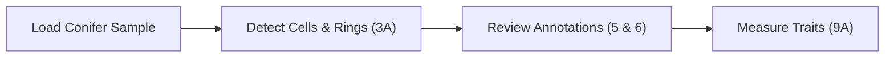
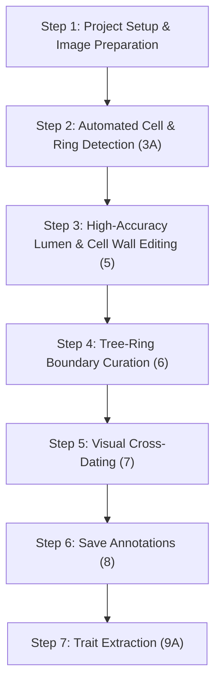
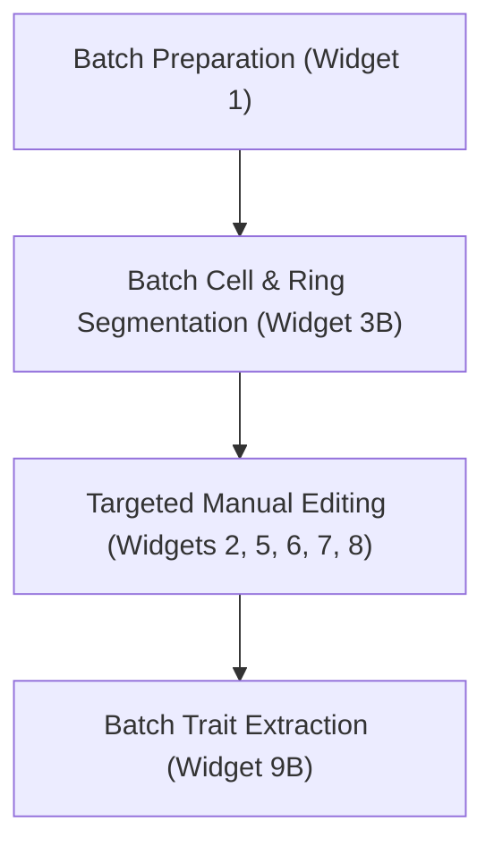

# Tutorials & Workflows

Step-by-step guides for quantitative wood anatomy (QWA) and dendrochronological analysis using ROXAS AI in napari.

---

## 1. Quickstart: 5-Minute Single Sample Walkthrough

This fast-track walkthrough gets you from raw image to measured anatomical traits using the bundled conifer sample.

### Step 1: Open the Built-in Sample Data
1. Launch **napari**.
2. Navigate to the top menu: **File > Open Sample > ROXAS AI > Conifer Sample Data**.
3. ROXAS AI automatically loads the conifer cross-section scan along with pre-configured spatial metadata ($\mu\text{m}/\text{px}$).

*Figure 1: Conifer sample dataset loaded into the napari viewer.*

### Step 2: Run Deep Learning Detection
1. Open the plugin menu: **Plugins > ROXAS AI > 3A - Detect cells & rings (individual image)**.
2. Ensure the active image is selected in the **Sample Image** dropdown.
3. Select the segmentation models:
   - **Cells Model**: `linear_cells_model`
   - **Rings Model**: `linear_rings_model`
4. Click **Run Segmentation**. Deep-learning inference generates two new layers: `.cells` (cell lumen labels) and `.rings` (ring boundary labels).

*Figure 2: Automated cell lumen and tree-ring boundary segmentation overlay.*

### Step 3: Quick Visual Verification
1. Toggle layer visibility in the left napari layer list to inspect the overlay against the anatomical scan.
2. Use **Plugins > ROXAS AI > 6 - Edit rings** or **5 - Edit cells** if minor adjustments are needed.

### Step 4: Extract Cell & Ring Measurements
1. Open **Plugins > ROXAS AI > 9A - Measure cells & rings (individual image)**.
2. Select the active sample and click **Run Measurements**.
3. Measurement output tables (`.cells_table.txt` and `.rings_table.txt`) are created in the project folder with comprehensive anatomical metrics (lumen area, cell wall thickness, Mork's index, ring widths).

*Figure 3: Measurement completion with generated tabular files.*

---

## 2. Standard Workflow: Tree-Ring & Cell Anatomy Time Series

This comprehensive, step-by-step workflow describes the standard protocol for generating publication-quality dendroclimatic and wood anatomical time series from raw microsections or high-resolution surface scans.

---

### Step 1: Project Setup & Image Preparation

1. Open **Plugins > ROXAS AI > 0 - Define project directory** and choose the root directory where your analysis files will reside.
2. Open **Plugins > ROXAS AI > 1 - Prepare project images for analysis**.
3. The preparation assistant scans your folder for raw images (`.tif`, `.jpg`, `.png`, etc.) and opens the **Metadata Dialog**:
   - **Resolution ($\mu\text{m}/\text{px}$)**: Enter the calibrated micrometer-per-pixel value of your optical microscope or scanner.
   - **Anatomy / Growth Type**: Select `conifer`.
   - **Geometry**: Select `linear` for standard radial increment cores or microsections.
   - **Outermost Ring Year**: Set the calendar year of the outermost complete ring (e.g., sampling year `2023`).
4. *(Optional)* Click **Start Processing Crossdating Files** to import reference ring-width chronologies (`.rwl`, `.tuc`, or tabular `.txt`/`.csv`).
5. Click **Prepare Images**. The images are standardized to `<sample>.scan.<ext>` and initialized with `<sample>.metadata.json`.

*Figure 4: Setting spatial resolution and calendar dating parameters in the image preparation dialog.*

---

### Step 2: Loading & Automated Segmentation

1. Open **Plugins > ROXAS AI > 2/4 - Load image(s)** and load your prepared sample.
2. Open **Plugins > ROXAS AI > 3A - Detect cells & rings (individual image)**.
3. Choose the appropriate neural network models and click **Run Segmentation**.
4. Both cell lumen masks and ring boundary contours will populate as interactive napari layers.

*Figure 5: Automated cell and ring predictions visualized in napari.*

---

### Step 3: High-Accuracy Lumen & Cell Wall Editing

Refine cell lumen annotations using **Plugins > ROXAS AI > 5 - Edit cells**.

> **Tip**: You can save your edits directly from within this widget at any time. Regularly saving edits is a good routine to preserve your work throughout the editing session.

*Figure 6: Cell layer editor displaying raster brush/eraser controls and vector polygon conversion.*

#### Raster vs. Vector Editing Modes

ROXAS AI offers two complementary editing modes for cell lumina:

| Mode | Best Used For | Tooling & Mechanics |
| :--- | :--- | :--- |
| **Raster Mode** | Rapid mask cleaning, separating merged cells, filling voids | Pixel brush, eraser, paint bucket. Direct modification of the integer label mask. |
| **Vector Mode** | High-precision boundary adjustments, polygon vertex editing, batch lasso deletion | Polygon contour representation with vertex manipulation and Lasso Delete. |

#### Editing Techniques

1. **Separating Merged Lumens**:
   - In Raster mode, switch to the **Eraser** tool with a small radius (10–15 px) and draw a dividing cut through the shared wall.
   - Run the connected component refresh to split into distinct labels.
2. **Removing False Detections & Clearing Resin Canals**:
   - Use the **Lasso Selection** tool in Vector mode to encircle non-tracheid structures, poorly detected tracheids (e.g., due to tissue overlap) or resin ducts, then press `Delete` (or use the Lasso Delete option) to remove all enclosed objects simultaneously.
3. **Restoring Overlooked Tracheids**:
   - Use the **Brush** tool in Raster mode or draw a new polygon in Vector mode over faint or damaged cell walls.

*Figure 7: Using lasso selection to batch-remove resin canal cells and preparation artifacts.*

---

### Step 4: Tree-Ring Editing & Boundary Curation

Accurate ring boundaries are essential because all radial cell positions and annual time series metrics depend on them. Open **Plugins > ROXAS AI > 6 - Edit rings**.

> **Tip**: You can save your edits directly from within this widget at any time. Regularly saving edits is a good routine to preserve your work throughout the editing session.

*Figure 8: Ring layer editor interface with polyline modification tools.*

#### Best Practices for Ring Boundary Tracing

- Ring boundaries must extend completely across the tangential width of the analyzed sample track.
- Boundaries should align precisely along the latewood-earlywood transition (the outer wall of the terminal latewood tracheid row).
- Ring lines must not self-intersect or cross neighboring ring boundaries.

#### Recommended Vertex Editing Strategies

Editing ring polylines in napari requires an efficient vertex manipulation strategy:

!!! warning "Vertex Deletion and Addition Sequence"
    When deleting existing vertices and immediately adding new vertices within the same uninterrupted editing action, polygon/polyline indexing can connect the new vertices in an unexpected sequence (such as creating self-intersecting loops or back-tracking lines).
    
    **Rule**: Always confirm/apply your changes after deleting vertices before starting a new edit action to insert additional vertices.

##### The Polyline Reset Strategy (Fastest Reconstruction)
When an automatically detected ring boundary has significant geometric deviations or artifacts, attempting to move individual vertices or perform mixed delete/insert operations often takes excessive time. Instead, use a reset strategy:

1. **Delete the defective ring boundary** or clear its internal vertices.
2. **Draw a simple polyline with at least three points** (beginning, intermediate, and end point across the lateral margins), as napari requires a minimum of three vertices before additional intermediate points can be inserted into the line.
3. **Switch to vertex addition/insertion mode**: Starting from one margin and progressing systematically toward the other, insert intermediate vertices along the actual anatomical boundary. Only place as many vertices as necessary to capture curvature and local boundary transitions.

This approach ensures minimal vertex count, eliminates loop artifacts, and is substantially faster than cleaning up messy automated traces.

*Figure 9: Polyline reset strategy: (A) draw initial polyline with minimum vertices; (B) sequentially insert critical intermediate vertices along the terminal latewood boundary.*

#### Handling Missing, Wedging, and False Rings

- **Mis-detected Rings**: If the deep-learning model identified a wrong ring boundary, delete the boundary line. The calendar years of subsequent rings will automatically update in sequence.
- **Wedging Rings**: When two rings share part of their boundary, trace the boundary of the wedging ring up to the point of convergence, then finish off neatly. Alternatively, copy and paste the partly shared ring to create a separate ring. Then, adjust the vertices in the wedging portion to match the correct ring boundary. Therefore, you can either reposition the existing vertices individually or use the lasso delete option to remove misplaced vertices and add new ones along the correct boundary.
- **Missing Rings**: Insert a new polyline at the expected anatomical position by copy-pasting the ring that should be duplicated. ROXAS AI will re-index all ring labels and calendar years accordingly.

---

### Step 5: Visual Cross-Dating & Ring Synchronization

To verify ring counts and calendar year assignments against its reference series or the mean chronology, open **Plugins > ROXAS AI > 7 - Visual cross-dating**.

*Figure 10: Visual cross-dating plotter showing sample ring widths (red) synchronized against reference series (yellow) and mean chronology (white).*

1. **Select Reference Series**: Choose the active sample or master chronology from the series list.
2. **Inspect Ring-Width Plots**: Examine the curve overlay in raw or log-transformed scale. Characteristic pointer years (exceptionally narrow or wide rings) provide anchor points.
3. **Adjust Dating**:
   - If a missing ring is detected, return to **6 - Edit rings**, insert the missing boundary, and refresh the plot.
   - If an offset exists, update the outermost year or shift the series interactively.
4. **Confirm Calibration**: Once the growth patterns match reference marker years, the chronological alignment is validated.

---

### Step 6: Saving Verified Annotations

While you can save edits directly from Widgets 5 and 6 during editing sessions, you can also use **Plugins > ROXAS AI > 8 - Save cells & rings editing** to review and persist all modified layers simultaneously.

1. Open **Plugins > ROXAS AI > 8 - Save cells & rings editing**.
2. Select the active sample and confirm layer selections.
3. Click **Save Layers**.
4. The system updates the synchronized files on disk:
   - `<sample>.cells.png`: 16-bit or 32-bit cell label mask.
   - `<sample>.rings.tif`: Vectorized ring boundary masks and calibrated ring identifiers.
   - `<sample>.metadata.json`: Updated metadata including user edits and verification timestamps.

*Figure 11: Saving finalized annotation layers to disk.*

---

### Step 7: Anatomical Traits Extraction & Chronology Export

1. Open **Plugins > ROXAS AI > 9A - Measure cells & rings (individual image)**.
2. *(Optional)* If you wish to review or adjust default measurement parameters (such as CWT calculation options or tangential sector bands), open the **Settings** widget directly from the button inside this widget.
3. Click **Run Measurements**.

#### Generated Output Tables

The measurement engine outputs two primary text tables in the sample directory (as `.txt` or `.csv`, depending on your settings):

- **[`<sample>.cells_table.txt` / `.csv`](../reference/technical_reference.md#cell-level-output-cells_tablecsv)**: Individual cell-level records (e.g., cell ID `CID`, ring affiliation year `YEAR`, lumen area `LA`, radial/tangential/overall cell wall thickness `CWTRAD`/`CWTTAN`/`CWTALL`, relative radial position `RRADDISTR`, and Mork's index `RTSR`).
- **[`<sample>.rings_table.txt` / `.csv`](../reference/technical_reference.md#ring-level-output-rings_tablecsv)**: Ring-level summary records (e.g., calendar year `YEAR`, mean ring width `MRW`, cell count `CNO`, mean lumen area `MLA`, cell density `CD`, and mean cell wall thickness `CWTALL`).

> For the complete list of all measured anatomical variables, abbreviations, theoretical hydraulic traits, and unit definitions, see the [Technical Reference: Output Variables](../reference/technical_reference.md#output-variables-acronyms).

*Figure 12: Measurement summary and exported tabular time series.*

---

## 3. Production Workflow: Batch Processing Multi-Sample Studies

When analyzing dozens or hundreds of wood sections, ROXAS AI allows automated batch processing to minimize hands-on computer time.

### Step 1: Batch Preparation & Standardization
1. Organize raw scans into your designated project folder.
2. Launch **Plugins > ROXAS AI > 1 - Prepare project images for analysis**.
3. Choose the directory and batch-assign spatial resolution and metadata across all matching images.

*Figure 13: Batch image preparation and metadata assignment.*

### Step 2: Batch Cell & Ring Segmentation
1. Open **Plugins > ROXAS AI > 3B - Batch detect cells & rings**.
2. Select your project directory (or manually select specific sample files to include in the batch run) and choose desired segmentation models.
3. Click **Run Batch Segmentation**.
4. The background queue sequentially processes each image, generating `.cells.png` and `.rings.tif` masks without requiring manual interaction for each image.

*Figure 14: Batch segmentation execution and progress tracking.*

### Step 3: Targeted Quality Control
1. Open **Plugins > ROXAS AI > 2/4 - Load image(s)**.
2. Iterate through processed samples.
3. Perform targeted manual editing using Widgets **5**, **6**, **7**, and **8**.

### Step 4: Automated Batch Measurement Extraction
1. Open **Plugins > ROXAS AI > 9B - Batch measure cells & rings**.
2. Select the project directory or manually select the images to process, then choose the desired options for anatomical trait calculation.
3. Click **Measure & Update**.
4. Measurement tables (`.cells_table.txt` and `.rings_table.txt`) are generated for all samples across the entire project directory.

*Figure 15: Batch measurement extraction over multiple sample directories.*

---

## 4. Troubleshooting & Quality Control Cookbook
tbd