# Tutorials & Workflows

Step-by-step guides for quantitative wood anatomy (QWA) and dendrochronological analysis using ROXAS AI in napari.

!!! tip "Choosing the Right Workflow"
    - **Interactive / Single-Sample Workflow (Section 1 & 2)**: Best for detailed visual inspection, manual touch-ups of cell lumens and tree-ring boundaries, and interactive visual cross-dating using the **Manual Editing Group** (`Ctrl+Shift+M`).
    - **Batch Processing Workflow (Section 3)**: Best for multi-sample datasets where segmentation, measurements, quality assurance data (`.cwt.json`), and overview plots are run automatically in sequence using the **Batch Operations Group** (`Ctrl+Shift+B`).

---

## 1. Quickstart: 5-Minute Single Sample Walkthrough

This fast-track walkthrough guides you from raw anatomical image to measured cellular and tree-ring traits using the bundled conifer sample and the **Manual Editing Group** (`Ctrl+Shift+M`).

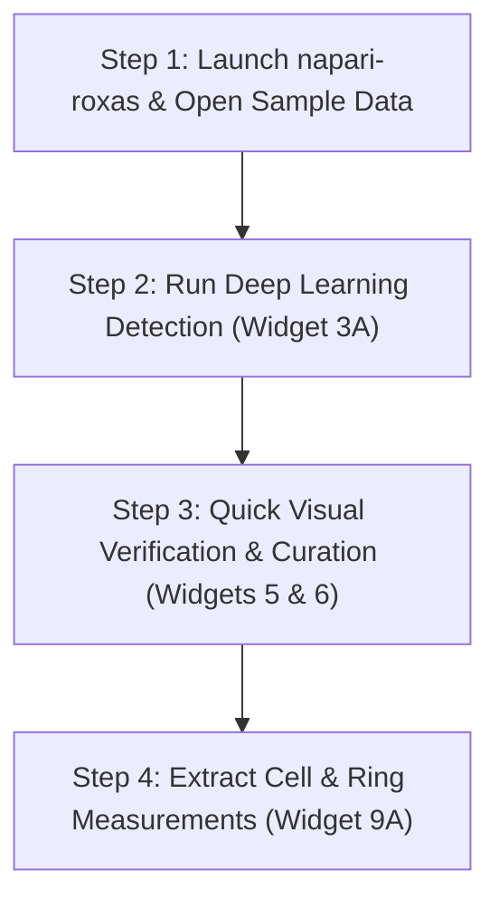

### Step 1: Launch ROXAS AI & Open Built-in Sample Data

1. Open your terminal or conda prompt with the `roxas-ai` environment active and start the application:
   ```bash
   napari-roxas
   ```
   *This starts napari, registers viewport navigation shortcuts (<kbd>WASD</kbd>, <kbd>Q</kbd>/<kbd>E</kbd>), and docks the **Manual Editing Group** in the right sidebar.*
2. Navigate to the top menu: **File > Open Sample > ROXAS AI**.
3. ROXAS AI loads the conifer cross-section scan along with pre-configured spatial metadata ($\text{px}/\mu\text{m}$).

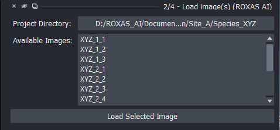

*Figure 1: Conifer sample dataset loaded into the napari viewer.*

---

### Step 2: Run Deep Learning Detection

1. In the docked sidebar, locate **3A - Detect cells & rings (individual image)**.
2. Select the deep-learning models:
    - **Cells Model**: `linear_cells_model` (ResNet-50 U-Net architecture)
    - **Rings Model**: `LinearRingModel_v3_iterative.pt` (Iterative boundary regression)
3. Click **Run Segmentation**.
   
   !!! info "Automatic Model Weights Download"
       If you are running segmentation for the first time, ROXAS AI automatically downloads pre-trained model weights in the background and caches them locally for all subsequent runs.

4. Deep-learning inference generates two interactive napari layers:
    - **`.cells`**: Labeled cell lumen instances (displayed with individual color labels).
    - **`.rings`**: Labeled annual tree-ring bands and boundary polylines.

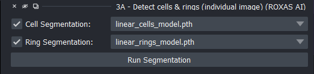

*Figure 2: Automated cell lumen and tree-ring boundary segmentation layers.*

---

### Step 3: Quick Visual Verification & Curation

1. Navigate across the sample using single-key shortcuts:
    - **Pan**: <kbd>W</kbd>, <kbd>A</kbd>, <kbd>S</kbd>, <kbd>D</kbd> or Arrow keys (hold <kbd>Shift</kbd> for fast panning at 400 px/step).
    - **Zoom**: <kbd>Q</kbd> to zoom out, <kbd>E</kbd> to zoom in ($0.25\times$ zoom step).
2. Expand **5 - Edit cells** or **6 - Edit rings** in the sidebar to make quick adjustments:
    - **Cell Editing (Raster Mode)**: Hold <kbd>Ctrl</kbd> + **Mouse Wheel** to dynamically resize the brush (1–100 px); hold <kbd>Ctrl</kbd> + **Double-Click** to toggle between brush and eraser. Press <kbd>Ctrl</kbd>+<kbd>Z</kbd> to undo any stroke.
    - **Ring Editing**: Select a boundary and press <kbd>Ctrl</kbd> + Arrow keys to nudge it by 1 pixel (or <kbd>Ctrl</kbd> + <kbd>Shift</kbd> + Arrow keys for 10 pixels). Press <kbd>Ctrl</kbd>+<kbd>Z</kbd> to undo.

---

### Step 4: Extract Cell & Ring Measurements

1. In the sidebar, scroll to **9A - Measure cells & rings (individual image)**.
2. Verify that **Measure Cells** and **Measure Rings** are checked.
3. *(Optional)* Click **Check Settings** to review or customize measurement parameters and quality control thresholds.
4. Click **Measure**.
5. The measurement engine outputs comprehensive semicolon-delimited CSV tables, CWT quality assurance data, and an updated overview image in the project directory:
    - **[`<sample>.cells_table.csv`](../reference/technical_reference.md#cell-level-output-cells_tablecsv)**: Lumen Area (`LA`), Cell Wall Thickness (`CWTALL`, `CWTRAD`, `CWTTAN`), Mork's Index (`RTSR`), Theoretical Hydraulic Conductance (`KH`), and Hydraulic Diameter (`DH`).
    - **[`<sample>.rings_table.csv`](../reference/technical_reference.md#ring-level-output-rings_tablecsv)**: Mean Ring Width (`MRW`), Cell Count (`CNO`), Mean Lumen Area (`MLA`), Cell Density (`CD`), and Relative Anatomical Density (`RWD`).
    - **[`<sample>.cwt.json`](../reference/technical_reference.md#data-metadata-files)**: Circle geometries, wall thickness values, inclusion/exclusion status, and filter reasons for sampled cells.
    - **`[<sample>] CWT Circles` Shapes Layer**: Non-destructive viewer layer displaying green (included) and red (excluded) measurement circles. Hover over any circle to view an interactive tooltip with Cell ID, wall sector, thickness ($\mu\text{m}$), status, and exclusion reason.
    - **`<sample>_annotated.jpg`**: High-resolution scan automatically regenerated with overlaid ring boundaries, calendar year labels, and cell lumen highlights.
    - **Layer Feature Tables**: In-memory feature tables on `.cells` and `.rings` layers are updated, allowing interactive trait inspection directly inside napari.

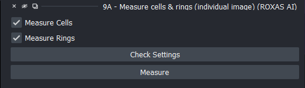

*Figure 3: Single sample measurement interface and extracted output tables.*

---

## 2. Standard Workflow: Tree-Ring & Cell Anatomy Time Series

This comprehensive protocol describes the standard end-to-end workflow for generating publication-quality dendroclimatic and wood anatomical time series from raw microsections or surface scans.

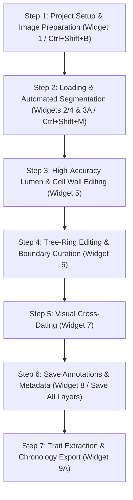

---

### Step 1: Project Setup & Image Preparation

1. Launch napari via `napari-roxas`.
2. Press <kbd>Ctrl</kbd> + <kbd>Shift</kbd> + <kbd>B</kbd> to open the **Batch Operations Group**.
3. In **1 - Prepare project images for analysis**:
    - Select your project directory (or use **0 - Define project directory**).
    - Enter physical spatial resolution ($\text{px}/\mu\text{m}$ or $\mu\text{m}/\text{px}$), anatomy type (`conifer`), geometry (`linear`), and the outermost complete calendar year.
    - *(Optional)* Click **Start Processing Crossdating Files** to import reference ring-width chronologies (`.rwl`, `.tuc`, or tabular `.txt`/`.csv`). Series names of up to 8 characters are parsed automatically.
4. Click **Prepare Images**. The images are standardized to `<sample>.scan.<ext>`, initialized with `<sample>.metadata.json`, and parsed reference chronologies saved to `rings_series.crossdating.txt`.

---

### Step 2: Loading & Automated Segmentation

1. Press <kbd>Ctrl</kbd> + <kbd>Shift</kbd> + <kbd>M</kbd> to switch to the **Manual Editing Group**.
2. In **2/4 - Load image(s)**, select your prepared sample from the dropdown (or double-click to load). Single-image enforcement ensures clean memory management.
3. In **3A - Detect cells & rings (individual image)**, select the neural network models and click **Run Segmentation**.
4. Both cell lumen masks (`.cells`) and ring boundary contours (`.rings`) will populate as interactive napari layers.


*Figure 4: Automated cell and ring predictions visualized in napari.*

---

### Step 3: High-Accuracy Lumen & Cell Wall Editing

Refine cell lumen annotations using **5 - Edit cells** in the Manual Editing group.

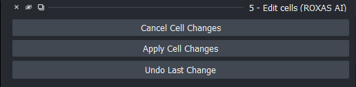

*Figure 5: Cell layer editor displaying raster brush/eraser controls and vector polygon conversion.*

#### Raster vs. Vector Editing Modes

| Mode | Best Used For | Tooling & Mechanics | Dedicated Shortcuts |
| :--- | :--- | :--- | :--- |
| **Raster Mode** | Rapid mask cleaning, separating merged cells, filling voids | Pixel brush, eraser, and paint bucket operating directly on the integer label raster. | <kbd>Ctrl</kbd> + Wheel (Brush size: 1–100 px)<br><kbd>Ctrl</kbd> + Double-Click (Switch brush/eraser)<br><kbd>Ctrl</kbd>+<kbd>Z</kbd> (Undo stroke) |
| **Vector Mode** | High-precision boundary adjustments, polygon vertex editing, batch lasso deletion | Interactive polygon contours with vertex dragging, shape addition, and Lasso Delete. | <kbd>Delete</kbd> / <kbd>Backspace</kbd> (Delete lasso selection)<br><kbd>Ctrl</kbd>+<kbd>Z</kbd> (Undo up to 50 operations) |

#### Core Editing Techniques
1. **Separating Merged Lumens**:
    - In Raster mode, hold <kbd>Ctrl</kbd> and double-click to switch to the eraser, hold <kbd>Ctrl</kbd> + mouse wheel to size the brush to 3–8 px, and draw a dividing cut through the shared wall.
2. **Batch-Removing False Detections & Clearing Resin Ducts**:
    - In Vector mode, check **Lasso Select** and encircle unwanted objects (multiple lasso loops union automatically). Press <kbd>Delete</kbd> or <kbd>Backspace</kbd> to delete all enclosed cells simultaneously.
3. **Restoring Overlooked Tracheids**:
    - In Raster mode, hold <kbd>Ctrl</kbd> and double-click to switch to the paint brush and fill faint or damaged cell lumens.
4. **Undo History**:
    - Press <kbd>Ctrl</kbd>+<kbd>Z</kbd> at any time to revert changes (supporting up to 50 undo steps).

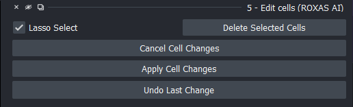

*Figure 6: Using lasso selection in vector mode to batch-remove resin canal cells and preparation artifacts.*

---

### Step 4: Tree-Ring Editing & Boundary Curation

Expand **6 - Edit rings** in the Manual Editing group.

#### Boundary Curation, Nudging & Wedging Rings
- **Fine & Fast Nudging**: Select one or more ring boundaries and press <kbd>Ctrl</kbd> + Arrow keys (1 px shift) or <kbd>Ctrl</kbd> + <kbd>Shift</kbd> + Arrow keys (10 px shift) to align boundaries perfectly along the terminal latewood tracheid row.
- **Adding Missing Rings**: Draw a path across the wood cross-section using napari's path tool; ROXAS AI automatically completes the line horizontally to both image margins ($x=0$ to $x=\text{width}$) upon applying changes.
- **Handling Wedging / Incomplete Rings**:
    1. Select and **copy-paste** the existing boundary that shares the common portion of the ring boundary.
    2. Enable **Lasso Select** and draw a lasso loop around the diverging section of the duplicated (topmost) ring.
    3. Press <kbd>Delete</kbd> or <kbd>Backspace</kbd>. ROXAS AI's top-priority lasso logic deletes vertices **strictly from the topmost ring**, keeping the underlying shared boundary completely intact.
    4. Use the path tool to extend and accurately trace the wedging branch.
- **Re-running AI Ring Segmentation Below Corrected Ring**: Select a verified ring boundary and trigger a model re-run to re-segment all rings below that year without disturbing validated boundaries above.
- **Updating Outermost Calendar Year**: Adjust the outermost year in the widget and click **Update Year** (supports calendar years from `-100,000` to `9,999`).
- **Undo (<kbd>Ctrl</kbd> + <kbd>Z</kbd>)**: Reverts any drawing, nudging, affine transformation, or deletion (up to 50 undo steps).

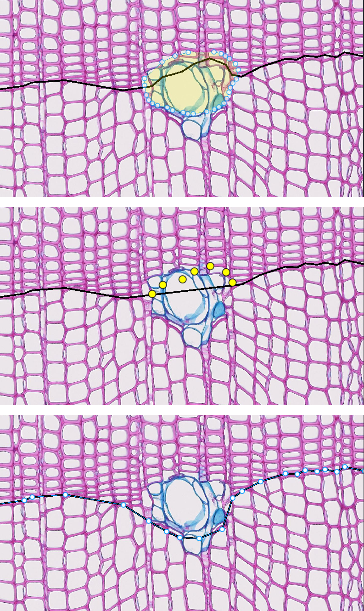

*Figure 7: Curating tree-ring boundary polylines in the napari canvas, including vertex dragging, boundary nudging, and wedging ring tracing.*

---

### Step 5: Visual Cross-Dating & Ring Synchronization

Open **Plugins > ROXAS AI > 7 - Visual crossdating** to verify ring counts and calendar year assignments against master chronologies.

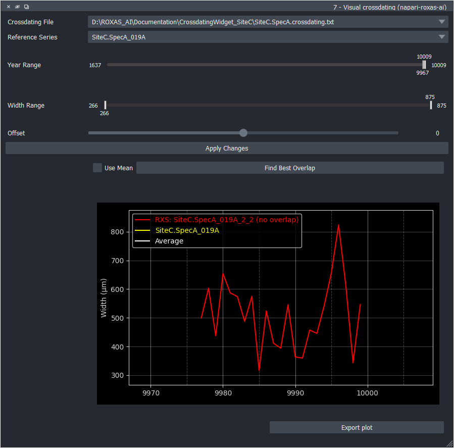

*Figure 8: Visual cross-dating plotter showing sample ring widths synchronized against reference series.*

1. **Automatic File Discovery & Upward Traversal**:
    - The plotter searches strictly upwards from the sample folder through parent project directories to auto-discover all available `.crossdating.txt` files.
2. **Reference Series Selection**:
    - Select reference series from the dropdown (or use the site composite curve with **Use Mean**). ROXAS AI automatically prioritizes series names matching the sample stem.
3. **Inspect Standard View ($\pm 10$ Years)**:
    - The plotter opens centered on the sample series with an overview buffer of $\pm 10$ years on each side.
4. **Expand Year Range & Offset Slider**:
    - To explore candidate shifts larger than $\pm 10$ years, widen the **Year Range** slider; this automatically expands the bounds of the **Offset** slider, allowing you to slide the sample across larger time spans.
5. **Auto-Offset Alignment**:
    - Click **Find Best Overlap** to let ROXAS AI compute candidate alignments ranked by statistical correlation ($r$), Gleichläufigkeit (GLK), and $t$-value. Interactive candidate alignment buttons allow instantaneous toggling between suggested shifts.
6. **Confirm Dating & Export Plot**:
    - Click **Apply Changes** to update the sample's outermost complete year metadata, shift ring years across `.rings` and `.rings_table.csv`, and regenerate `<sample>_annotated.jpg`.
    - Click **Export Plot** to save a publication-ready `<sample>_ReferenceSeries.jpg` image (rendered with a standardized 70 px/year aspect ratio) in the sample directory.

---

### Step 6: Saving Verified Annotations

Click **Save All Layers** inside the active editor or open **8 - Save cells & rings editing**.

- **Modified-Layer Tracking**: Checks which layers have pending changes (`layer.metadata["is_modified"] = True`) and saves only modified files to disk:
    - `.cells.png` (8-bit or 16-bit label mask).
    - `.rings.tif` (16-bit TIFF label mask).
    - `.metadata.json` (synchronized metadata record with updated ring counts, outermost year, and timestamps).
- **Explicit Save Status Notifications**: Displays clear feedback: `"Saved cells layer."`, `"Saved rings layer."`, `"Saved cells and rings layers."`, or `"No unsaved changes in cells or rings layers."`.
- **Fast Decoupled Saving**: Manual layer saving does **not** redraw the annotated overview image, ensuring saves complete in milliseconds without disk or CPU overhead. The overview image is automatically re-rendered at key workflow checkpoints (AI segmentation, Year updates, Cross-dating application, and Trait measurement).

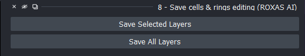

*Figure 9: Saving finalized annotation layers to disk.*

---

### Step 7: Anatomical Traits Extraction & Chronology Export

1. In the Manual Editing group, scroll to **9A - Measure cells & rings (individual image)**.
2. Check **Measure Cells** and/or **Measure Rings**.
3. *(Optional)* Click **Check Settings** to review or customize measurement parameters and quality control thresholds.
4. Click **Measure**.
5. The measurement engine computes anatomical traits via CWT and wall profiling, cleans non-measured edge artefacts, attaches measurements to layer properties for interactive table inspection, and outputs comprehensive semicolon-delimited CSV tables and quality assurance datasets:
    - **[`<sample>.cells_table.csv`](../reference/technical_reference.md#cell-level-output-cells_tablecsv)**: Individual cell metrics (`CID`, `YEAR`, `LA`, `CWTRAD`, `CWTTAN`, `CWTALL`, `RTSR`, `KH`, `DH`).
    - **[`<sample>.rings_table.csv`](../reference/technical_reference.md#ring-level-output-rings_tablecsv)**: Ring summary metrics (`YEAR`, `MRW`, `CNO`, `MLA`, `CD`, `CWTALL`, `RWD`, `RCTA`).
    - **[`<sample>.cwt.json`](../reference/technical_reference.md#data-metadata-files)**: Exported CWT quality assurance dataset containing circle coordinates, wall thickness values, inclusion/exclusion flags, and exclusion reasons.
    - **`[<sample>] CWT Circles` Shapes Layer**: Interactive viewer layer with hover tooltips displaying Cell ID, sector, thickness ($\mu\text{m}$), status, and exclusion reason for visual QA inspection.
    - **`<sample>_annotated.jpg`**: Automatically regenerated and saved with synchronized ring boundaries, calendar years, and cell lumen highlights matching the final measurements.
    - **`<sample>_ReferenceSeries.jpg`**: Saved in the sample directory when cross-dating was performed and applied.

=== "A: Measurement Controls"
    

=== "B: In-Viewer CWT QA Layer"
    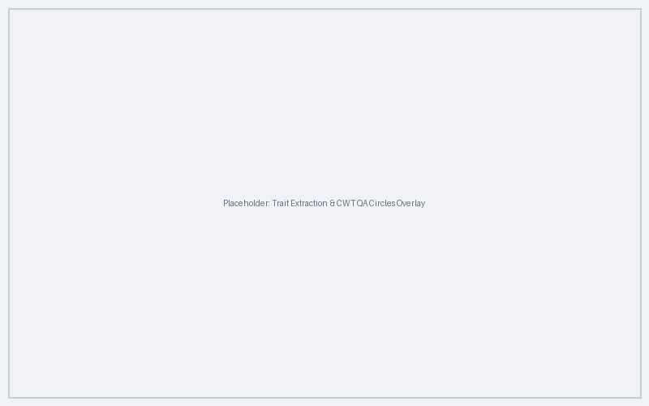

*Figure 10: Single sample trait extraction and quality assurance: (A) Measurement control panel and (B) In-viewer CWT circles overlay with hover tooltips alongside extracted feature tables.*

---

## 3. Production Workflow: Batch Processing Multi-Sample Studies

When analyzing dozens or hundreds of wood sections, ROXAS AI provides an automated batch processing pipeline to maximize throughput while guaranteeing complete file synchronization across all sample folders.

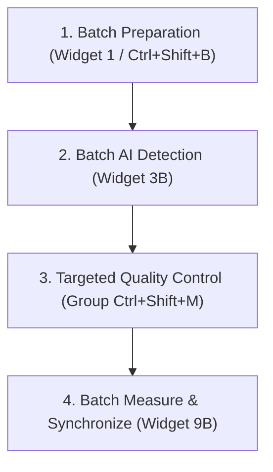

---

### Step 1: Batch Preparation & Standardization

1. Organize raw cross-section scans into your project folder.
2. Launch `napari-roxas` and press <kbd>Ctrl</kbd> + <kbd>Shift</kbd> + <kbd>B</kbd> to open the **Batch Operations Group**.
3. In **1 - Prepare project images for analysis**:
    - Select your project directory (or use **0 - Define project directory**).
    - Batch-assign physical spatial resolution ($\text{px}/\mu\text{m}$), sample type, and geometry across all matching images.
    - Import reference cross-dating chronologies if available.
4. Click **Prepare Images** to standardize filenames (`<sample>.scan.<ext>`) and initialize `<sample>.metadata.json` across the entire dataset.

---

### Step 2: Batch Cell & Ring Segmentation

1. In the same batch container, scroll to **3B - Batch detect cells & rings**.
2. **Real-Time Dynamic Sync**: The widget automatically listens to the project directory so all newly prepared samples appear immediately in the file list.
3. Select your deep-learning models (`linear_cells_model` and `LinearRingModel_v3_iterative.pt`).
4. Click **Run Batch Segmentation**.
5. The multi-threaded background queue processes each sample sequentially, creating `<sample>.cells.png` and `<sample>.rings.tif` masks without loading full-resolution images into memory.

---

### Step 3: Targeted Quality Control

1. Press <kbd>Ctrl</kbd> + <kbd>Shift</kbd> + <kbd>M</kbd> to switch to the **Manual Editing Group**.
2. In **2/4 - Load image(s)**, iterate through samples to inspect automated predictions.
3. Perform targeted curation as needed:
    - **5 - Edit cells**: Use Vector Lasso Select (<kbd>Delete</kbd>) to batch-remove resin canal cells or preparation defects.
    - **6 - Edit rings**: Nudge boundaries (<kbd>Ctrl</kbd>+Arrows), add missing rings, or curate wedging rings.
    - **7 - Visual cross-dating**: Verify ring counts and synchronize calendar dating against master chronologies.
4. Click **Save All Layers** (or use **8 - Save cells & rings editing**) to persist curated layers.

---

### Step 4: Automated Batch Measurement & File Synchronization

1. Press <kbd>Ctrl</kbd> + <kbd>Shift</kbd> + <kbd>B</kbd> to return to the **Batch Operations Group**.
2. In **9B - Batch measure & update**:
    - Check **Measure Cells** and **Measure Rings**.
    - **Linked Operations Locking**: Notice that **Update Annotated image** and **Update Crossdating Reference Files** are **automatically locked ON** whenever measurements are active. This guarantees that all numerical CSV tables, CWT JSON files (`.cwt.json`), annotated overview images (`_annotated.jpg`), and reference cross-dating plots (`_ReferenceSeries.jpg`) remain 100% consistent and synchronized across every sample folder in the project.
    - **Reference Plot Auto-Generation**: ROXAS AI automatically searches upwards through the directory tree for cross-dating files and matches sample stems to reference chronologies (or uses the validated `reference_series` in metadata).
3. Click **Measure & Update**.
4. The batch engine executes across all samples, writing `.cells_table.csv`, `.rings_table.csv`, `.cwt.json`, `_annotated.jpg`, and `_ReferenceSeries.jpg` directly to each sample folder.

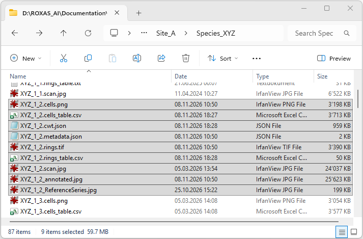

*Figure 11: Standardized sample folder file hierarchy generated after batch processing (`.cells.png`, `.rings.tif`, `.cells_table.csv`, `.rings_table.csv`, `.cwt.json`, `_annotated.jpg`, and `_ReferenceSeries.jpg`).*
