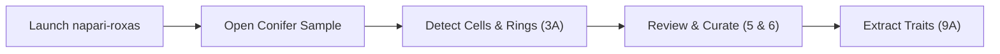
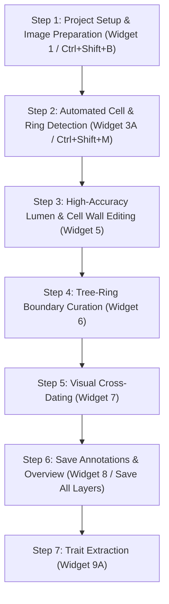
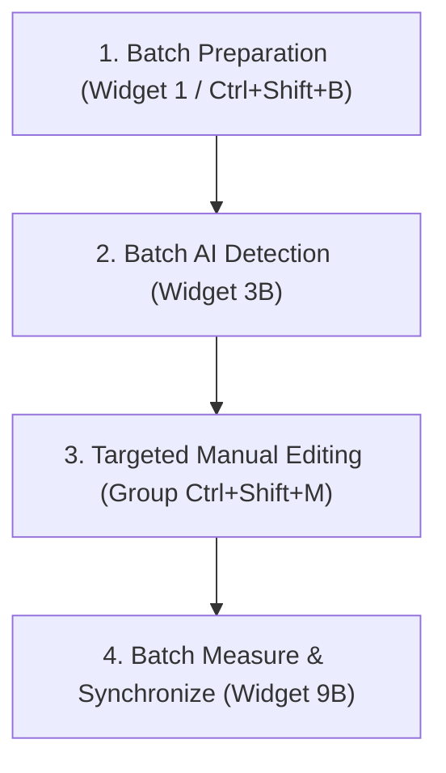

# Tutorials & Workflows

Step-by-step guides for quantitative wood anatomy (QWA) and dendrochronological analysis using ROXAS AI in napari.

---

## 1. Quickstart: 5-Minute Single Sample Walkthrough

This fast-track walkthrough guides you from raw image to measured anatomical traits using the bundled conifer sample and the **Manual Editing** workflow group.



### Step 1: Launch ROXAS AI & Open Built-in Sample Data
1. Open your terminal / conda prompt with the `roxas-ai` environment active and start the application:
   ```bash
   napari-roxas
   ```
   *This opens napari with navigation shortcuts active and the **Manual Editing Group** docked in the right sidebar.*
2. Navigate to the top menu: **File > Open Sample > ROXAS AI > Conifer Sample Data**.
3. ROXAS AI loads the conifer cross-section scan along with pre-configured spatial metadata ($\mu\text{m}/\text{px}$).


*Figure 1: Conifer sample dataset loaded into the napari viewer.*

### Step 2: Run Deep Learning Detection
1. In the docked sidebar, locate **3A - Detect cells & rings (individual image)**.
2. Select the segmentation models:
    - **Cells Model**: `linear_cells_model`
    - **Rings Model**: `LinearRingModel_v3_iterative.pt`
3. Click **Run Segmentation**. Deep-learning inference generates two new layers: `.cells` (cell lumen labels) and `.rings` (ring boundary labels).


*Figure 2: Automated cell lumen and tree-ring boundary segmentation overlay.*

### Step 3: Quick Visual Verification & Curation
1. Navigate across the sample using single-key shortcuts:
    - **Pan**: <kbd>W</kbd>, <kbd>A</kbd>, <kbd>S</kbd>, <kbd>D</kbd> or Arrow keys (or hold <kbd>Shift</kbd> for fast panning).
    - **Zoom**: <kbd>Q</kbd> to zoom out, <kbd>E</kbd> to zoom in.
2. Expand **5 - Edit cells** or **6 - Edit rings** in the sidebar to make quick adjustments:
    - In **Cell Editing (Raster Mode)**: Hold <kbd>Ctrl</kbd> + **Mouse Wheel** to dynamically resize the brush; hold <kbd>Ctrl</kbd> + **Double-Click** to toggle between brush and eraser. Press <kbd>Ctrl</kbd>+<kbd>Z</kbd> to undo any mistake.
    - In **Ring Editing**: Select a boundary and press <kbd>Ctrl</kbd> + Arrow keys to nudge it by 1 pixel (or <kbd>Ctrl</kbd> + <kbd>Shift</kbd> + Arrow keys for 10 pixels). Press <kbd>Ctrl</kbd>+<kbd>Z</kbd> to undo.

### Step 4: Extract Cell & Ring Measurements
1. In the sidebar, scroll to **9A - Measure cells & rings (individual image)**.
2. *(Optional)* Click **Check Settings** to review measurement parameters in the floating settings window.
3. Click **Measure**.
4. Measurement output tables (`.cells_table.csv` and `.rings_table.csv`) and an updated overview image (`_annotated.jpg`) are generated in the project folder with comprehensive anatomical metrics (lumen area, cell wall thickness, Mork's index, ring widths).


*Figure 3: Measurement completion with generated tabular files.*

---

## 2. Standard Workflow: Tree-Ring & Cell Anatomy Time Series

This comprehensive protocol describes the standard workflow for generating publication-quality dendroclimatic and wood anatomical time series from raw microsections or surface scans.



---

### Step 1: Project Setup & Image Preparation

1. Launch napari via `napari-roxas`.
2. Press <kbd>Ctrl</kbd> + <kbd>Shift</kbd> + <kbd>B</kbd> to open the **Batch Operations Group**.
3. In **1 - Prepare project images for analysis**:
    - Select your project directory (or use **0 - Define project directory**).
    - Enter physical resolution ($\mu\text{m}/\text{px}$), anatomy type (`conifer`), geometry (`linear`), and the outermost complete calendar year.
    - *(Optional)* Click **Start Processing Crossdating Files** to import reference ring-width chronologies (`.rwl`, `.tuc`, or tabular `.txt`/`.csv`). Series names of up to 8 characters are parsed automatically.
4. Click **Prepare Images**. The images are standardized to `<sample>.scan.<ext>` and initialized with `<sample>.metadata.json`.


*Figure 4: Setting spatial resolution and calendar dating parameters in the image preparation dialog.*

---

### Step 2: Loading & Automated Segmentation

1. Press <kbd>Ctrl</kbd> + <kbd>Shift</kbd> + <kbd>M</kbd> to open the **Manual Editing Group**.
2. In **2/4 - Load image(s)**, select your prepared sample from the dropdown.
3. In **3A - Detect cells & rings (individual image)**, select the neural network models and click **Run Segmentation**.
4. Both cell lumen masks and ring boundary contours will populate as interactive napari layers.


*Figure 5: Automated cell and ring predictions visualized in napari.*

---

### Step 3: High-Accuracy Lumen & Cell Wall Editing

Refine cell lumen annotations using **5 - Edit cells** in the Manual Editing group.


*Figure 6: Cell layer editor displaying raster brush/eraser controls and vector polygon conversion.*

#### Raster vs. Vector Editing Modes

| Mode | Best Used For | Tooling & Mechanics | Shortcuts |
| :--- | :--- | :--- | :--- |
| **Raster Mode** | Rapid mask cleaning, separating merged cells, filling voids | Pixel brush, eraser, paint bucket directly on label mask. | <kbd>Ctrl</kbd> + Wheel (Brush size: 1–100 px), <kbd>Ctrl</kbd> + Double-Click (Switch brush/eraser), <kbd>Ctrl</kbd>+<kbd>Z</kbd> (Undo). |
| **Vector Mode** | High-precision boundary adjustments, polygon vertex editing, batch lasso deletion | Polygon contour representation with vertex manipulation and Lasso Delete. | <kbd>Delete</kbd> / <kbd>Backspace</kbd> (Delete lasso selection), <kbd>Ctrl</kbd>+<kbd>Z</kbd> (Undo up to 50 operations). |

#### Editing Techniques
1. **Separating Merged Lumens**:
    - In Raster mode, hold <kbd>Ctrl</kbd> and double-click to switch to the eraser, hold <kbd>Ctrl</kbd> + mouse wheel to size the brush to 5–10 px, and draw a dividing cut through the shared wall.
2. **Removing False Detections & Clearing Resin Canals**:
    - In Vector mode, check **Lasso Select** and encircle unwanted objects (multiple loops union automatically). Press <kbd>Delete</kbd> or <kbd>Backspace</kbd> to delete all enclosed cells simultaneously.
3. **Restoring Overlooked Tracheids**:
    - In Raster mode, hold <kbd>Ctrl</kbd> and double-click to switch to the paint brush and fill faint or damaged cell walls.


*Figure 7: Using lasso selection to batch-remove resin canal cells and preparation artifacts.*

---

### Step 4: Tree-Ring Editing & Boundary Curation

Open **6 - Edit rings** in the Manual Editing group.


*Figure 8: Ring layer editor interface with polyline modification tools.*

#### Boundary Curation, Nudging & Wedging Rings
- **Fine Nudging**: Select one or more ring boundaries and press <kbd>Ctrl</kbd> + Arrow keys (1 px shift) or <kbd>Ctrl</kbd> + <kbd>Shift</kbd> + Arrow keys (10 px shift) to align boundaries perfectly along the terminal latewood tracheid row.
- **Adding Missing Rings**: Draw a path across the wood cross-section using napari's path tool; ROXAS AI automatically completes the line horizontally to both image margins ($x=0$ to $x=\text{width}$) upon applying changes.
- **Handling Wedging / Incomplete Rings**:
    1. Select and **copy-paste** the existing boundary that shares the common portion of the ring boundary.
    2. Enable **Lasso Select** and draw a lasso loop around the diverging section of the duplicated (topmost) ring.
    3. Press <kbd>Delete</kbd> or <kbd>Backspace</kbd>. ROXAS AI's top-priority lasso logic deletes vertices **strictly from the topmost ring**, keeping the underlying shared boundary completely intact.
    4. Use the path tool to extend and accurately trace the wedging branch.
- **Undo (<kbd>Ctrl</kbd> + <kbd>Z</kbd>)**: Reverts any drawing, nudging, affine transformation, or deletion (up to 50 undo steps).

---

### Step 5: Visual Cross-Dating & Ring Synchronization

Open **Plugins > ROXAS AI > 7 - Visual cross-dating** to verify ring counts and calendar year assignments against master chronologies.


*Figure 9: Visual cross-dating plotter showing sample ring widths synchronized against reference series.*

1. **Inspect Standard View ($\pm 10$ Years)**:
    - The plotter opens centered on the sample series with an overview buffer of $\pm 10$ years on each side.
2. **Expand Year Range & Offset Slider**:
    - To explore candidate shifts larger than $\pm 10$ years, widen the **Year Range** slider; this automatically expands the bounds of the **Offset** slider, allowing you to slide the sample across larger time spans.
3. **Auto-Offset Alignment**:
    - Click **Find Best Overlap** to let ROXAS AI compute the best statistical correlation ($r$) and Gleichläufigkeit (GLK) alignment.
4. **Confirm Dating**:
    - Click **Apply Changes** to update the sample's outermost complete year metadata and shift ring years across the dataset.

---

### Step 6: Saving Verified Annotations

Click **Save All Layers** inside the active editor or open **8 - Save cells & rings editing**.

- Saves `.cells.png` (cell label mask).
- Saves `.rings.tif` (ring label mask).
- Saves `<sample>_annotated.jpg` (high-resolution scan overlaid with ring boundaries, calendar years, and cell lumen highlights).
- Saves `<sample>.metadata.json` (synchronized metadata record with updated ring counts, outermost year, and timestamps).


*Figure 10: Saving finalized annotation layers to disk.*

---

### Step 7: Anatomical Traits Extraction & Chronology Export

1. In the Manual Editing group, scroll to **9A - Measure cells & rings (individual image)**.
2. Click **Check Settings** to review or customize CWT thresholds or smoothing parameters.
3. Click **Measure**.
4. The measurement engine outputs comprehensive semicolon-delimited CSV tables:
    - **[`<sample>.cells_table.csv`](../reference/technical_reference.md#cell-level-output-cells_tablecsv)**: Individual cell metrics (`CID`, `YEAR`, `LA`, `CWTRAD`, `CWTTAN`, `CWTALL`, `RTSR`).
    - **[`<sample>.rings_table.csv`](../reference/technical_reference.md#ring-level-output-rings_tablecsv)**: Ring summary metrics (`YEAR`, `MRW`, `CNO`, `MLA`, `CD`, `CWTALL`).
    - **`<sample>_annotated.jpg`**: Automatically refreshed overview image matching the final measurements.


*Figure 11: Measurement summary and exported tabular time series.*

---

## 3. Production Workflow: Batch Processing Multi-Sample Studies

When analyzing dozens or hundreds of wood sections, ROXAS AI provides an automated batch processing pipeline to maximize efficiency and maintain file synchronization.



### Step 1: Batch Preparation & Standardization
1. Organize raw scans into your project folder.
2. Launch `napari-roxas` and press <kbd>Ctrl</kbd> + <kbd>Shift</kbd> + <kbd>B</kbd> for the **Batch Operations Group**.
3. In **1 - Prepare project images for analysis**, batch-assign spatial resolution and metadata across all matching images.

### Step 2: Batch Cell & Ring Segmentation
1. In the same batch container, scroll to **3B - Batch detect cells & rings**.
2. Select your project directory (or handpick files with **Manually select files to process**).
3. Select models and click **Run Batch Segmentation**. The queue processes all samples in the background, creating `.cells.png` and `.rings.tif` masks.

### Step 3: Targeted Quality Control
1. Press <kbd>Ctrl</kbd> + <kbd>Shift</kbd> + <kbd>M</kbd> to switch to the **Manual Editing Group**.
2. Use **2/4 - Load image(s)** to iterate through samples and perform targeted curation in **5 - Edit cells**, **6 - Edit rings**, and **7 - Visual cross-dating**.

### Step 4: Automated Batch Measurement & File Synchronization
1. Press <kbd>Ctrl</kbd> + <kbd>Shift</kbd> + <kbd>B</kbd> to return to the **Batch Operations Group**.
2. In **9B - Batch measure & update**:
    - Check **Measure Cells** and **Measure Rings**.
    - Notice that **Update Annotated image** and **Update Crossdating Reference Files** are **automatically locked ON** to ensure that all numerical tables, annotated overview images (`_annotated.jpg`), and reference plots (`_ReferenceSeries.jpg`) remain 100% consistent and synchronized across all sample folders.
3. Click **Measure & Update**.


*Figure 12: Batch measurement extraction and synchronized output generation across multiple sample folders.*
