# User Guide: Widgets & Tools

**ROXAS AI** provides a modular suite of widgets within the napari environment designed to take your wood cross-section images through the entire Quantitative Wood Anatomy (QWA) pipeline—from raw anatomical image to deep-learning segmentation, interactive manual curation, visual cross-dating, and measurement of anatomical traits.

Widgets are accessible via the napari **Plugins > ROXAS AI** menu and are numbered according to their typical execution sequence.

---

## ROXAS AI Launcher & Startup

ROXAS AI provides a dedicated command-line entry point to launch napari pre-configured for wood anatomy workflows:

```bash
napari-roxas
```

### What `napari-roxas` Does:
1. **Installs Shortcuts Immediately**: Registers global viewport navigation (<kbd>WASD</kbd>, <kbd>Q</kbd>/<kbd>E</kbd>) and widget group shortcuts (<kbd>Ctrl</kbd>+<kbd>Shift</kbd>+<kbd>M</kbd>/<kbd>B</kbd>/<kbd>W</kbd>) right from the start.
2. **Docks the Manual Editing Group**: Automatically opens the **Manual Editing** workflow container in the right sidebar, ready for immediate sample loading and inspection.

!!! info "Launching via standard `napari`"
    You can also launch the application using standard `napari`. In this case, plugin shortcuts and duplicate prevention hooks activate automatically the moment any ROXAS AI widget or menu command is opened for the first time in that session.

---

## Workflow Widget Groups & Dock Management

To eliminate sidebar clutter and streamline multi-step curation, ROXAS AI organizes individual tools into unified, scrollable **Workflow Widget Groups**:

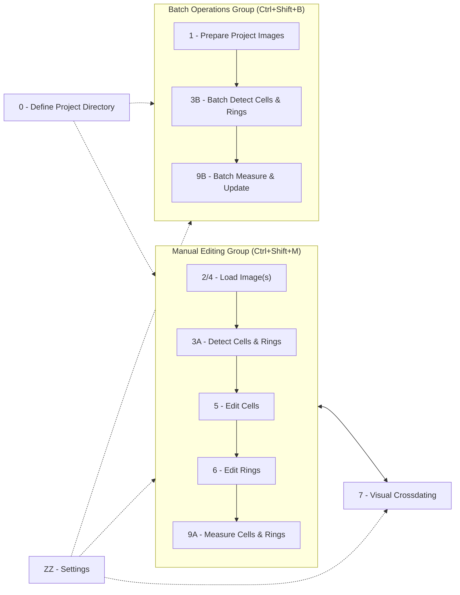

### 1. Manual Editing Group (`Ctrl+Shift+M`)
Designed for interactive sample-by-sample analysis. It docks a single, scrollable container containing:
- **`2/4 - Load image(s)`**
- **`3A - Detect cells & rings (individual image)`**
- **`5 - Edit cells`**
- **`6 - Edit rings`**
- **`9A - Measure cells & rings (individual image)`**

### 2. Batch Operations Group (`Ctrl+Shift+B`)
Designed for high-throughput batch processing across entire project directories without loading individual images into the viewer. It docks:
- **`1 - Prepare project images for analysis`**
- **`3B - Batch detect cells & rings`**
- **`9B - Batch measure & update`**

### 3. Global Dock Management & Duplicate Prevention
- **Close All Docks (<kbd>Ctrl</kbd> + <kbd>Shift</kbd> + <kbd>W</kbd>)**: Instantly closes all open dock widgets in the napari viewer.
- **Duplicate Prevention**: If you attempt to open an individual widget that is already loaded (either standalone or inside an active group), ROXAS AI displays a notification (`'<Widget Name>' is already active in the sidebar.`) and prevents duplicate dock instances.

For a complete reference of all available keyboard and mouse shortcuts, see the dedicated [Shortcuts Reference](../reference/shortcuts.md).

---

## Overview of Widgets & Tools

| Widget Number & Name | Primary Purpose | Dedicated Shortcut (Scope) | Input | Output |
| :--- | :--- | :--- | :--- | :--- |
| **0 - Define project directory** | Set or change the active project working directory | — | Folder path | Global project path in `settings.json` |
| **1 - Prepare project images for analysis** | Standardize filenames, assign physical resolution, parse cross-dating files | Part of Batch Group (<kbd>Ctrl</kbd>+<kbd>Shift</kbd>+<kbd>B</kbd>) | Raw image files & reference series | `<sample>.scan.<ext>`, `.metadata.json`, `rings_series.crossdating.txt` |
| **2/4 - Load image(s)** | Load sample scans and associated cells/rings label layers | Part of Manual Group (<kbd>Ctrl</kbd>+<kbd>Shift</kbd>+<kbd>M</kbd>) | Prepared sample files | Image & Labels layers in viewer |
| **3A - Detect cells & rings (individual image)** | Run deep-learning segmentation on the currently active scan | Part of Manual Group (<kbd>Ctrl</kbd>+<kbd>Shift</kbd>+<kbd>M</kbd>) | Active scan image | `.cells` and `.rings` Labels layers |
| **3B - Batch detect cells & rings** | Run deep-learning segmentation across multiple samples in batch mode | Part of Batch Group (<kbd>Ctrl</kbd>+<kbd>Shift</kbd>+<kbd>B</kbd>) | Project directory / selected files | `.cells.png`, `.rings.tif`, `.metadata.json` |
| **5 - Edit cells** | Interactive curation of cell lumens (raster brush/eraser, vector polygons, lasso) | <kbd>Ctrl</kbd>+Wheel (Brush size), <kbd>Ctrl</kbd>+DblClick (Switch tool), <kbd>Ctrl</kbd>+<kbd>Z</kbd> (Undo) *(Scope: `5 - Edit cells`)* | `.cells` layer | Refined `.cells` layer |
| **6 - Edit rings** | Interactive curation of tree-ring boundaries, nudging, wedging rings, re-runs | <kbd>Ctrl</kbd>+Arrows (1 px Nudge), <kbd>Ctrl</kbd>+<kbd>Shift</kbd>+Arrows (10 px Nudge), <kbd>Ctrl</kbd>+<kbd>Z</kbd> (Undo) *(Scope: `6 - Edit rings`)* | `.rings` layer | Refined `.rings` layer & ring years |
| **7 - Visual cross-dating** | Synchronize sample ring-width series against master reference chronologies | — | `.rings` layer & crossdating file | Synchronized ring years & reference plots |
| **8 - Save cells & rings editing** | Persist manual edits, masks, annotated scan images, and metadata to disk | — | Active ROXAS AI layers | `.cells.png`, `.rings.tif`, `_annotated.jpg`, `.metadata.json` |
| **9A - Measure cells & rings (individual image)** | Extract anatomical and tree-ring traits for active sample; update annotated image | Check Settings button *(Scope: `9A - Measure cells & rings`)* | `.cells` & `.rings` layers | `.cells_table.csv`, `.rings_table.csv`, `_annotated.jpg` |
| **9B - Batch measure & update** | Batch measurement extraction, annotated image generation, and reference plot updates | Part of Batch Group (<kbd>Ctrl</kbd>+<kbd>Shift</kbd>+<kbd>B</kbd>) | Project directory / selected files | Synchronized measurement tables, annotated images, and reference plots |
| **ZZ - Settings** | Preferences for hardware acceleration, visualization, tolerances, and measurements | Floating dialog via widgets or menu | User configuration | `settings.json` file |

---

## 0 - Define Project Directory

The **Define Project Directory** widget configures the root folder where your sample images, metadata, and analysis tables reside.

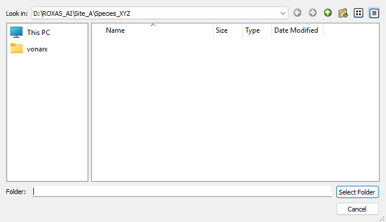

*Figure 1: Project directory selection dialog.*

### How It Works
When triggered from the menu or from any widget directory button, it opens a system folder browser. Selecting a folder updates the `project_directory` entry in `settings.json`. All subsequent loading, saving, and batch processing widgets default to this directory. Note that the exact same directory selection functionality is also triggered whenever selecting the project directory directly from within widgets [1 - Prepare Project Images](#1-prepare-project-images-for-analysis), [2/4 - Load Image(s)](#24-load-images), [3B - Batch Detect Cells & Rings](#3b-batch-detect-cells-rings), and [9B - Batch Measure & Update](#9b-batch-measure-update).

### Inaccessible Directory Fallback
On multi-user systems, shared network drives, or when folders are moved or deleted, a previously saved directory path may become invalid or restricted:

- During startup and settings loading, ROXAS AI automatically validates read and execution permissions on the configured `project_directory`.
- If the directory cannot be accessed (e.g., `PermissionError` or non-existent path), ROXAS AI safely catches the error, notifies the user with a warning notification, and resets `project_directory` to `"Not set"` (`None`) rather than causing application crashes.

### Key Controls
- **Select Project Directory**: Prompts the user to pick a folder. Upon confirmation, a notification displays the chosen path.

---

## 1 - Prepare Project Images for Analysis

The **Prepare Project Images** widget standardizes anatomical images and external cross-dating files into the structured file naming conventions and data structures required by ROXAS AI.


*Figure 2: Sample preparation widget interface.*

### How It Works
1. Scans the selected project directory (and subdirectories) for supported image formats (`.jpg`, `.jpeg`, `.png`, `.tif`, `.tiff`, `.bmp`, `.jp2`).
2. Opens an interactive **Metadata Dialog** for each sample to capture physical dimensions, spatial resolution ($\mu\text{m}/\text{px}$), sample type (e.g., `conifer`), measurement geometry (`linear`), and the outermost complete calendar year.
3. Automatically standardizes filenames to `<sample_name>.scan.<ext>` and creates a synchronized `<sample_name>.metadata.json`.
4. Discovers and merges external cross-dating series (e.g., Tucson `.rwl`, `.tuc`, or tabular `.txt`/`.csv` files) into a unified reference file (`rings_series.crossdating.txt`, configured as `[".crossdating", ".txt"]` in `settings.json`) scaled to micrometers ($\mu\text{m}$).


*Figure 3: Interactive metadata prompt dialog during image preparation.*

### Cross-Dating Text Files Processing

The **Start Processing Crossdating Files** action allows you to import and compile one or more external tree-ring width (TRW) measurement files or master reference chronologies into a single synchronized project cross-dating file.


*Figure 4: Dialog for selecting cross-dating files and setting unit scaling.*

#### Supported Input File Formats
The cross-dating parser automatically recognizes and parses several standard dendrochronological and tabular formats:

- **Tabular Files (`.csv`, `.tsv`, `.txt`)**:
    - **Delimiters**: Auto-detected among tab (`\t`), comma (`,`), or semicolon (`;`).
    - **Structure**: Column-oriented or matrix tables where the first column or index contains the calendar year (`YEAR`), and additional columns contain tree-ring width series for individual trees, radii, or site chronologies.
    - **Header handling**: Automatically detects whether headers with series names exist or if the file contains pure numeric columns.

    *Example Tabular Input (`sample_series.txt` or `sample_series.csv`, values in $1/100\,\text{mm}$):*

    | YEAR | Series01 | Series02 |
    | :--- | :--- | :--- |
    | 2018 | 142 | 165 |
    | 2019 | 118 | 130 |
    | 2020 | 155 | 148 |
    | 2021 |  98 | 112 |
    | 2022 | 125 | 135 |

- **Tucson / Decadal Files (`.rwl`, `.tuc`)**:
    - **Raw Tucson Decadal Format**: Standard space-delimited format used by dendrochronology software (e.g., COFECHA, ARSTAN, TSAP-Win). Each line contains `series_id`, `start_year`, and up to 10 ring-width values followed by end-of-series sentinel markers (`-9999`, `-999`, `9999`, or `999`).
    - **8-Character Series Names**: Series names of up to 8 characters are fully supported without collapsing into the `YEAR` column. The parsing algorithm detects when long series IDs abut the decade column and splits them smartly.
    - **Tab-Delimited ("Doctored") Tucson Format**: Tucson decadal files where fields are separated by tab characters. The parser identifies sentinel stop values and pivots the decadal entries into continuous annual time series.

    > **ATTENTION**: Tucson/decadal files must be saved with the `.rwl` or `.tuc` extension. If an RWL file is saved or renamed with a `.txt` extension, it will not be processed correctly because the parser will attempt to read it as a standard tabular file rather than a decadal file.

    *Example Tucson Input (`site_chronology.rwl`, values in $1/100\,\text{mm}$):*

    ```text
    Series01 2010   110  125  130  142  118  155   98  125  140  150
    Series01 2020   160  135  120 -9999
    ```

#### Unit Scaling Conversion
Because tree-ring measurement devices export widths in varying units, the selection dialog allows specifying the unit scale of the input files to convert all values into standard **micrometers ($\mu\text{m}$)**:

| Selected Unit Option | Multiplier Applied | Resulting Unit |
| :--- | :--- | :--- |
| **`1 / 1 mm`** | $\times 1000.0$ | $\mu\text{m}$ |
| **`1 / 10 mm`** | $\times 100.0$ | $\mu\text{m}$ |
| **`1 / 100 mm`** *(default)* | $\times 10.0$ | $\mu\text{m}$ |
| **`1 / 1000 mm`** | $\times 1.0$ | $\mu\text{m}$ |
| **`divide values by 10`** | $\times 0.1$ | $\mu\text{m}$ |

#### Output File Structure & Merging Logic
The compiled series is saved in the project directory as `<prefix><crossdating_file_extension>` (by default `rings_series.crossdating.txt`, where `file_extensions.crossdating_file_extension` in `settings.json` is configured as `[".crossdating", ".txt"]`, which concatenates to `.crossdating.txt`):

- **Customizable Output Prefix**: Users can customize the filename prefix in the dialog (defaulting to `rings_series`). This allows naming the cross-dating file after a site, project, or chronology acronym (e.g., `TORN.PISY.crossdating.txt` for a *Pinus sylvestris* chronology from the Torneträsk site).
- **Updating and Merging Existing Files with Unit Scaling Logic**: You can select multiple raw files alongside existing `.crossdating.txt` files to merge them into a single reference file or update an existing project cross-dating file.
    - **Scaling suppression for existing `.crossdating.txt` files**: Any selected file that is already a cross-dating output file (e.g., `*.crossdating.txt` or containing `crossdating` in its filename) is recognized as already converted to micrometers ($\mu\text{m}$). The chosen unit scaling multiplier is automatically **suppressed** (multiplier $= 1.0$) for these files.
    - **Selective scaling for raw inputs**: The selected unit scaling multiplier is applied **only to newly added raw measurement files** (`.rwl`, `.tuc`, standard `.txt`).
    - **Priority handling**: When merging, data from newly added raw files takes priority over older values in case of duplicate series and year combinations. This allows updating existing chronologies with new measurements while preserving previously imported data.
- **Format & Delimiter**: Tab-delimited plain text file (`\t` separator).
- **Index (`YEAR`)**: The first column is named `YEAR` and contains unique calendar years spanning the complete chronological range across all imported series, sorted in ascending order.
- **Series Columns**: Each imported file/series forms its own named column header (derived from series IDs or column labels in the source files).
- **Data Alignment & Missing Values**: Ring widths are aligned by year across all series in micrometers ($\mu\text{m}$). Years not covered by a given series are left empty (`NaN`), allowing seamless integration of chronologies with differing time spans.

*Example Output File (`TORN.PISY.crossdating.txt`, tab-delimited, values in $\mu\text{m}$ after applying $\times 10.0$ scaling to raw 1/100 mm files):*

| YEAR | Series01 | Series02 |
| :--- | :--- | :--- |
| **2018** | 1420 | 1650 |
| **2019** | 1180 | 1300 |
| **2020** | 1550 | 1480 |
| **2021** |  980 | 1120 |
| **2022** | 1250 | 1350 |

### Key Controls & Options
- **Project Directory Button**: Displays and allows switching the active project directory (triggering the same global project directory selection dialog).
- **Process already processed files**: When unchecked (default), skips files that already have the `.scan` extension.
- **Manually select files to process**: Expands a multi-selection list allowing selective processing of specific samples instead of the entire directory.
- **Reverse Selection**: Inverts the current file selection in the list.
- **Automatic Filtering of ROXAS Output Files**: The widget automatically ignores and excludes ROXAS AI output layers (`.cells.*`, `.rings.*`), annotated overviews (`_annotated.jpg`), cross-dating plots (`_ReferenceSeries.jpg`), and ROXAS Classic output files (`_annotated_cells.jpg`, `_annotated_twin.jpg`, `_ReferenceSeries.gif`, `_Preview.jpg`, etc.) from the candidate input list.
- **Start Processing Image Files**: Launches the preparation worker thread with a live progress bar.
- **Start Processing Crossdating Files**: Opens the cross-dating file selection, unit conversion, and custom filename prefix dialog to compile or update project reference series.

---

## 2/4 - Load Image(s)

The **Samples Loading Widget** loads prepared sample images (`.scan`), cell labels (`.cells`), and tree-ring labels (`.rings`) into napari with standardized colormaps, scaling, and navigation shortcuts.

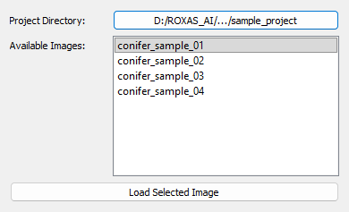

*Figure 5: Samples loading widget interface.*

### How It Works
- Queries the project directory for prepared sample stems.
- **Real-Time Directory Synchronization**: Changes to the project directory are automatically synchronized and updated across all widgets in real-time.
- **Single-Image Workflow Enforcement**: Only one sample image can be loaded in the napari viewer at a time. Attempting to load another image prompts the user to first close the currently active image.
- Reads image layers along with their associated metadata (scale in $\mu\text{m}/\text{px}$, sample stem paths, and ring year metadata) and automatically loads any available associated `.rings` and `.cells` layers.
- Applies high-contrast colormaps (binary colormap for cells and distinct color cycling for rings).

### Key Controls
- **Project Directory Button**: Displays and allows switching the active project directory (triggering the same global project directory selection dialog).
- **Available Images List**: Displays discovered sample scans in the current project directory. **Double-clicking** any sample entry immediately loads that image into the viewer along with its available associated rings and cells layers (identical to selecting the file and clicking **Load Selected Image**).
- **Load Selected Image**: Loads the currently selected sample file (along with available associated rings and cells layers) into the viewer.
- **Progress Bar**: Displays sample loading progress.

---

## 3A - Detect Cells & Rings (Individual Image)

The **Single Sample Segmentation Widget** performs automated deep-learning inference to identify tracheid cell lumens and annual tree-ring boundaries on the currently displayed image.

!!! info "Automatic Background Model Downloads"
    Pre-trained neural network models (`.pth` / `.pt` weights) are downloaded automatically in the background if they are missing. Once downloaded, models are cached locally for all subsequent operations.

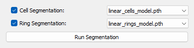

*Figure 6: Single sample AI segmentation interface.*

### How It Works
- Runs neural network models (PyTorch / PyTorch Lightning / SMP architectures) locally on either GPU or CPU. For full architectural details and literature citations, see [Deep-Learning Segmentation Models](../reference/segmentation_models.md).
- **Cells Detection**: Predicts individual cell lumen instances using a U-Net architecture with a ResNet-50 backbone (Katzenmaier et al. 2023) and outputs a labeled mask layer (`<sample>.cells`).
- **Rings Detection**: Detects continuous tree-ring boundaries using an iterative regression formulation based on Katzenmaier et al. (2025), sorts boundaries from bark to pith, enforces boundary continuity across the sample width, and constructs labeled annual ring bands (`<sample>.rings`).
- Post-processes masks to eliminate edge artefacts (e.g., boundary-touching partial cells).

### Key Controls & Options
- **Cell Segmentation Checkbox & Model Dropdown**: Checkbox to enable cell lumen detection, alongside a dropdown list to choose the trained cell model checkpoint (`.pth`). Unchecking disables cell detection and hides the model selection dropdown.
- **Ring Segmentation Checkbox & Model Dropdown**: Checkbox to enable tree-ring boundary detection, alongside a dropdown list to choose the trained ring model checkpoint (`.pth`). Unchecking disables ring detection and hides the model selection dropdown.
- **Run Segmentation Button**: Initiates the segmentation inference process in a non-blocking background worker thread. The button is automatically disabled if both segmentation options are unchecked.

---

## 3B - Batch Detect Cells & Rings

The **Batch Sample Segmentation Widget** executes AI detection across multiple samples in the background without needing to load each image into the viewer.

!!! info "Automatic Background Model Downloads"
    If segmentation model weights are not present locally, they are automatically downloaded in the background when needed and cached for future runs.


*Figure 7: Batch segmentation widget.*

### How It Works
- Iterates over all discovered sample scans in the project directory.
- Applies the selected neural network models sequentially (see [Deep-Learning Segmentation Models](../reference/segmentation_models.md)).
- Automatically saves segmentation masks (`.cells.png` and `.rings.tif`) directly to disk alongside updated `.metadata.json` files.

### Key Controls
- **Project Directory Selection**: Choose the target folder containing prepared samples (triggering the same global project directory selection dialog).
- **File Selection Mode**: Toggle between **Batch Process All Samples** and handpicking subsets (**Manually select files to process**).
- **Reverse Selection**: Inverts current sample selections in the list.
- **Segmentation Targets**: Checkboxes for **Segment Cells** and **Segment Rings**.
- **Model Dropdowns**: Select weights for cell and ring models.
- **Run Segmentation Button**: Launches the batch worker with overall progress tracking.

---

## 5 - Edit Cells

The **Cells Layer Editor Widget** provides interactive manual editing tools to correct, split, merge, add, or erase cell lumen detections.

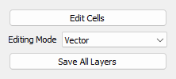

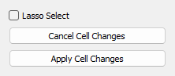

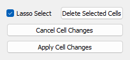

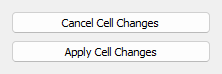

*Figure 8: Cells layer editor widget in its four states (from top to bottom): (A) Startup, (B) Vector editing startup, (C) Vector editing with lasso selection enabled, and (D) Raster editing.*

### How It Works
- Temporarily transfers the active `.cells` layer into an editable working state (`Cells Modification`), temporarily hiding tree-ring layers (`.rings` and `Rings Year`) to minimize visual clutter.
- Supports two distinct editing paradigms:
    - **Edit As Raster**: Uses napari's native brush, paint bucket, and eraser tools directly on the label mask without geometric approximation.
        - **Brush Size Adjustment**: Adjust brush diameter smoothly between 1 and 100 px using <kbd>Ctrl</kbd> + Mouse Wheel (or trackpad scroll). Dimension slider scrolling is suspended during resizing.
        - **Tool Switching**: Quickly toggle between brush and eraser using <kbd>Ctrl</kbd> + Double-Click.
    - **Edit As Vector**: Converts cell outlines into editable polygon shapes for precise vertex editing, shape adjustment, and deletion.
- **Lasso Selection & Union (OR) Behavior**: In Vector editing mode, drawing lasso loops encloses cells. Multiple overlapping lasso polygons combine (union / OR logic) rather than toggling/canceling, allowing seamless regional selection.
- **Undo Mechanism**: Supports a 50-step history stack (<kbd>Ctrl</kbd>+<kbd>Z</kbd> or **Undo Last Change** button) that snapshots polygon coordinates and shape types in Vector mode, and triggers napari's label brush history in Raster mode.
- When applied, rasterizes vectors back to label masks, resets layer feature tables for fresh re-measurement, restores ring layer visibility, and preserves layer metadata.
- **Customizable Tolerances & Colors**: Polygon smoothing tolerances, line widths, and display colors can be customized in [ZZ - Settings](#zz-settings) (see [Technical Reference: Visualization Settings](../reference/technical_reference.md#4-visualization-vectorization-rasterization)).

### Key Controls & Options
- **Editing Mode**: Switch between `Vector` and `Raster` editing modes.
- **Edit Cells**: Enters editing mode, hides ring layers, and creates the working canvas (`Cells Modification`).
- **Lasso Select**: Checkbox (available during Vector editing) that activates a yellow `Lasso Selection` shapes layer for freehand polygon area selection.
- **Delete Selected Cells**: Deletes all cell polygons that intersect or touch the drawn lasso area (can also be triggered using the <kbd>Delete</kbd> or <kbd>Backspace</kbd> key).
- **Undo Last Change**: Reverts the most recent edit (brush/eraser stroke, shape edit or lasso deletion) made during the active editing session (also available with <kbd>Ctrl</kbd>+<kbd>Z</kbd>).
- **Apply Cell Changes**: Commits edits, updates the `.cells` layer, restores layer visibility, and exits editing mode.
- **Cancel Cell Changes**: Discards pending modifications, removes the working layer, restores original layer visibility, and exits editing mode.
- **Save All Layers**: Persists all modified sample layers, metadata, and the annotated overview image directly to disk (see [8 - Save Cells & Rings Editing](#8-save-cells-rings-editing)).

### Dedicated Shortcuts
For a complete summary of all shortcuts across the application, see the [Shortcuts Reference](../reference/shortcuts.md).

| Action | Dedicated Shortcut | Scope |
| :--- | :--- | :--- |
| **Adjust Brush Size** | <kbd>Ctrl</kbd> + Mouse Wheel *(macOS: <kbd>Cmd</kbd> + Wheel)* | Active in `5 - Edit cells` (Raster Mode) |
| **Switch Brush / Eraser** | <kbd>Ctrl</kbd> + Double-Click *(macOS: <kbd>Cmd</kbd> + Double-Click)* | Active in `5 - Edit cells` (Raster Mode) |
| **Delete Lasso Selection** | <kbd>Delete</kbd> or <kbd>Backspace</kbd> | Active in `5 - Edit cells` (Vector Mode) |
| **Undo Last Change** | <kbd>Ctrl</kbd> + <kbd>Z</kbd> | Active in `5 - Edit cells` |

---

## 6 - Edit Rings

The **Rings Layer Editor Widget** enables precise curation of annual tree-ring boundaries, outermost year re-numbering, fine nudging, handling of wedging rings, and targeted model-assisted re-detection.

!!! info "Automatic Background Model Downloads"
    Opening this widget checks for missing ring segmentation model weights (required for the **Rerun Ring Segmentation** feature) and downloads them automatically in the background without blocking the interface. Once downloaded, models are cached locally for subsequent use.


*Figure 9: Rings layer editor with interactive shapes and year labels.*

### How It Works
1. Converts the raster ring mask into continuous polyline shapes representing each ring boundary.
2. Displays real-time calendar year labels (`Rings Years` overlay) along the sample.
3. Allows interactive vertex adjustments, insertion of missing boundaries, or deletion of false boundaries using napari shape tools.
4. **Fine-Positioning & Bulk Movement**:
    - **Fine Nudging (1 px)**: Press <kbd>Ctrl</kbd> + Arrow keys to nudge all selected boundary vertices by 1 pixel.
    - **Fast Nudging (10 px)**: Press <kbd>Ctrl</kbd> + <kbd>Shift</kbd> + Arrow keys to nudge all selected boundary vertices by 10 pixels.
    - **Bulk Movement**: Multiple boundaries can be selected simultaneously and moved manually or with nudging operations with full transform undo tracking.
    - **Transformations**: The entire rings layer can be selected and moved manually or with nudging operations.
5. **Lasso Selection Priority on Overlapping Rings**:
    - When boundaries overlap or share coordinates, deleting vertices with the lasso tool selectively removes vertices strictly from the topmost ring boundary (highest shape index), leaving underlying boundaries intact.
6. **Adding Missing & Wedging/Incomplete Rings**:
    - **Missing Rings**: Select a ring boundary with the feature selection tool and copy-paste it; the added ring boundary will be perfectly on top.
    - **Wedging / Incomplete Rings**:
        1. Copy-paste the ring boundary that shares the common portion of the ring contour.
        2. Use the lasso tool to delete the diverging/erroneous vertices from the top ring.
        3. Extend the top ring by manually tracing the actual wedging trajectory.
7. **Undo Mechanism**:
    - Full 50-step undo history (<kbd>Ctrl</kbd>+<kbd>Z</kbd> or **Undo Last Change** button) restoring boundary geometries, calendar year metadata, deleted vertex markers, and affine transform states.
8. **Annotated Image Generation**:
    - Configurable annotated overview scans (`<sample_name>_annotated.jpg`) overlaid with ring boundaries, year labels, and optional semi-transparent cell lumen overlays (`cell_opacity`, `cell_fill_color`, `year_label_size`, scale factor, JPEG quality).
9. **Rerun Ring Segmentation**:
    - Re-runs the ring boundary detection AI specifically below a corrected reference ring boundary.
10. **Customizable Tolerances & Colors**:
    - Polyline smoothing tolerances, line thickness, and boundary colors can be customized in [ZZ - Settings](#zz-settings) (see [Technical Reference: Visualization Settings](../reference/technical_reference.md#4-visualization-vectorization-rasterization)).

### Key Controls & Options
- **Last Complete Ring Year (SpinBox)**: Specifies the calendar year of the outermost complete annual ring. Supports calendar years from **`-100,000`** (prehistoric/BCE dates) up to **`9,999`** (CE).
- **Update Year**: Updates the calendar year metadata, recalculates ring year labels in the viewer, and redraws the annotated overview image (`<sample_name>_annotated.jpg`) with the new ring years.
- **Edit Ring Boundaries**: Enters vector polyline editing mode and displays boundary lines.
- **Lasso Select**: Checkbox activating lasso-based vertex selection.
- **Delete Selected Ring Vertices**: Removes all boundary vertices enclosed by the lasso selection (deleting from the topmost boundary when layers overlap).
- **Undo Last Change**: Reverts the most recent shape edit, deletion, or movement (also available via <kbd>Ctrl</kbd>+<kbd>Z</kbd>).
- **Perform Visual Crossdating**: Opens the Visual Cross-Dating widget directly for the active sample (see [7 - Visual Cross-Dating](#7-visual-cross-dating)).
- **Rerun Model from Year Workflow**: Re-evaluates and automatically re-detects ring boundaries starting below a corrected reference ring boundary:
    1. **Initial Detection**: Run standard automated tree-ring segmentation on the sample (via [3A - Detect Cells & Rings](#3a-detect-cells-rings-individual-image)).
    2. **Inspect Boundaries**: Starting from the top (bark side), inspect the detected ring boundaries.
    3. **Correct Boundary Error**: If you notice a series of systematically incorrectly defined ring boundaries (e.g., jumps, jags; frequently starting from the top ring), delete the first/top erroneous boundary and manually redraw it correctly using the shape editing tools; then click **Apply Ring Changes**.
    4. **Re-enter Editing & Set Year**: Click **Edit Ring Boundaries** again and set **Rerun From Year:** to the calendar year of the manually added or corrected ring boundary.
    5. **Select Model & Re-run**: In the **Model:** dropdown, choose the ring model checkpoint (e.g., `LinearRingModel_v3_iterative.pt`) and click **Rerun Ring Segmentation**.
    6. **Iterative Re-detection**: All ring boundaries below the manually corrected ring boundary are automatically re-detected and reconstructed based on the corrected boundary geometry.
- **Apply Ring Changes**: Validates topology, updates `.rings` labels, updates `.rings_table.csv`, and saves year metadata.
- **Cancel Ring Changes**: Reverts to original ring boundaries and restores previous layer states.
- **Save All Layers**: Persists all modified sample layers, metadata, and the annotated overview image directly to disk (see [8 - Save Cells & Rings Editing](#8-save-cells-rings-editing)).

### Dedicated Shortcuts
For a complete summary of all shortcuts across the application, see the [Shortcuts Reference](../reference/shortcuts.md).

| Action | Dedicated Shortcut | Scope |
| :--- | :--- | :--- |
| **Fine Nudge Boundary (1 px)** | <kbd>Ctrl</kbd> + <kbd>↑</kbd> / <kbd>↓</kbd> / <kbd>←</kbd> / <kbd>→</kbd> | Active in `6 - Edit rings` (Selected Boundaries) |
| **Fast Nudge Boundary (10 px)** | <kbd>Ctrl</kbd> + <kbd>Shift</kbd> + <kbd>↑</kbd> / <kbd>↓</kbd> / <kbd>←</kbd> / <kbd>→</kbd> | Active in `6 - Edit rings` (Selected Boundaries) |
| **Delete Lasso Vertices** | <kbd>Delete</kbd> or <kbd>Backspace</kbd> | Active in `6 - Edit rings` (Lasso Mode) |
| **Undo Last Change** | <kbd>Ctrl</kbd> + <kbd>Z</kbd> | Active in `6 - Edit rings` |

---

## 7 - Visual Cross-Dating

The **Cross-Dating Plotter Widget** couples tree-ring width (TRW) time series derived from detected rings with master reference chronologies in an interactive plotting environment.

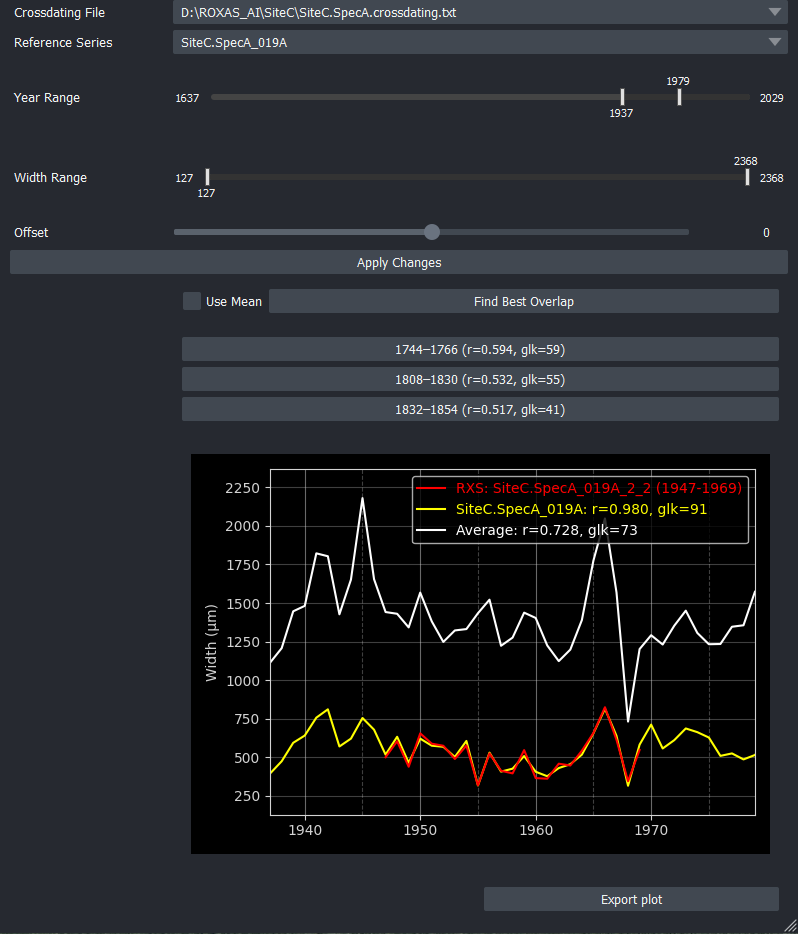

*Figure 10: Visual cross-dating plotter synchronizing sample ring-width series with reference chronology.*

### How It Works
- Computes mean ring width (`MRW`) from the ring boundaries currently in the viewer.
- Renders dual interactive curves in a Matplotlib canvas: the sample series and the reference series.
- Supports calendar year ranges spanning from prehistoric/BCE periods down to **`-100,000`** up to **`9,999`** (CE).
- Formats negative/prehistoric years as plain integers on axes and dynamically calculates gridline steps (e.g., 10, 20, 50, 100, 200, 500, 1000 years) based on the active viewing span.
- **Year Range & Offset Slider Interaction**:
    - The standard view automatically centers on the target ROXAS sample series with a default buffer of **$\pm 10$ years** on each side.
    - To slide the sample series beyond this initial $\pm 10$ year window, adjust the **Year Range** slider to expand the visible time span. Expanding the Year Range slider automatically widens the allowable range of the **Offset** slider, allowing you to slide the series across decades or centuries.
- **Auto-Offset Alignment**:
    - The **Find Best Overlap** feature scans offsets across the active time window to automatically maximize correlation ($r$) and sign agreement (GLK).
- **Uniform Scaling Across Reference Plots**:
    - Reference plot figures are generated with a standardized vertical height of 800 pixels and a constant horizontal scale of **70 pixels per year** of overlap (`min(50 + (20 + overlap_years) * 70, 65000)`). This guarantees identical visual scale across different samples and chronologies.
- **Reference Plot Creation**:
    - Reference plot images (`<sample>_ReferenceSeries.jpg`) are generated and saved when clicking **Export Plot** or automatically during batch measurement runs in [9B - Batch Measure & Update](#9b-batch-measure-update).
- **Statistical Synchrony Metrics**:
    - Computes **Correlation coefficient ($r$)**, **Gleichläufigkeit (GLK / % sign agreement)**, and **$t$-value / statistical significance** in real time.

### Cross-Dating Files Discovery & Folder Hierarchy Traversal

When a sample's tree-ring layer is selected in napari, the widget automatically locates associated cross-dating text files using an upward directory traversal algorithm:

1. **Starting Point**: The search begins in the directory containing the active sample scan (determined from `sample_stem_path`, the layer's file path, or the global `project_directory`).
2. **Search Direction (Strictly Upward)**:
    - The search is strictly **upward** (from the sample's directory towards the root of the file system).
    - The widget does **not** search downwards into subdirectories.
3. **Search Pattern & Prefix Requirements**:
    - The search matches files using the pattern `*<crossdating_file_extension>`, where `<crossdating_file_extension>` is the configured extension in `settings.json` under `file_extensions.crossdating_file_extension` (by default `[".crossdating", ".txt"]`, which concatenates to `.crossdating.txt`).
    - **Prefixes are supported**: Because of the leading wildcard `*`, any custom prefix before the extension is detected (e.g., `rings_series.crossdating.txt`, `siteA_chronology.crossdating.txt`, or `conifer_ref.crossdating.txt`).
    - **Suffixes are NOT supported after the extension**: The file must strictly end with the configured cross-dating extension (e.g., `.crossdating.txt`). If a file has an additional suffix after the extension (e.g., `.crossdating.txt.bak`) or a different extension (such as `.csv` when `.crossdating.txt` is configured), it will not be matched unless the extension setting in `settings.json` is updated.
4. **Upward Directory Tree Traversal Process**:
    - The widget first inspects the sample's immediate folder (`current_path.glob(pattern)`).
    - If one or more matching cross-dating files are found in that folder, search stops and those files are loaded.
    - If no matching file is found, it moves up to the parent directory (`current_path = current_path.parent`) and repeats the check.
    - The upward search continues through parent folders until matching files are found or it reaches the file system root.
    - **Architectural Workflow**: This allows placing a single global reference file at the project root directory (e.g., `<project_root>/rings_series.crossdating.txt`) to serve all samples in subfolders, or placing local reference files in specific sample subfolders (e.g., `<project_root>/SiteA/rings_series.crossdating.txt`), which automatically take priority for samples located within `SiteA`.

### Behavior When Multiple Cross-Dating Files Are Present

- **Multiple Files in the Same Directory**:
    - If two or more matching cross-dating files exist within the first directory where matches are found (e.g., `<project_root>/rings_series_site1.crossdating.txt` and `<project_root>/rings_series_site2.crossdating.txt`):
        - All discovered cross-dating files are collected and populated into the **Crossdating File** dropdown combobox (`_crossdating_file_combo`).
        - The widget automatically selects the first file in the list by default.
        - Users can freely switch between files using the **Crossdating File** dropdown. Selecting a different file immediately re-reads the dataset, recalculates the series average, updates the **Reference Series** dropdown with all series columns from that file, and refreshes the plot.
- **Files in Different Directory Levels**:
    - Because traversal stops at the first directory containing matches, a cross-dating file located in a sample's local subfolder takes precedence over a cross-dating file located in parent or root directories.

### Key Controls & Options
- **Crossdating File Dropdown**: Selects among multiple detected cross-dating files in the directory tree.
- **Reference Series Dropdown**: Selects from individual series, site chronologies, or the auto-computed `"average"` column from the active cross-dating file. Automatically prioritizes columns whose names match the active sample stem.
- **Find Best Overlap Button**: Automatically scans temporal shifts to align sample and reference curves by maximizing correlation.
- **Year Range & Width Range Dual Sliders**: Interactively set X (calendar year range, supporting `-100,000` to `9,999`) and Y (ring width in $\mu\text{m}$) viewing windows.
- **Offset Slider**: Manually shifts sample dating relative to the reference chronology. Expanding the Year Range slider broadens the available offset adjustment window.
- **Apply Changes Button**: Confirms the adjusted temporal offset, updates ring boundary year numbering, shifts the `.rings` layer labels, and records the new outermost year in sample metadata (`rings_outmost_complete_year`).
- **Export Plot Button**: Saves the current cross-dating plot as a publication-ready `.jpg` image in the sample directory and records the validated reference series in `<sample_name>.metadata.json`.

---

## 8 - Save Cells & Rings Editing

The **Samples Saving Widget** writes modified cell masks, ring boundaries, and updated sample metadata from napari back to their respective files on disk.

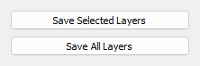

*Figure 11: Samples saving widget.*

### How It Works
- Gathers data, layer parameters, and metadata from active napari layers.
- Formats and writes `.cells.png` (8-bit or 16-bit label rasters) and `.rings.tif`.
- Keeps track of unsaved changes: layers loaded from disk start out unmodified, and edits, year updates, cross-dating offsets and new segmentations mark them as modified.
- Does not redraw the annotated overview image (`<sample_name>_annotated.jpg`), so that saving stays fast. The overview is updated at the workflow checkpoints instead: segmentation (3A/3B), **Update Year** (6), **Apply Changes** (7) and measurements (9A/9B).
- Updates `<sample_name>.metadata.json` with updated ring counts, outermost year, and timestamps.
- Operates in a non-blocking background worker thread.

### Key Controls
- **Save Selected Layers**: Saves only the layers currently highlighted in the napari layer list.
- **Save All Layers**: Saves only the `.cells` and `.rings` layers with unsaved changes and reports what was written: "Saved cells layer.", "Saved rings layer." or "Saved cells and rings layers.". Without changes, nothing is written and "No unsaved changes in cells or rings layers." is shown.
- **Progress Bar**: Shows disk write progress, scaled to the number of layers actually saved.

---

## 9A - Measure Cells & Rings (Individual Image)

The **Single Sample Measurements Widget** computes the full suite of Quantitative Wood Anatomy (QWA) metrics for the sample currently loaded in napari.

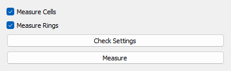

*Figure 12: Single sample measurements interface.*

### How It Works
- Combines the `.cells` lumen mask and `.rings` boundary geometry with spatial resolution metadata ($\mu\text{m}/\text{px}$).
- Uses Continuous Wavelet Transform (CWT) and radial/tangential wall profiling to calculate:
    - **Cell Lumen Metrics**: Lumen Area (`LA`), Hydraulic Diameter (`DH`), Theoretical Hydraulic Conductance (`KH`), Aspect Ratio (`ASP`).
    - **Cell Wall Thickness (CWT)**: Radial (`CWTRAD`), Tangential (`CWTTAN`), Pith-side (`CWTPI`), Bark-side (`CWTBA`), Overall (`CWTALL`).
    - **Ring-Level Aggregates**: Mean Ring Width (`MRW`), Cell Density (`CD`), Conductive Area Fraction (`RCTA`), Mork's Index (`RTSR`), Relative Anatomical Density (`RWD`).
- Outputs semicolon-delimited CSV tables: `<sample_name>.cells_table.csv` and `<sample_name>.rings_table.csv` (file extensions and delimiter configurable in settings).
- **Always Re-creates Annotated Image**: Re-creates and saves an updated annotated overview image (`<sample_name>_annotated.jpg`) overlaid with ring boundaries and years whenever measurements are performed, ensuring the annotated image remains strictly in line with the measurements.

### Key Controls
- **Measure Cells / Measure Rings**: Checkboxes selecting whether to measure cell anatomical metrics, tree-ring boundary metrics, or both.
- **Check Settings Button**: Launches the Settings window (see [ZZ - Settings](#zz-settings)) as a floating widget that appears maximized with a comfortable margin on top of napari, automatically scrolling to and focusing on the measurement parameters.
- **Measure Button**: Launches analysis in a background worker, writes measurement tables and the updated annotated image, and attaches measurements to layer properties for interactive table inspection.

---

## 9B - Batch Measure & Update

The **Batch Sample Measurements Widget** runs high-throughput anatomical trait extraction, annotated image generation, and reference plot synchronization across all samples in a project folder.


*Figure 13: Batch measurements widget.*

### How It Works
- Discovers all matched pairs of `.cells` and `.rings` files in the project directory.
- Reads image scale and configuration from each sample's `.metadata.json`.
- Computes cell-level and ring-level measurement tables in batch mode.
- Writes `<sample>.cells_table.csv` and `<sample>.rings_table.csv` directly to each sample folder.
- Generates or updates annotated overview scans (`<sample>_annotated.jpg`) and cross-dating reference plots (`<sample>_ReferenceSeries.jpg`).

### Linked Operations Logic (File Synchronization)
To prevent dataset inconsistencies, ROXAS AI enforces linked operation synchronization:

- When **Measure Cells** or **Measure Rings** is checked, the update checkboxes for **Update Annotated Images** and **Update Crossdating Reference Files** are automatically locked **ON** (checked and disabled).
- *Reason*: Any recalculation of anatomical traits or ring boundaries changes the underlying metrics and years; locking the image and plot updates guarantees that measurement tables, annotated scan images, and crossdating plots remain 100% synchronized with the new measurements.
- When both measurement options are unchecked, the update checkboxes are unlocked, enabling standalone batch generation/updating of annotated images and reference plots across the project directory without re-running full measurements.

### Key Controls
- **Project Directory**: Path to project directory containing segmented samples (selecting or changing the directory here triggers the same global project directory selection dialog).
- **File Selection Mode**: Toggle between **Batch Process All Samples** and handpicking subsets (**Manually select files to process**).
- **Reverse Selection**: Inverts current sample selections in the list.
- **Operation Checkboxes**:
    - **Measure Cells**: Extracts cell lumen and cell wall thickness metrics to `<sample>.cells_table.csv`.
    - **Measure Rings**: Extracts ring-width and ring-level aggregate metrics to `<sample>.rings_table.csv`.
    - **Update Annotated Images**: Generates/updates `<sample>_annotated.jpg` with ring boundaries, year labels, and cell overlays.
    - **Update Crossdating Reference Files**: Generates/updates standardized `<sample>_ReferenceSeries.jpg` plots.
- **Measurement Configuration**: Adjust global CWT thresholds, integration fractions, and smoothing settings via [ZZ - Settings](#zz-settings).
- **Run Analysis Button**: Runs batch extraction and updates with real-time progress tracking.

---

## ZZ - Settings

The **Settings Widget** is a visual preferences manager that allows adjusting global defaults, file extensions, visualization parameters, and hardware settings without manual editing of JSON files.

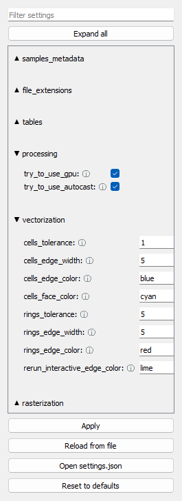

*Figure 14: Global settings manager widget with collapsible categories.*

### How It Works
- Directly manages `settings.json` with dedicated input editors matching each data type (spinboxes, color selectors, list editors, checkboxes).
- Prevents syntax errors, invalid datatypes, or formatting corruption.
- Dynamically notifies and updates active widgets upon applying changes without requiring a napari restart.

### Key Settings Categories
1. **File Extensions**:
    - Standardized file suffixes for scans, cell masks, ring masks, metadata files, and tables.
2. **Hardware & Processing**:
    - `try_to_use_gpu`: Toggle CUDA / GPU acceleration for deep-learning segmentation.
    - Worker thread and batch settings.
3. **Visualization & Vectorization**:
    - Default colormaps for cell lumen layers.
    - Ring color sequence (alternating colormap for adjacent annual rings).
    - Display line widths and point sizes.
    - Annotated image parameters (`cell_opacity`, `cell_fill_color`, `year_label_size`).
4. **Measurement Defaults**:
    - Default CWT integration widths, smoothing kernel sizes, and IQR outlier rejection multipliers.
5. **Metadata Schema**:
    - Default metadata prompts and fields presented during sample preparation.

### Troubleshooting: Settings Not Updating After an App Upgrade

When updating `napari-roxas-ai` over an older installation, existing configurations in `settings.json` are automatically preserved so custom user settings are not lost.

- **Reset from the UI**: To load the newest defaults, open the [ZZ - Settings](#zz-settings) widget and click **Reset to defaults**.
- **Clean Reinstall**: For step-by-step instructions on performing a complete clean reinstall, see the [Installation Guide](../getting_started/installation.md#troubleshooting-clean-reinstall).
